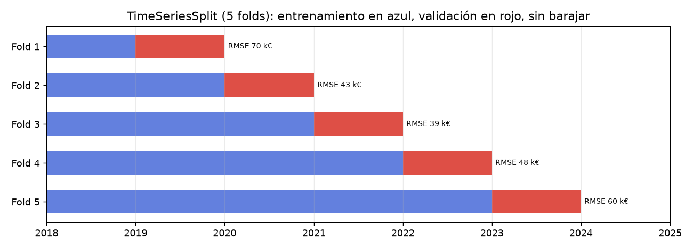
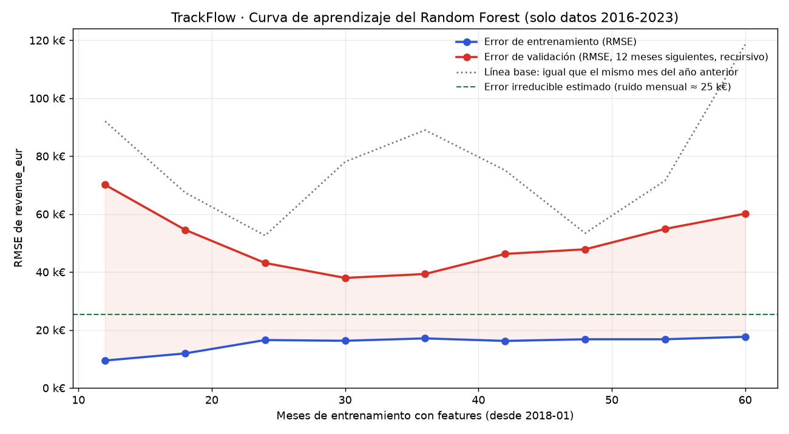
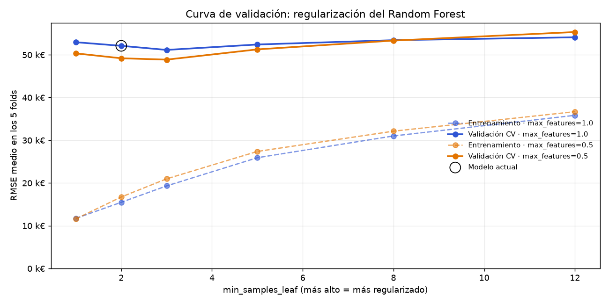

# Evaluación técnica del modelo de predicción de ventas · TrackFlow

> **Ticket:** evaluación formal antes de promover a staging el modelo de
> `scripts/sales_forecast.py` (Random Forest sobre el ratio interanual de
> `revenue_eur`, fila `consolidated`).
> **Script:** `python scripts/sales_model_eval.py` · **Resultados:** `data/eval/sales_model_cv_results.json`
> **Alcance:** solo el conjunto de entrenamiento 2016-2023. La prueba
> 2024-2025 no se ha usado para nada de lo que sigue.

## Diagnóstico

**El modelo tiene overfitting moderado.** Memoriza el ruido mensual de
entrenamiento: su error en entrenamiento (15,5 k€) es menor que el error
irreducible estimado (25,3 k€), y valida con un error 3,4 veces mayor
(52,1 k€). Esa brecha no se cierra al añadir datos. **No es underfitting**: en
validación el error es un 36 % menor que el de la línea base y sigue la
estacionalidad.

**Acción correctiva:** regularizar el Random Forest con
`min_samples_leaf` de 2 a **3** y `max_features` de 1.0 a **0.5**. Con ese
cambio, el RMSE de validación baja de 52,1 k€ a **48,9 k€** (-6 %), mejora en 4
de los 5 folds y la brecha baja de 3,4× a 2,3×. No se recomienda añadir
complejidad, y tampoco esperar a tener más datos (justificación en la sección 6).

---

## 1. Métrica principal: RMSE (y por qué no MAE)

El BRIEFING de TrackFlow explica que la facturación depende del **volumen de
envíos** y que ese volumen tiene **picos y valles muy marcados**: noviembre y
diciembre suben un 25-35 % (Black Friday y Navidad) y febrero baja un 10-15 %.
También dice que Ana (Almacén) y Carlos (Transportistas) ya preparan esos picos
a mano. Por tanto, la predicción no se usa solo para el informe de Finanzas:
sirve para dimensionar operarios y capacidad de transportistas.

- **El error caro es el grande, y casi siempre es quedarse corto en un pico.**
  Si se subestima noviembre, faltan operarios y camiones en la semana de más
  volumen del año, los envíos llegan tarde y se incumplen los SLA. Según
  `CONTEXT.md`, los contratos anuales se renuevan o se pierden según si la
  operación logística funciona. Sobreestimar cuesta horas ociosas: es un coste
  real, pero acotado y recuperable.
- **El RMSE eleva cada error al cuadrado**, así que un fallo de 100 k€ en
  diciembre pesa cuatro veces más que dos fallos de 50 k€ en meses tranquilos.
  Esa es la asimetría del negocio. El **MAE** trata igual un euro perdido en
  febrero que uno en Black Friday y diluye justo los errores que más cuestan.
- Por eso **el RMSE es la métrica para decidir**: diagnóstico, folds y
  regularización. El **MAE** se reporta para comunicar ("de media fallamos unos
  44 k€ al mes") y, como complemento, el **sesgo** con signo, porque el BRIEFING
  pide distinguir quedarse corto de pasarse.
- Que el RMSE salga un 19 % mayor que el MAE (52,1 frente a 44,0 k€) confirma
  que hay errores grandes concentrados en pocos meses: justo lo que el MAE
  escondería.

## 2. Validación cruzada temporal (5 folds)

`TimeSeriesSplit(n_splits=5)` sobre las 72 filas con features (2018-01 →
2023-12; 2016 y 2017 solo aportan historia a los lags). Cada fold entrena con
todo lo anterior y valida un año natural completo.

**Garantías (verificadas en código y en `tests/pipelines/test_sales_model_eval.py`):**

1. **Sin barajar.** Los índices de cada fold son contiguos y crecientes, el
   último mes de entrenamiento es anterior al primero de validación, y ningún
   fold posterior valida un mes anterior a otro fold (`check_fold` y los tests).
2. **Sin fuga de lags ni rolling entre folds.** Las features no se calculan
   sobre la serie completa: en cada fold se recalculan sobre la serie
   **recortada en el último mes de entrenamiento** (`fold_history`). Así,
   `trailing_growth` o `seasonal_index_last_year` no pueden mirar dentro del
   año que se valida. Un test multiplica por 5 los ingresos del fold de
   validación y comprueba que ni la matriz de entrenamiento ni la predicción
   cambian.
3. **Validación recursiva a 12 meses.** Para predecir, por ejemplo, junio, el
   modelo usa su propia predicción de mayo, nunca el valor real. Es el uso real
   que tendrá el modelo.

| Fold | Entrena (filas) | Valida | RMSE train | RMSE validación | MAE validación | Sesgo anual | RMSE línea base |
|---|---|---|---|---|---|---|---|
| 1 | 2018 (12) | 2019 | 9.424 € | 70.108 € | 58.805 € | -6,0 % | 92.021 € |
| 2 | 2018-2019 (24) | 2020 | 16.497 € | 43.106 € | 36.473 € | +0,5 % | 52.572 € |
| 3 | 2018-2020 (36) | 2021 | 17.071 € | 39.303 € | 31.918 € | -0,2 % | 88.991 € |
| 4 | 2018-2021 (48) | 2022 | 16.768 € | 47.823 € | 42.376 € | +1,4 % | 53.390 € |
| 5 | 2018-2022 (60) | 2023 | 17.631 € | 60.133 € | 50.208 € | -2,2 % | 118.541 € |

**Media ± desviación estándar en los 5 folds** (desviación muestral, `ddof=1`):

| Métrica | Entrenamiento | Validación | Línea base (validación) |
|---|---|---|---|
| **RMSE** | 15.478 ± 3.410 € | **52.095 ± 12.765 €** | 81.103 ± 28.129 € |
| MAE | 11.804 ± 2.544 € | 43.956 ± 10.758 € | 70.919 ± 29.457 € |
| MAPE | 1,23 ± 0,22 % | 4,17 ± 1,12 % | 6,59 ± 2,50 % |

La línea base es "cada mes igual que el mismo mes del año anterior".

## 3. Curva de aprendizaje

Cada punto entrena con las primeras *n* filas con features (de 12 a 60, de 6
en 6) y valida los 12 meses siguientes de forma recursiva. La línea verde es el
**error irreducible estimado**: un "oráculo" que conoce el ingreso medio real
de cada año y aplica la estacionalidad media. Lo que le queda es el ruido
mensual (±5 % según el BRIEFING), que ningún modelo puede predecir: **RMSE
25.253 €, MAPE 2,13 %**.

**Lectura del patrón:**

- **El entrenamiento está por debajo del error irreducible en toda la curva**
  (9-18 k€ frente a 25 k€). Un modelo bien ajustado no puede acertar el
  entrenamiento mejor que el ruido: si lo hace, es que ha aprendido el ruido.
  Es la firma del overfitting.
- **La brecha es amplia y persistente.** Con 24 meses o más, el error de
  entrenamiento se estabiliza en ~16-18 k€ y el de validación oscila entre 38 y
  60 k€, de 2,3 a 3,4 veces más. Las curvas no convergen.
- **Más datos no cierran la brecha.** La validación mejora hasta ~30 meses y
  después sube. Esa subida no es empeoramiento del modelo: sigue la dificultad
  del año que se valida. La línea base también sube, porque 2023 creció un
  10,1 %, el mayor crecimiento del histórico. Restando ese efecto, la
  validación se estanca, mientras el entrenamiento sigue plano en ~17 k€.
- **No es underfitting.** Con underfitting, las dos curvas convergerían en un
  error alto, y el entrenamiento no podría estar por debajo del ruido. Aquí la
  validación es un 36 % mejor que la línea base y el entrenamiento es muy bajo.

## 4. Estabilidad frente a la porción de entrenamiento

- **Variabilidad moderada:** RMSE de validación 52,1 ± 12,8 k€ (coeficiente de
  variación del 25 %), con un rango de 39 a 70 k€.
- **El fold 1 es el peor por falta de historia.** Con solo 12 meses de
  entrenamiento, el modelo no ha visto un año de cada tipo de crecimiento, que
  alterna entre ~9 % y ~3 %. Subestima 2019 un 6 %. Sin ese fold, la validación
  queda en 47,6 k€.
- **Del fold 2 al 5, el error depende del año validado más que del tamaño del
  entrenamiento.** Los años de crecimiento alto (2019 con 9,4 % y 2023 con
  10,1 %) tienen sesgo negativo, es decir, el modelo se queda corto. Los de
  crecimiento bajo (2020 y 2022) tienen sesgo positivo. El modelo "suaviza" la
  alternancia hacia el crecimiento medio, y ese error es el más caro para el
  negocio (sección 1).
- **El sesgo anual es pequeño** (entre -2,2 % y +1,4 % del fold 2 al 5): el
  total del año se predice bien, y el error se concentra en meses concretos.

## 5. Evidencia de la acción correctiva: curva de validación de regularización

Se repitió la misma validación cruzada de 5 folds para
`min_samples_leaf` ∈ {1, 2, 3, 5, 8, 12} y `max_features` ∈ {1.0, 0.5}, sin
tocar la prueba.

| min_samples_leaf | max_features | RMSE train | RMSE validación (media ± std) |
|---|---|---|---|
| 1 | 1.0 | 11.714 € | 52.939 ± 12.295 € |
| **2** | **1.0** | **15.478 €** | **52.095 ± 12.765 € ← actual** |
| 2 | 0.5 | 16.717 € | 49.182 ± 14.490 € |
| **3** | **0.5** | **20.969 €** | **48.861 ± 15.067 € ← recomendado** |
| 5 | 0.5 | 27.375 € | 51.261 ± 16.344 € |
| 8 | 1.0 | 31.000 € | 53.415 ± 15.148 € |
| 12 | 0.5 | 36.679 € | 55.319 ± 13.887 € |

La tabla completa está en `sales_model_cv_results.json` → `regularization_sweep`.

- La curva tiene **forma de U**. Regularizar un poco mejora la validación;
  regularizar de más (`min_samples_leaf` ≥ 8) la empeora, porque el modelo
  empieza a no captar el patrón. El óptimo está en el codo:
  `min_samples_leaf=3` y `max_features=0.5`.
- Con esa configuración, el error de entrenamiento (21 k€) queda ya cerca del
  irreducible (25 k€) y la validación mejora en los folds 2, 3, 4 y 5 (de 43,1 a
  40,7 k€, de 39,3 a 33,6 k€, de 47,8 a 43,9 k€ y de 60,1 a 53,5 k€). Solo
  empeora el fold 1, el de 12 meses de entrenamiento, de 70,1 a 72,6 k€; por eso
  la desviación estándar sube un poco.

## 6. Acción correctiva propuesta

**Cambiar en `scripts/sales_forecast.py`
`RandomForestRegressor(min_samples_leaf=2)` por
`RandomForestRegressor(min_samples_leaf=3, max_features=0.5)`.**

**Por qué esta es la causa raíz:**

1. **Hojas de 2 meses memorizan el ruido.** Con `min_samples_leaf=2`, cada
   hoja puede representar dos meses concretos, y el árbol aprende sus ±5 %
   aleatorios como si fueran patrón. Por eso el entrenamiento queda por debajo
   del error irreducible. Con hojas de 3 o más, cada predicción promedia al
   menos 3 meses y el ruido se cancela en parte.
2. **Los 300 árboles son casi iguales.** Con `max_features=1.0`, todos los
   árboles eligen primero la misma variable, `yoy_same_month_last_year`, que
   tiene el 52 % de la importancia. Promediar 300 árboles parecidos no reduce la
   varianza, que es precisamente para lo que existe el Random Forest. Con
   `max_features=0.5`, cada corte elige entre la mitad de las features: los
   árboles se descorrelacionan y el promedio sí estabiliza.

**Qué no hacer, y por qué:**

- **Más complejidad** (más profundidad, `min_samples_leaf=1`, más features):
  agrava el problema. La tabla lo muestra: con `min_samples_leaf=1` baja el
  error de entrenamiento y sube el de validación.
- **"Más datos" como primera respuesta:** la serie es mensual y cada año aporta
  12 filas. La curva de aprendizaje ya muestra que pasar de 30 a 60 meses no
  cerró la brecha.

**Antes de promover a staging:**

1. Aplicar el cambio y volver a ejecutar `python scripts/sales_model_eval.py`
   (RMSE de validación esperado: 48,9 k€).
2. **Solo entonces**, una única vez y sin volver a ajustar nada, ejecutar
   `python scripts/sales_forecast.py` para confirmar en la prueba 2024-2025.
3. Riesgo que queda: el sesgo en años de crecimiento alto (sección 4). Si el
   RMSE de validación con la configuración nueva no baja de ~45 k€, el
   siguiente paso es revisar cómo capturan las features la alternancia del
   crecimiento. Eso es calidad de features, no complejidad del modelo.

## 7. Respuestas al ticket

| Pregunta | Respuesta |
|---|---|
| ¿Underfitting, overfitting o bien ajustado? | **Overfitting moderado**: entrenamiento por debajo del ruido irreducible (15,5 frente a 25,3 k€) y brecha persistente de 3,4× con validación (52,1 k€). No es underfitting: un 36 % mejor que la línea base |
| ¿Qué tan estable es? | RMSE de validación **52,1 ± 12,8 k€** en 5 folds (CV 25 %). Es inestable con 12 meses de entrenamiento; del fold 2 al 5, el error depende del tipo de año (crecimiento alto o bajo) y no del tamaño del entrenamiento |
| ¿Acción correctiva específica? | `min_samples_leaf` 2 → 3 y `max_features` 1.0 → 0.5: RMSE de validación 48,9 k€ (-6 %), mejora en 4/5 folds y brecha de 3,4× a 2,3×. Confirmar después una sola vez en la prueba |
