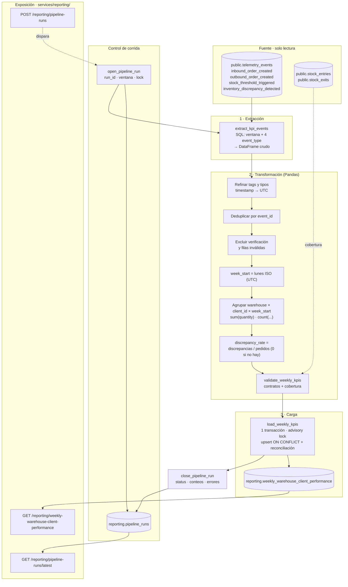

# Pipeline de Desempeño de Negocio — Documento de diseño (v1)

> **Proyecto 4Geeks:** Hito — Diseño de un Pipeline de Desempeño de Negocio (Parte 1 de 3).
> **Compañía:** TrackFlow · monorepo `Mi-Contexto-De-Empresa-Marisin`.
> **Fuente de verdad del negocio:** `trackflow-BRIEFING` de data pipelines (syllabus, `content/contexts/06-telemetry-data-pipelines/data-pipelines/`), construido sobre las métricas obligatorias del `trackflow-BRIEFING` de telemetría.
> **Estado:** solo diseño. No hay código de orquestación todavía; la implementación llega en la Parte 2 y los subflows y tests en la Parte 3.

## Ficha rápida

| Pregunta | Respuesta |
|---|---|
| Entregable de negocio | **Reporte Semanal de Desempeño por Almacén y Cliente** |
| Audiencia | Thomas (CEO) y Ana Whitfield (Head of Warehouse Operations); Miguel Torres (Comercial) usa la frecuencia de quiebre de stock |
| Frecuencia | Semanal, fresco el lunes por la mañana |
| Fuente (solo lectura) | `public.telemetry_events` en Supabase |
| Destino | `reporting.weekly_warehouse_client_performance` (+ log `reporting.pipeline_runs`) |
| Grano | 1 fila por `warehouse` × `client_id` × semana ISO (`week_start` = lunes, UTC) |
| KPIs | Volumen de entrada, Throughput de salida, Frecuencia de quiebre de stock, Tasa de discrepancia |
| Exposición | Módulo nuevo `services/reporting/` (3 endpoints) |
| Orquestador | Prefect: 1 flow principal, 6 tasks, 2 blocks, 1 deployment semanal |
| Fuera de alcance | `services/telemetry/analysis.py`, `GET /telemetry/report` y cualquier escritura en `telemetry_events` |

---

## 1. Estado actual

### 1.1 Qué telemetría capturamos hoy

El backoffice (`uis/backoffice`) emite **20 tipos de evento** a través del `TelemetryService` (`src/lib/telemetry.ts`), definidos en `docs/telemetry/telemetry-plan.md` y validados contra `docs/telemetry/event-schemas.json` (réplica en runtime: `services/api/telemetry_catalog.py`). El servicio completa el envelope (`eventId`, `timestamp`, `sessionId`, `userId` opaco, `schemaVersion`, `requestId`), encola los eventos y los envía en lotes de hasta 20 cada 10 s a `POST /telemetry/events`, con reintentos y `sendBeacon` al cerrar la pestaña.

Los cuatro eventos que alimentan este pipeline son métricas obligatorias del BRIEFING de telemetría y ya se capturan:

| `event_type` | Dónde se emite | Cuándo | Propiedades que usa este pipeline |
|---|---|---|---|
| `inbound_order_created` | `app/inventory/orders/inbound/page.tsx` | Tras HTTP 201 de `POST` de entrada (crea un `StockEntry`) | `warehouse`, `client_id`, `quantity` (unidades de la orden), `order_id` |
| `outbound_order_created` | `app/inventory/orders/outbound/page.tsx` | Tras HTTP 201 de `POST` de salida (crea un `StockExit`) | `warehouse`, `client_id`, `order_id`, `exit_type` |
| `stock_threshold_triggered` | `app/inventory/orders/outbound/page.tsx` | Tras una salida, solo si el stock del SKU en ese almacén cruza de `>= 50` a `< 50` (D16, umbral global `global_default`) | `warehouse`, `client_id`, `product_id`, `min_threshold`, `trigger_order_id` |
| `inventory_discrepancy_detected` | `app/inventory/counts/page.tsx` ("Conteo físico") | Al registrar un conteo cuyo `counted_quantity - system_quantity` es distinto de 0 (D29) | `warehouse`, `client_id`, `product_id`, `quantity` (diferencia con signo), `detection_source` |

Las dimensiones ya llegan normalizadas por `src/lib/telemetry-mappers.ts`: `warehouse` ∈ {`los_angeles`, `zaragoza`} (en la BD de dominio es "Los Angeles"/"Zaragoza") y `client_id` es el slug de `skus.client_name` (`EcoWear USA` → `ecowear_usa`, `HydroLife` → `hydrolife`). Los SKUs sintéticos `LOAD-…` no emiten eventos de negocio (D15).

### 1.2 Dónde se almacena

Tabla `public.telemetry_events` en Supabase (DDL en `services/api/sql/001_telemetry_events.sql`):

| Columna | Tipo | Uso en este pipeline |
|---|---|---|
| `id` | `uuid` PK (`gen_random_uuid()`) | Desempate estable al deduplicar |
| `timestamp` | `timestamptz` | Hora de **captura** en el cliente (UTC) → define `week_start` |
| `service` | `text` | Siempre `backoffice` |
| `event_type` | `text` | Filtro a los 4 tipos del BRIEFING |
| `level` | `text` | No se usa |
| `value` | `numeric` | Valor de `x-value-property` (`quantity` en los 4 eventos); se usa `tags` como fuente canónica |
| `message` | `text` | No se usa |
| `tags` | `jsonb` | Propiedades filtradas al allowlist + `eventId`, `sessionId`, `userId`, `schemaVersion`, `requestId` |

Características que condicionan el diseño:

- **Inmutable** (D33): triggers bloquean `UPDATE`, `DELETE` y `TRUNCATE`; RLS sin políticas. Un registro nunca se modifica: solo se añaden filas.
- **Sin unicidad sobre `eventId`** (D40): la deduplicación se hace al consultar. Un reintento de transporte puede dejar dos filas con el mismo `tags->>'eventId'`.
- **No existe columna de hora de recepción.** Solo hay hora de captura, así que no se puede leer "lo que llegó desde la última corrida". Esto obliga a la estrategia de recálculo por ventana de la §6.
- Índices disponibles: `timestamp desc`, `event_type` y GIN sobre `tags`.

### 1.3 Qué responde ya el reporte técnico

`services/telemetry/analysis.py` + `GET /telemetry/report` (caché de 60 s, ventana de 7 días por defecto) responden preguntas **de ingeniería** sobre el sistema:

| Métrica | Pregunta |
|---|---|
| `events_per_day` | ¿Cuántos eventos de cada tipo llegan al día? ¿Hay picos o caídas? |
| `error_rate_per_day` | ¿Qué parte del tráfico diario es error o aviso? |
| `api_latency_per_day` | ¿Qué endpoints son lentos (media y p95 ponderados por `sample_rate`)? |
| `auth_failure_rate` | ¿Cuántos logins fallan al día? |

Ese reporte se queda **exactamente como está**: este pipeline no lo modifica, no lo importa y no comparte su caché.

### 1.4 Datos reales disponibles hoy

La verificación de almacenamiento y la muestra del reporte técnico (`docs/telemetry/evidence/report-sample.json`) muestran **46 eventos** del 19-11-2026: 2 `inbound_order_created`, 1 `outbound_order_created`, 0 `stock_threshold_triggered` y 0 `inventory_discrepancy_detected`. Uno de los `inbound_order_created` es de verificación (`userId = curl_verification`, `client_id = nova_beauty`, un cliente que no existe en el catálogo). Con los datos de hoy, el pipeline produciría muy pocas filas en la semana `2026-11-16` (las órdenes reales del backoffice, de `ecowear_usa` en `los_angeles`), con quiebres y discrepancias en cero: el diseño debe tratar bien los conteos en cero y los datos de prueba (D7).

### 1.5 La brecha de negocio

El reporte técnico cuenta eventos, pero no responde ninguna de estas preguntas del BRIEFING:

- ¿Cuántas **unidades** recibió cada almacén **para cada cliente** esta semana? (Volumen de entrada, para planificar capacidad.)
- ¿Cuántos **pedidos** despachó cada almacén para cada cliente? (Throughput de salida.)
- ¿Cuántas veces los SKUs de un cliente **cayeron por debajo del mínimo** en un almacén? (Frecuencia de quiebre de stock, alerta temprana para Miguel.)
- ¿Qué combinaciones almacén/cliente tienen **peor precisión de inventario**? (Tasa de discrepancia, para priorizar auditorías.)

Hoy Thomas recibe esto en un informe que cada director arma a mano el domingo por la noche (3–4 h por director) y que llega el lunes con datos de hace uno o dos días. El reporte técnico no puede cubrirlo porque **agrega por día y por `event_type`, no por almacén × cliente × semana ISO**, no suma cantidades, no separa clientes, no persiste resultados (se recalcula en cada petición con caché de 60 s) y no deja rastro de auditoría de qué número se publicó y cuándo. Hace falta un pipeline dedicado que **materialice** un consolidado semanal auditable.

---

## 2. Propósito del pipeline

> **Producir cada lunes antes de las 07:00 (hora de Madrid) el consolidado de `reporting.weekly_warehouse_client_performance` que alimenta el "Reporte Semanal de Desempeño por Almacén y Cliente" de Thomas (CEO) y Ana (Operaciones de Almacén), calculando por almacén, cliente y semana ISO el Volumen de entrada, el Throughput de salida, la Frecuencia de quiebre de stock y la Tasa de discrepancia a partir de las métricas obligatorias `inbound_order_created`, `outbound_order_created`, `stock_threshold_triggered` e `inventory_discrepancy_detected`.**

Cada etapa de este documento se justifica contra esa frase. Lo que no la sostiene queda fuera de la v1 (§14).

---

## 3. Formato de extracción

### 3.1 Tablas de origen

| Tabla | Rol | Modo |
|---|---|---|
| `public.telemetry_events` | **Fuente única de los KPIs** | Solo lectura, nunca destino |
| `public.stock_entries`, `public.stock_exits` | Control de calidad: cobertura de la captura (§10.3). No alimentan ningún KPI | Solo lectura |

### 3.2 Forma del dato

Cada fila llega como columnas planas más un `jsonb` en `tags`. Ejemplo de `inbound_order_created` (estructura real, valores ilustrativos):

```json
{
  "id": "6f0c…",
  "timestamp": "2026-11-19T07:12:44.381Z",
  "event_type": "inbound_order_created",
  "value": 20,
  "tags": {
    "warehouse": "los_angeles",
    "client_id": "ecowear_usa",
    "country": "US",
    "product_id": "ECO-TSHIRT-001",
    "product_category": "fashion",
    "quantity": 20,
    "order_id": 41,
    "eventId": "1d4e…",
    "sessionId": "9a2b…",
    "userId": "u_7c1f…",
    "schemaVersion": "1.0.0",
    "requestId": "c83e…"
  }
}
```

Campos que se extraen de `tags` y tipo esperado tras refinarlos:

| Campo | Tipo | Eventos | Regla de calidad |
|---|---|---|---|
| `eventId` → `event_id` | UUID (texto) | los 4 | Obligatorio; clave de deduplicación |
| `warehouse` | texto | los 4 | ∈ {`los_angeles`, `zaragoza`} |
| `client_id` | texto | los 4 | `^[a-z0-9]+(?:_[a-z0-9]+)*$` |
| `quantity` | entero | `inbound_order_created` | `>= 1` (unidades recibidas) |
| `order_id` / `trigger_order_id` | entero | inbound/outbound / threshold | Solo trazabilidad |
| `userId` → `user_id` | texto | los 4 | Filtro de datos de verificación (D7) |
| `requestId` → `request_id` | UUID | los 4 | Trazabilidad evento → petición API |

### 3.3 Consulta de extracción

Una sola consulta por corrida, con la ventana y los `event_type` filtrados **en SQL** (mismo principio que el reporte técnico: nunca se carga la tabla entera):

```sql
select id,
       "timestamp",
       event_type,
       tags->>'eventId'   as event_id,
       tags->>'warehouse' as warehouse,
       tags->>'client_id' as client_id,
       tags->>'quantity'  as quantity,
       tags->>'userId'    as user_id,
       tags->>'requestId' as request_id
from public.telemetry_events
where "timestamp" >= :window_start          -- lunes 00:00 UTC de la semana más antigua
  and "timestamp" <  :window_end            -- lunes 00:00 UTC siguiente a la más reciente
  and event_type in (
    'inbound_order_created',
    'outbound_order_created',
    'stock_threshold_triggered',
    'inventory_discrepancy_detected'
  );
```

La consulta aprovecha los índices de `timestamp` y `event_type`. Una segunda consulta ligera cuenta `page_viewed` y el total de eventos de la ventana para distinguir silencio de caída (§10.1).

### 3.4 Cadencia de actualización de la fuente

- **Llegada:** casi en tiempo real (stream). Los eventos llegan en lotes de hasta 20 cada ~10 s mientras haya un operario en el backoffice.
- **Retrasos esperables:** reintentos del `TelemetryService` (segundos o minutos), `sendBeacon` al cerrar la pestaña y lotes que se quedaron en la cola del navegador sin conexión (hasta que el operario vuelve a abrir el backoffice). Como `timestamp` es la hora de captura, un evento puede caer en una semana que ya se publicó.
- **Consumo del pipeline:** semanal (lunes 05:00 UTC) recalculando las **4 últimas semanas cerradas** (D3), más disparos manuales. La frescura que pide el BRIEFING es semanal: no hace falta streaming.

---

## 4. Flujo de datos



### 4.1 Detalle de la transformación

| Paso | Qué hace | Resultado |
|---|---|---|
| T1 | `pd.to_datetime(timestamp, utc=True)`; `quantity` a `Int64` con `pd.to_numeric(errors="coerce")`; textos con `str.strip()` | Tipos correctos antes de agrupar |
| T2 | `drop_duplicates(subset="event_id")` tras ordenar por `timestamp, id` (se queda la primera captura) | `duplicates_dropped` = filas crudas − filas únicas |
| T3 | Excluye `user_id` de la lista `excluded_user_ids` (D7) y las filas que no cumplen §3.2 | `excluded_events` y `rejected_events` por motivo, al log |
| T4 | `week_start = (timestamp.dt.normalize() - pd.to_timedelta(timestamp.dt.weekday, unit="D")).dt.date` (lunes de la semana ISO en UTC) | Una semana por fila |
| T5 | Columnas indicadoras por tipo y `groupby(["warehouse", "client_id", "week_start"]).agg(...)`: `inbound_units_count = sum(quantity)` en inbound; `count` en el resto | 1 fila por combinación con actividad |
| T6 | `discrepancy_rate = discrepancy_events_count / outbound_orders_count`, `0` si `outbound_orders_count == 0` (vectorizado con `where`) | Fila final con los 4 KPIs |

Sin bucles: todo es vectorizado, igual que en `analysis.py`. Las funciones de T1–T6 son puras (mismos datos → mismo DataFrame) y vivirán en `data/process/` para poder probarlas sin base de datos.

---

## 5. Tablas de destino (esquema `reporting`)

### 5.1 `reporting.weekly_warehouse_client_performance`

Nombre y columnas **exactamente** como en la sección "Tabla de destino" del BRIEFING:

```sql
create schema if not exists reporting;

create table if not exists reporting.weekly_warehouse_client_performance (
  id uuid primary key default gen_random_uuid(),
  warehouse text not null,
  client_id text not null,
  week_start date not null,
  inbound_units_count integer not null default 0,
  outbound_orders_count integer not null default 0,
  stockout_events_count integer not null default 0,
  discrepancy_events_count integer not null default 0,
  discrepancy_rate numeric not null default 0,
  computed_at timestamptz not null default now(),
  unique (warehouse, client_id, week_start)
);

alter table reporting.weekly_warehouse_client_performance enable row level security;
```

- `computed_at` lo fija la carga como `now()` de la **transacción** de carga: en Postgres `now()` es constante dentro de una transacción, así que todas las filas escritas por una corrida comparten el mismo valor, igual al `loaded_at` de esa corrida en `pipeline_runs`. Esa igualdad es el vínculo fila → corrida (D9) sin añadir columnas a la tabla del BRIEFING.
- RLS sin políticas, como `telemetry_events`: solo el backend (propietario vía `DATABASE_URL`) lee y escribe.

### 5.2 `reporting.pipeline_runs`

Log de ejecución (campos justificados en la §8):

```sql
create table if not exists reporting.pipeline_runs (
  run_id               uuid        primary key,
  pipeline_name        text        not null,
  trigger              text        not null check (trigger in ('scheduled', 'manual', 'backfill')),
  triggered_by         text,
  prefect_flow_run_id  uuid,
  status               text        not null check (status in ('running', 'completed', 'failed')),
  last_completed_phase text        check (last_completed_phase in ('extract', 'transform', 'validate', 'load')),
  window_start         date        not null,
  window_end           date        not null,
  started_at           timestamptz not null default now(),
  heartbeat_at         timestamptz not null default now(),
  finished_at          timestamptz,
  loaded_at            timestamptz,
  duration_ms          integer,
  events_extracted     integer     not null default 0,
  duplicates_dropped   integer     not null default 0,
  events_excluded      integer     not null default 0,
  events_rejected      integer     not null default 0,
  events_by_type       jsonb       not null default '{}'::jsonb,
  rows_inserted        integer     not null default 0,
  rows_updated         integer     not null default 0,
  rows_unchanged       integer     not null default 0,
  rows_deleted         integer     not null default 0,
  source_max_timestamp timestamptz,
  capture_coverage     jsonb       not null default '{}'::jsonb,
  warnings             jsonb       not null default '[]'::jsonb,
  error_type           text,
  error_message        text
);

create index if not exists pipeline_runs_latest_idx
  on reporting.pipeline_runs (pipeline_name, started_at desc);

alter table reporting.pipeline_runs enable row level security;
```

`pipeline_name` = `weekly_warehouse_client_performance`, así la misma tabla sirve para pipelines futuros (como sugiere el BRIEFING para `GET /reporting/pipeline-runs/latest`).

### 5.3 Separación respecto a la telemetría técnica

| | Reporte técnico (no se toca) | Este pipeline |
|---|---|---|
| Código | `services/telemetry/analysis.py` | `data/pipelines/weekly_warehouse_client_performance/` + `data/process/weekly_kpis.py` |
| Resultado | Calculado al vuelo, caché 60 s | Materializado en `reporting.*` |
| Endpoint | `GET /telemetry/report` | `services/reporting/` → `/reporting/...` |
| Relación con `telemetry_events` | Lee | Lee (nunca escribe) |

---

## 6. Fuentes que "actualizan" registros: estrategia contra duplicados

En TrackFlow la fuente **no puede** actualizar registros (`telemetry_events` es inmutable por trigger). Lo que en otra fuente sería un `UPDATE` aquí aparece de tres formas, y la que sí cambia filas existentes es el **destino**:

| Caso | Cómo se ve en `telemetry_events` | Riesgo | Mecanismo |
|---|---|---|---|
| Reintento de transporte | Dos filas con el mismo `tags->>'eventId'` y distinto `id` | Contar dos veces el mismo pedido | Deduplicar por `event_id` en T2 (D2) |
| Evento tardío | Fila nueva con `timestamp` de una semana ya publicada | El agregado publicado queda corto | Recalcular la ventana de 4 semanas en cada corrida (D3) |
| Recalcular una semana ya cargada | — | Duplicar o inflar la fila del destino | **Upsert por la clave natural** `(warehouse, client_id, week_start)` (D4) |

**Mecanismo concreto (D4):** el pipeline nunca suma sobre lo ya cargado. Cada corrida **recalcula desde cero** las semanas de su ventana a partir de la fuente y las escribe con:

```sql
insert into reporting.weekly_warehouse_client_performance as t
  (warehouse, client_id, week_start, inbound_units_count, outbound_orders_count,
   stockout_events_count, discrepancy_events_count, discrepancy_rate, computed_at)
values (...)                                    -- todas las filas de la ventana, una sentencia
on conflict (warehouse, client_id, week_start) do update set
  inbound_units_count      = excluded.inbound_units_count,
  outbound_orders_count    = excluded.outbound_orders_count,
  stockout_events_count    = excluded.stockout_events_count,
  discrepancy_events_count = excluded.discrepancy_events_count,
  discrepancy_rate         = excluded.discrepancy_rate,
  computed_at              = excluded.computed_at
where (t.inbound_units_count, t.outbound_orders_count, t.stockout_events_count,
       t.discrepancy_events_count, t.discrepancy_rate)
  is distinct from
      (excluded.inbound_units_count, excluded.outbound_orders_count, excluded.stockout_events_count,
       excluded.discrepancy_events_count, excluded.discrepancy_rate);
```

El `where ... is distinct from` hace que una fila sin cambios no se reescriba: conserva su `computed_at` y la corrida la cuenta como `rows_unchanged`. Así `computed_at` dice cuándo cambió por última vez un número publicado.

**Reconciliación:** si una combinación desaparece al recalcular (por ejemplo, el único evento de `nova_beauty` era de verificación y ahora se excluye), en la misma transacción se borran las filas de las semanas recalculadas que no están en el resultado nuevo (`rows_deleted`). El destino queda siempre igual a "lo que la fuente dice hoy" para esas semanas.

**Ejemplo:** la corrida del lunes 23-11 publica `zaragoza × hydrolife × 2026-11-16` con 3 pedidos. El martes llega, por la cola offline de un navegador, un `outbound_order_created` capturado el viernes 20. La corrida manual del martes recalcula de nuevo 2026-10-26…2026-11-16, obtiene 4 pedidos y el upsert actualiza esa fila (`rows_updated = 1`); las demás quedan `rows_unchanged`. Si el mismo lote llega dos veces, T2 descarta la copia y el número sigue siendo 4.

---

## 7. Estrategia de idempotencia

**Garantía:** correr el pipeline N veces sobre la misma ventana y los mismos datos de origen deja `reporting.weekly_warehouse_client_performance` exactamente igual que una sola corrida limpia, sin duplicados ni filas a medias.

Se apoya en cuatro piezas:

1. **Cálculo determinista:** extracción y transformación son funciones puras de (ventana, contenido de la fuente). No dependen de lo que ya hay en el destino ni de contadores incrementales.
2. **Clave natural única:** `unique (warehouse, client_id, week_start)` del BRIEFING; toda escritura es upsert sobre ella (§6). Un `INSERT` simple está prohibido en el diseño.
3. **Una transacción por carga:** upsert de todas las filas + reconciliación + `pipeline_runs.loaded_at`, todo en una única transacción. O entra completa o no entra nada.
4. **Serialización de escritores:** `pg_advisory_xact_lock(hashtext('weekly_warehouse_client_performance'))` al inicio de la transacción de carga (D10).

**Qué pasa en la segunda corrida tras un fallo en la carga** (escenario: la corrida de las 05:00 llevaba 847 de 1.412 filas y Supabase cortó por timeout):

1. Como las 1.412 filas iban en **una sola transacción**, el timeout provoca `ROLLBACK`: las 847 filas **no quedan escritas**. El destino sigue con los valores de la última corrida buena; el reporte no muestra una semana a medias.
2. Prefect reintenta la task de carga (3 reintentos con espera de 30 s, D6) con el mismo DataFrame en memoria. Si el reintento entra, el resultado es idéntico al de una corrida limpia.
3. Si los reintentos se agotan, la corrida queda `failed` con `last_completed_phase = 'validate'`, `error_type` y `error_message`. La siguiente corrida (manual o la del lunes siguiente) **vuelve a extraer y transformar desde la fuente** y hace el upsert completo: las filas que no cambiaron se quedan igual, las demás se actualizan; ninguna se duplica porque la clave natural no lo permite.
4. Incluso en el caso hipotético de que una carga hubiera quedado a medias (p. ej. si en una versión futura se partiera en lotes), la siguiente corrida converge al mismo estado: el upsert sobrescribe con el valor correcto y nunca suma.

Por qué no se reanuda desde un snapshot intermedio guardado: el volumen es pequeño (cientos o pocos miles de eventos por semana, segundos de cálculo) y un snapshot de ayer **perdería los eventos tardíos** que han llegado desde entonces. Reextraer es más barato y más correcto (D6).

---

## 8. Log de ejecución (`reporting.pipeline_runs`)

Una fila por corrida, creada **antes** de extraer (`status = 'running'`) y cerrada al final con éxito o con error. Si el proceso muere sin cerrarla, la fila queda en `running` con un `heartbeat_at` viejo y la siguiente corrida la marca `failed` con `error_type = 'stale_run'` (§11.3).

| Campo | Tipo | Por qué es necesario para auditar |
|---|---|---|
| `run_id` | `uuid` | Identifica la corrida de punta a punta: logs de Prefect, filas cargadas (vía `computed_at = loaded_at`), respuesta del `POST` y alertas |
| `pipeline_name` | `text` | Permite reutilizar la tabla para otros pipelines y filtrar "la última corrida de este pipeline" |
| `trigger` | `text` (`scheduled`/`manual`/`backfill`) | Distingue el cron de un clic en el backoffice: clave para investigar solapes y cambios fuera de calendario |
| `triggered_by` | `text` | `userId` opaco de quien disparó la corrida manual (`null` en el cron): responsabilidad sin guardar PII |
| `prefect_flow_run_id` | `uuid` | Enlaza con la UI y los logs de Prefect |
| `status` | `text` (`running`/`completed`/`failed`) | Estado de negocio de la corrida; lo que devuelve `GET /reporting/pipeline-runs/latest` |
| `last_completed_phase` | `text` | Checkpoint: dice hasta dónde llegó una corrida fallida (extracción, transformación, validación o carga) |
| `window_start`, `window_end` | `date` | Qué semanas recalculó la corrida; sin esto no se puede saber qué números pudo cambiar |
| `started_at` | `timestamptz` | Hora de inicio: detectar retrasos del cron y medir frescura del reporte del lunes |
| `heartbeat_at` | `timestamptz` | Se actualiza al cerrar cada fase; distingue una corrida lenta de una muerta (lock caducado) |
| `finished_at` | `timestamptz` | Hora de fin; con `started_at`, la duración y si la corrida terminó |
| `loaded_at` | `timestamptz` | `now()` de la transacción de carga = `computed_at` de las filas escritas: vínculo fila → corrida |
| `duration_ms` | `integer` | Tendencia de rendimiento: avisa antes de que la carga se acerque a un timeout |
| `events_extracted` | `integer` | Registros procesados en la entrada; base de las comparaciones semana a semana |
| `duplicates_dropped` | `integer` | Mide cuántos reintentos de transporte se colaron; un salto indica un problema en `POST /telemetry/events` |
| `events_excluded` | `integer` | Eventos de verificación descartados (D7): explica diferencias entre `telemetry_events` y el reporte |
| `events_rejected` | `integer` | Eventos inválidos (almacén o cliente fuera de contrato); el detalle por motivo va en `warnings` |
| `events_by_type` | `jsonb` | Conteo por `event_type` tras deduplicar: detecta que un tipo concreto dejó de llegar |
| `rows_inserted`, `rows_updated`, `rows_unchanged`, `rows_deleted` | `integer` | Registros procesados en la salida: muestran si una corrida cambió números ya publicados (eventos tardíos) |
| `source_max_timestamp` | `timestamptz` | Evento más reciente visto en la ventana: frescura real de la fuente |
| `capture_coverage` | `jsonb` | Eventos frente a filas de `stock_entries`/`stock_exits` por almacén (§10.3): pérdida de captura |
| `warnings` | `jsonb` | Avisos no bloqueantes (silencio, cobertura baja, motivos de rechazo) |
| `error_type`, `error_message` | `text` | Errores: clase de la excepción y mensaje saneado (sin datos de eventos), para diagnosticar sin abrir Prefect |

---

## 9. Mapeo a Prefect

### 9.1 Flow y tasks

**Flow principal:** `weekly_warehouse_client_performance_flow(week_start: date | None = None, lookback_weeks: int | None = None, trigger: str = "scheduled", run_id: UUID | None = None, triggered_by: str | None = None)`

- Sin `week_start`: recalcula las `lookback_weeks` (por defecto 4, del block de configuración) semanas cerradas que terminan en la semana anterior al lunes actual.
- Con `week_start`: recalcula solo esa semana (disparo manual); puede ser la semana en curso, que quedará parcial hasta su siguiente recálculo.

| Task | Etapa | Entrada → salida | Configuración Prefect |
|---|---|---|---|
| `open_pipeline_run` | Control | ventana, trigger → `run_id`; inserta `pipeline_runs` (`running`), cierra corridas `stale` y rechaza si hay otra viva | `retries=2` |
| `extract_kpi_events` | **Extracción** | ventana → DataFrame crudo (+ conteos de silencio §10.1) | `retries=3`, `retry_delay_seconds=[10, 30, 60]`, `timeout_seconds=120` |
| `transform_weekly_kpis` | **Transformación** | DataFrame crudo → DataFrame con grano del BRIEFING + estadísticas (duplicados, excluidos, rechazados) | sin reintentos (determinista: reintentar no arregla un bug) |
| `validate_weekly_kpis` | Transformación (calidad) | DataFrame final + `stock_entries`/`stock_exits` → avisos y cobertura; falla si viola contratos | sin reintentos |
| `load_weekly_kpis` | **Carga** | DataFrame final → conteos `rows_*`; transacción única con upsert + reconciliación | `retries=3`, `retry_delay_seconds=30`, `timeout_seconds=120` |
| `close_pipeline_run` | Control | estadísticas → `pipeline_runs` (`completed`) | `retries=2`; el fallo lo registra el hook `on_failure` del flow |

Las tasks llaman a funciones normales de `data/process/weekly_kpis.py` y `data/pipelines/weekly_warehouse_client_performance/`: Prefect orquesta, la lógica es Python puro y se prueba sin Prefect.

**Flow opcional (backfill):** `backfill_weekly_warehouse_client_performance(start_week: date, end_week: date)` llama al flow principal por tramos de 4 semanas con `trigger="backfill"`. En la Parte 3 las etapas pasan a ser subflows.

### 9.2 States relevantes

| State de Prefect | Cuándo | Reflejo en `pipeline_runs.status` |
|---|---|---|
| `Scheduled` / `Pending` | El deployment programó la corrida del lunes o se disparó una manual | (aún sin fila) |
| `Running` | El flow empezó | `running` (creada por `open_pipeline_run`) |
| `Retrying` | Una task de extracción o carga falló y Prefect la reintenta | sigue `running`; `heartbeat_at` se actualiza |
| `Completed` | Todas las tasks terminaron | `completed` |
| `Failed` | Una task agotó reintentos o falló la validación | `failed` (hook `on_failure` con `error_type`/`error_message`) |
| `Crashed` | El proceso murió (OOM, reinicio del worker) sin poder ejecutar hooks | queda `running`; la siguiente corrida la pasa a `failed` (`stale_run`) |
| `Cancelled` | `open_pipeline_run` detecta otra corrida viva y cancela esta | no crea fila; el `POST` devuelve 409 |

### 9.3 Blocks

| Block | Tipo | Contenido | Por qué block |
|---|---|---|---|
| `trackflow-supabase-database-url` | `Secret` | URI del Transaction pooler de Supabase (el mismo valor que `DATABASE_URL`) | La credencial no vive en el código ni en el repo; se rota sin redeploy |
| `trackflow-reporting-config` | `JSON` | `{"lookback_weeks": 4, "excluded_user_ids": ["curl_verification"], "coverage_warning_threshold": 0.9, "stale_run_minutes": 30}` | Parámetros operativos que Ana o ingeniería pueden ajustar sin tocar código |

Cuando el pipeline corre dentro de la API (disparo manual), la URL sale de `DATABASE_URL` como ya hace `services/api/database.py`; el block se usa cuando corre el deployment de Prefect.

### 9.4 Deployment

- Nombre: `weekly-warehouse-client-performance/weekly`.
- Schedule: `cron "0 5 * * 1"`, zona `UTC` (lunes 06:00 en Madrid en invierno, 07:00 en verano; domingo 21:00/22:00 en Los Ángeles). Listo antes de las 07:00 de Madrid, como pide el CEO (D5).
- Automation de Prefect: aviso si el flow termina en `Failed`/`Crashed` o si el lunes a las 06:30 UTC no hay corrida `Completed`.

---

## 10. Observabilidad

### 10.1 Silencio frente a ausencia real

| Señal | Actividad cero real | Captura caída | Pipeline que no corrió |
|---|---|---|---|
| Fila en `pipeline_runs` | Sí, `completed` | Sí, `completed` con aviso | **No** (o `failed`) |
| `events_by_type` de negocio | 0 o bajo | 0 | — |
| Eventos técnicos de la ventana (`page_viewed`, `api_latency_recorded`) | Hay (se usa el backoffice) | **0** | — |
| `stock_entries`/`stock_exits` en la ventana | 0 | **> 0** | — |

- **Heartbeat del pipeline:** cada corrida deja su fila aunque no haya eventos; que falte la fila del lunes dispara la automation de §9.4.
- **Alerta de silencio:** si una semana tiene órdenes en `stock_entries`/`stock_exits` pero 0 eventos de negocio, o 0 eventos técnicos, se añade un aviso `capture_silence` a `warnings`.

### 10.2 Trazabilidad evento → reporte

`requestId` (en `tags`) une cada evento con la petición API que creó la orden; `run_id` une la corrida con sus filas (`loaded_at = computed_at`) y con su flow run de Prefect. Para un pico raro (por ejemplo, la métrica se dispara a las 09:00 y se aplana a las 09:15), `window_start`/`window_end` y `events_by_type` de cada corrida muestran si una corrida procesó dos ventanas a la vez o si el pico está en la fuente; el detalle se reconstruye con `requestId` en `telemetry_events`.

### 10.3 Crecimiento frente a pérdida de datos

El volumen de eventos varía por la propia actividad (los domingos casi no hay operarios). Para saber si la caída es negocio o pérdida, `validate_weekly_kpis` compara por almacén y semana:

- `inbound_order_created` frente a filas de `stock_entries` y `outbound_order_created` frente a `stock_exits` (con "Los Angeles" → `los_angeles` y el cliente vía `skus.client_name` → slug, la misma normalización de `telemetry-mappers.ts`, excluyendo SKUs `LOAD-`).
- `coverage = eventos / filas de dominio`. Por debajo de `coverage_warning_threshold` (0,9) → aviso `low_capture_coverage`; por encima de 1 → posibles duplicados no detectados.

Si el negocio crece, crecen a la vez los eventos y las órdenes del dominio; si se pierden mediciones, la cobertura cae. La cobertura es solo un control de calidad: los KPIs siguen saliendo de la telemetría, como manda el BRIEFING.

---

## 11. Recuperabilidad

### 11.1 Caída de la base de datos a mitad de corrida

| Dónde cae | Qué queda | Dónde retoma |
|---|---|---|
| Extracción | `pipeline_runs.last_completed_phase = null` | Reintentos de la task; si se agotan, `failed` y la siguiente corrida empieza de cero |
| Transformación o validación | `last_completed_phase = 'extract'` o `'transform'` | Mismo flow run: Prefect reintenta solo la task afectada con su entrada en memoria |
| Carga (Pandas agrupó, el `INSERT` falló) | `last_completed_phase = 'validate'`, destino intacto (rollback) | Reintento de `load_weekly_kpis` con el mismo DataFrame; si se agotan, la siguiente corrida recalcula y hace el upsert completo |

El checkpoint persistido es `last_completed_phase` (+ `heartbeat_at`) en `pipeline_runs`. Sirve para diagnosticar y para que la UI muestre dónde se quedó; la reanudación entre flow runs distintos siempre es "recalcular la ventana", que es segura por la §7.

### 11.2 Telemetría en el origen (frontend y `POST /telemetry/events`)

- **Buffer en el navegador:** ya existe (cola del `TelemetryService`, reintentos y `sendBeacon`). Tiene sentido porque un operario sin WiFi 20 minutos no debe perder 45 eventos, pero introduce envíos tardíos y duplicados. El **cliente asume el buffer y el servidor la deduplicación**: el pipeline deduplica por `eventId` (D2) y absorbe los tardíos con la ventana de 4 semanas (D3). Lo que llegue más tarde se recupera con el flow de backfill.
- **Reintentos de transmisión:** el reintento reutiliza el mismo `eventId` (D40 del plan de telemetría). `POST /telemetry/events` responde `200` cuando el lote se guardó (aunque haya rechazados, que no se reintentan) y `503` cuando la BD falló y hizo rollback (el cliente reintenta). Si el primer request fue lento pero sí se guardó, el reintento crea una segunda fila con el mismo `eventId`, que este pipeline descarta. Un `Idempotency-Key` o un índice único sobre `tags->>'eventId'` en la ingesta cambiaría la telemetría y queda como recomendación futura (§14).

### 11.3 Corridas concurrentes (cron + disparo manual)

Escenario: el cron empieza a las 05:00 UTC y a las 05:05 alguien pulsa "Correr pipeline ahora" en el backoffice.

1. `POST /reporting/pipeline-runs` consulta `pipeline_runs`: hay una corrida `running` con `heartbeat_at` reciente → responde **409** con su `run_id` y no crea otra. El backoffice puede mostrar "ya hay una corrida en marcha" y consultar `GET /reporting/pipeline-runs/latest`.
2. Si dos corridas llegaran a solaparse igualmente (carrera entre la comprobación y el insert), la carga está serializada por `pg_advisory_xact_lock`: la segunda espera a que la primera confirme. Como ambas recalculan desde la fuente, la segunda escribe el mismo resultado o uno más reciente; nunca duplica.
3. Una corrida `running` con `heartbeat_at` de hace más de `stale_run_minutes` (30) se considera muerta: la siguiente la marca `failed` (`stale_run`) y continúa. Así un `Crashed` no bloquea el pipeline para siempre.

---

## 12. Respuestas a las preguntas de diseño

| # | Pregunta | Respuesta en TrackFlow |
|---|---|---|
| 1 | Duplicados en el origen | Clave de deduplicación: `eventId` del envelope (`tags->>'eventId'`). Capa: transformación del pipeline (T2), porque la ingesta es solo inserción sin índice único (D40) y no se modifica en este hito. En el destino, la clave natural `(warehouse, client_id, week_start)` impide filas duplicadas |
| 2 | Reintento tras un fallo en la carga | Transacción única → rollback de las 847 filas; reintento de la task o recálculo completo con upsert. Mismo resultado que una corrida limpia (§7) |
| 3 | Eventos tardíos | Cada corrida recalcula las 4 últimas semanas; el upsert actualiza la fila afectada y `rows_updated` + `computed_at` + `run_id` dejan el rastro de qué corrida cambió el número publicado (§6) |
| 4 | Silencio frente a ausencia | Heartbeat en `pipeline_runs`, eventos técnicos de la ventana y cruce con `stock_entries`/`stock_exits` (§10.1) |
| 5 | Trazabilidad | `requestId` evento ↔ API, `run_id` corrida ↔ filas (`loaded_at = computed_at`) ↔ Prefect; ventana y `events_by_type` por corrida (§10.2) |
| 6 | Crecimiento frente a pérdida | Cobertura eventos / órdenes de dominio por almacén y semana (§10.3) |
| 7 | Caída de la BD | Checkpoint `last_completed_phase` en `pipeline_runs`; reintentos de Prefect; recálculo seguro (§11.1) |
| 8 | Buffer en el frontend | Sí (ya existe); el cliente bufferea, el servidor deduplica (§11.2) |
| 9 | Reintento de transmisión | Mismo `eventId`; `200` = guardado, `503` = reintentar; duplicado lento absorbido por el pipeline; `Idempotency-Key` como mejora futura (§11.2) |
| 10 | Corridas concurrentes | 409 si hay una viva, advisory lock en la carga, `run_id` único y corridas `stale` liberadas (§11.3) |

---

## 13. Integración con la aplicación (solo diseño)

### 13.1 Endpoints de `services/reporting/`

Módulo nuevo `services/reporting/` (router `prefix="/reporting"`, `tags=["reporting"]`), incluido en `services/api/main.py` junto a los demás routers, **sin tocar** `services/telemetry/` ni `services/api/routes/telemetry.py`. Todos exigen sesión (`security.get_current_user`) y declaran `response_model` (lo exige `tests/test_serialization_contracts.py`, que pasará de 33 a 36 rutas). Ningún endpoint contiene lógica de ETL: solo validan la petición, llaman a `data/pipelines/` y traducen errores a HTTP.

| Endpoint | Uso | Llama a (en `data/pipelines/weekly_warehouse_client_performance/`) | Respuesta |
|---|---|---|---|
| `GET /reporting/weekly-warehouse-client-performance?week_start=AAAA-MM-DD` | **Consulta de KPIs**: el feed del dashboard de la Parte 3 | `queries.get_weekly_performance(engine, week_start)` | Formato del BRIEFING `{week_start, entries: [...]}`; sin `week_start`, la semana calculada más reciente. 422 si la fecha no es lunes; 404 si la semana no está calculada; 503 si falla la BD |
| `GET /reporting/pipeline-runs/latest` | **Consulta de estado** de la última corrida | `queries.get_latest_pipeline_run(engine)` | `run_id`, `status`, `trigger`, ventana, horas, conteos y error; 404 si nunca corrió |
| `POST /reporting/pipeline-runs` | **Disparo manual** (body opcional `{"week_start": "AAAA-MM-DD"}`) | `triggers.trigger_manual_run(week_start, triggered_by)` → ejecuta `flow.weekly_warehouse_client_performance_flow` en segundo plano | **202** `{run_id, status: "running"}`; **409** si ya hay una corrida viva; 403 si el rol no es `admin` o `manager` |

Forma esperada de `GET /reporting/weekly-warehouse-client-performance?week_start=2026-11-16` con los datos de hoy (unidades ilustrativas):

```json
{
  "week_start": "2026-11-16",
  "entries": [
    {
      "warehouse": "los_angeles",
      "client_id": "ecowear_usa",
      "inbound_units_count": 20,
      "outbound_orders_count": 1,
      "stockout_events_count": 0,
      "discrepancy_events_count": 0,
      "discrepancy_rate": 0
    }
  ]
}
```

(Los números exactos se confirmarán con la primera corrida real de la Parte 2.)

### 13.2 Importaciones y despliegue

- Dirección de dependencias: `services/reporting/` **importa** de `data/pipelines/`; `data/` nunca importa de `services/`. Las funciones de `data/pipelines/` reciben el `engine` como parámetro, igual que `analysis.py` (D47), para no depender de cómo arranque la API.
- Hallazgo para la Parte 2: el contenedor de la API monta solo `./services` en `/app` (y `./packages`). Para que los endpoints importen `data.pipelines`, el `docker-compose.yml` necesitará montar también `./data` y el `PYTHONPATH` deberá incluirlo; con `uvicorn services.api.main:app` desde la raíz ya funciona. Se resolverá con el mismo patrón `try/except ModuleNotFoundError` que usa `routes/telemetry.py`.
- `prefect` no está en `pyproject.toml` ni en `services/requirements.txt`: se añadirá en la Parte 2.

### 13.3 Estructura de ficheros prevista (Parte 2)

```text
data/
├── pipelines/
│   ├── PIPELINE_DESIGN.md                        ← este documento
│   └── weekly_warehouse_client_performance/
│       ├── __init__.py
│       ├── flow.py          # flow + tasks de Prefect
│       ├── extract.py       # consulta de §3.3
│       ├── load.py          # upsert + reconciliación (§6)
│       ├── runs.py          # pipeline_runs: abrir, heartbeat, cerrar, stale
│       ├── queries.py       # lecturas para los endpoints
│       ├── triggers.py      # disparo manual desde la API
│       └── sql/001_reporting_schema.sql
└── process/
    └── weekly_kpis.py       # T1–T6, funciones puras de Pandas
services/
└── reporting/
    ├── __init__.py
    ├── router.py            # los 3 endpoints
    └── schemas.py           # modelos de respuesta
```

---

## 14. Decisiones, límites y fuera de alcance

### 14.1 Decisiones de diseño

| # | Decisión | Por qué |
|---|---|---|
| D1 | Los KPIs salen solo de `telemetry_events` y de los 4 eventos del BRIEFING | Lo exige el BRIEFING ("no necesitas ningún evento fuera de esta lista") |
| D2 | Deduplicación por `eventId` en la transformación | La ingesta no tiene índice único (D40) y no se modifica en este hito |
| D3 | Ventana de recálculo de 4 semanas cerradas en cada corrida programada | No hay hora de recepción: recalcular es la única forma de absorber eventos tardíos sin perderlos; 4 semanas cubren la cola offline del navegador con margen |
| D4 | Upsert por `(warehouse, client_id, week_start)` con `is distinct from` + reconciliación | Idempotencia y rastro de cambios sin columnas extra en la tabla del BRIEFING |
| D5 | Cron lunes 05:00 UTC | Fresco antes de las 07:00 de Madrid y del inicio del lunes en Los Ángeles |
| D6 | Reintentos solo en extracción y carga; entre flow runs se recalcula, no se reanuda de un snapshot | Los fallos de red/BD son transitorios; la transformación es determinista; un snapshot perdería eventos tardíos |
| D7 | Lista configurable `excluded_user_ids` (hoy `curl_verification`) | Evita que el lote de verificación (`nova_beauty`) aparezca como cliente en el reporte del CEO |
| D8 | `discrepancy_rate` = fórmula del BRIEFING, sin redondear en la BD | Fidelidad al contrato; el redondeo es cosa de la presentación |
| D9 | `computed_at = now()` de la transacción = `pipeline_runs.loaded_at` | Vínculo fila → corrida sin añadir columnas |
| D10 | 409 + `pg_advisory_xact_lock` + detección de corridas `stale` | Evita carreras entre el cron y el botón manual sin bloqueos eternos |
| D11 | Solo semanas cerradas en la corrida programada; la semana en curso solo por disparo manual | El reporte del lunes no debe mezclar semanas parciales |

### 14.2 Límites conocidos de la v1

- **Tasa de discrepancia:** los eventos de discrepancia no se enlazan a un pedido concreto, así que la tasa es "discrepancias / pedidos de salida" y puede ser mayor que 1 si hubo conteos con diferencias y pocas salidas. Si no hubo pedidos, vale 0 aunque haya discrepancias (regla del BRIEFING): el dashboard debe mostrar también `discrepancy_events_count`.
- **Quiebre de stock** usa el umbral global 50 (`threshold_source = global_default`); no hay mínimo por cliente todavía.
- **Captura desde el frontend:** una orden confirmada puede no generar evento si se cierra la pestaña antes del envío; la cobertura (§10.3) lo hace visible, pero no lo corrige.
- Solo hay combinaciones con actividad: un cliente sin ningún evento en una semana no tiene fila (se interpreta como 0 en el dashboard).

### 14.3 Fuera de alcance

- Cambios en `services/telemetry/analysis.py`, `GET /telemetry/report` o el esquema de `telemetry_events` (incluido un índice único sobre `eventId` o una columna de hora de recepción, que se recomiendan para una versión futura).
- KPIs de transportistas, devoluciones, coste o satisfacción (otros dashboards del CONTEXT).
- Dimensión de moneda (el BRIEFING la excluye) y agregados entre clientes en la misma fila.
- Generación del PDF o del correo del lunes: este pipeline deja los datos listos; el informe automático es un consumidor posterior.
