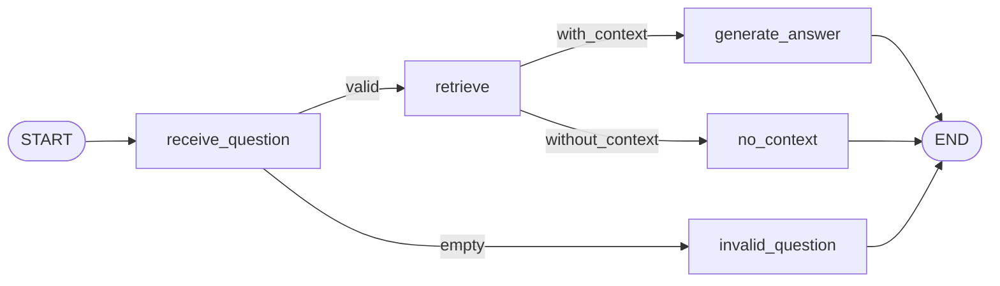

# Agente de soporte de TrackFlow con LangGraph — Parte 1: migración y flujo

El RAG del Hito 7 (`data/pipelines/rag.py`) deja de ser una caja negra: el mismo comportamiento vive ahora en un grafo de LangGraph con estado, nodos y transiciones explícitos, compilado antes de ejecutarse, con checkpoints en cada transición y un trace consultable por corrida.

- Código: `services/agent/` · Endpoint: `POST /agent/query`, `GET /agent/traces/{run_id}`
- Versión: `langgraph` 1.2.24 (`langgraph-checkpoint` 4.3.2)
- Plan y decisiones: `memory-bank/history/2026-11-20_langgraph-agent-base.md`

## 1. Grafo



| Nodo | Responsabilidad única | Llama a |
|---|---|---|
| `receive_question` | Normaliza la pregunta y marca si es válida | — |
| `retrieve` | Recupera los chunks por encima de `min_score` (0,46) | `rag.retrieve()` |
| `generate_answer` | Genera la respuesta con el contexto **ya recuperado** | `rag.generate_answer()`, `rag.unsupported_figures()` (aviso en el log) |
| `no_context` | Responde con honestidad que no hay información; **no llama al LLM** | — |
| `invalid_question` | Rechaza la pregunta vacía con un mensaje claro | — |

Ningún nodo llama a `rag.query()`: lo prohíben `tests/pipelines/test_agent_graph.py` y `tests/test_agent_routes.py`. `POST /knowledge/query` sigue usando `query()` y convive con el agente.

**Condiciones de salida** (`services/agent/nodes.py`):

| Desde | Router | Etiqueta → destino |
|---|---|---|
| `receive_question` | `route_after_receive` | `valid` → `retrieve` · `empty` → `invalid_question` |
| `retrieve` | `route_after_retrieve` | `with_context` → `generate_answer` · `without_context` → `no_context` |

`retrieve()` ya devuelve `[]` cuando ningún chunk alcanza el umbral calibrado en el Hito 7, así que la condición `without_context` evita forzar la generación sobre un contexto vacío.

## 2. Estado

```python
class AgentState(TypedDict, total=False):
    question: str                    # pregunta normalizada
    context: list[dict[str, Any]]    # payloads de Qdrant que superan min_score
    answer: str                      # respuesta final
    status: Literal["received", "invalid", "retrieved", "answered", "no_context"]
```

Son las cuatro claves que los nodos leen o escriben. **No hay historial de conversación:** cada consulta es independiente y ningún nodo lo necesita para decidir. Arrastrarlo inflaría cada checkpoint y cada trace sin cambiar ninguna decisión. Si la memoria conversacional llega (Hito 8), se añadirá con su propia justificación.

## 3. Compilación y errores estructurales

El grafo se declara como datos (`AGENT_SPEC` en `services/agent/graph.py`) y `compile_graph()`:

1. ejecuta `validate_structure()` (`services/agent/structure.py`, sin depender de LangGraph);
2. construye el `StateGraph`, envuelve cada nodo con el trace y llama a `compile(checkpointer=…)`;
3. convierte cualquier `ValueError`/`TypeError` de LangGraph en `GraphStructureError`.

`AGENT_GRAPH = compile_graph()` se ejecuta al importar el módulo, es decir, al arrancar la API: un grafo mal formado impide arrancar, no falla en una petición.

`validate_structure()` existe porque `StateGraph.compile()` de LangGraph 1.2 rechaza aristas hacia nodos desconocidos y grafos sin entrada, pero **acepta** nodos inalcanzables y nodos sin camino a `END`. Detecta y lista en un único error: estado sin anotaciones válidas o sin claves, nodos que se llaman como una clave del estado, nombres reservados, nodos no invocables, aristas con origen o destino desconocido, nodos con arista fija y condicional a la vez, número de entradas desde `START`, nodos sin conexión desde `START` y nodos que no llegan a `END`.

Ejemplo (test `test_compile_fails_clearly_on_an_unconnected_node`):

```text
GraphStructureError: Estructura del grafo inválida:
- Nodos sin conexión desde START (nunca se ejecutarían): ['orphan'].
- Nodos desde los que no se llega a END (la corrida no terminaría): ['orphan'].
```

## 4. Checkpointing

El grafo se compila con un `InMemorySaver` y cada corrida usa `thread_id = run_id`. LangGraph guarda un checkpoint por transición: el de entrada (`step = -1`), el de `START` (`step = 0`) y uno tras cada nodo. Para una pregunta con contexto:

| step | origen | `next` | estado |
|---|---|---|---|
| -1 | input | `__start__` | entrada pendiente de aplicar |
| 0 | loop | `receive_question` | pregunta tal como llega |
| 1 | loop | `retrieve` | `status = received` |
| 2 | loop | `generate_answer` | `status = retrieved`, N chunks |
| 3 | loop | — | `status = answered` |

Se verifica en `test_every_state_transition_is_checkpointed` y en el eval E6. `test_a_run_can_be_resumed_from_a_checkpoint_without_retrieving_again` reanuda desde el checkpoint posterior a `retrieve`: solo se vuelve a ejecutar la generación.

**Limitación:** `InMemorySaver` vive en el proceso de la API (se pierde al reiniciar y crece con cada corrida). En producción se usaría un saver persistente (Postgres/Supabase), con el mismo `thread_id`. El trace en disco (§5) sí persiste.

## 5. Trace

Cada nodo se envuelve con `traced()` (`services/agent/tracing.py`), que registra la ejecución en el recorder de la corrida. `run_agent()` (`services/agent/runner.py`) guarda el trace como JSON aunque la corrida falle:

- Ruta: `data/agent_traces/<run_id>.json` (no se versiona; configurable con `AGENT_TRACE_DIR`).
- Consulta: `GET /agent/traces/{run_id}` (solo `admin`/`manager`: el trace contiene los chunks) o `load_trace(run_id)`.

```json
{
  "run_id": "…", "thread_id": "…", "graph": "trackflow_support_agent",
  "question": "…", "started_at": "…", "finished_at": "…",
  "status": "answered | no_context | invalid | error",
  "path": ["receive_question", "retrieve", "generate_answer"],
  "events": [{"step": 1, "node": "…", "started_at": "…", "duration_ms": 0.1,
              "status": "ok | error", "input": {"question": "…", "status": "…", "context_chunks": 0, "has_answer": false},
              "output": {…}, "error": null}],
  "checkpoints": [{"checkpoint_id": "…", "step": -1, "source": "input", "next": ["__start__"], "values": {…}}],
  "answer": "…", "failed_node": null, "error": null
}
```

Ejemplo real: `docs/agent/trace-example.json`. No se usa LangSmith (no hay clave); el formato es propio y estable para que los evals lo lean.

## 6. Endpoint

| Petición | Respuesta |
|---|---|
| `POST /agent/query {"question": "…"}` con sesión | `200 {run_id, status, answer}` (`answered` o `no_context`) |
| Pregunta vacía o en blanco | `422 {"detail": "La pregunta está vacía…"}` (mensaje del nodo `invalid_question`) |
| Fallo de cualquier nodo | `503 {"detail": "El agente de soporte no ha podido completar la consulta… Referencia: <run_id>"}`, sin stack trace |
| `GET /agent/traces/{run_id}` | `200` trace · `403` si el rol no es admin/manager · `404` si no existe · `422` si no es un UUID |

El router solo llama a `run_agent()`. `AgentQueryRequest` no exige longitud mínima: decidir qué hacer con una pregunta vacía es trabajo del grafo.

## 7. Evals

Los casos están en `data/eval/agent-eval-cases.json` (4 de anclaje, 1 fuera de alcance, 1 pregunta vacía). Las preguntas de anclaje y sus datos esperados son los de `data/eval/test-queries.json` (Hito 7).

1. `python scripts/agent_record_traces.py` ejecuta cada caso con Qdrant y el LLM reales y guarda los traces en `tests/pipelines/fixtures/agent_traces/`.
2. `python -m pytest tests/pipelines/test_agent_evals.py -v` evalúa esos traces sin volver a llamar al modelo.

| Eval | Criterio verificable |
|---|---|
| E1 | La ruta y el estado final son los esperados para cada caso |
| E2 | `retrieve` se ejecuta una vez y antes que `generate_answer`, que recibe ese mismo contexto |
| E3 | Fuera de alcance: contexto vacío, sin `generate_answer`, respuesta honesta |
| E4 | Pregunta vacía: no se ejecuta `retrieve` |
| E5 | **Anclaje:** documentos esperados en el contexto, dato clave en la respuesta (`30 días`, `40%`, `manual` + `Sofía Ramos`, `16 EUR`), ninguna cifra inventada (`unsupported_figures`) y línea `Fuente:` |
| E6 | Un checkpoint por transición, del `step -1` al final |

Los tests del RAG (`tests/pipelines/test_rag.py`, `tests/test_knowledge_routes.py`) no cambian y siguen pasando: los evals del agente los amplían, no los sustituyen.

## 8. Hacia la Parte 2

- Una herramienta nueva se añade como **un nodo y una arista condicional** en `AGENT_SPEC`; `validate_structure()` comprueba que el nodo quede conectado y llegue a `END`.
- La voz de `generate_answer()` sigue siendo la del asistente comercial del Hito 7 (Miguel Torres). Los BRIEFING del Hito 8 describen el agente como el de primera línea de CX de Valentina Cruz: el cambio de identidad se hará en la Parte 2 sin tocar el flujo.

## 9. Evidencias (corrida real)

| Evidencia | Fichero |
|---|---|
| Trace completo de una corrida (eval a01) | `docs/agent/trace-example.json` |
| Resultado de los evals (22 passed) | `docs/agent/eval-results.txt` |
| `POST /agent/query` respondido y anclado | `docs/agent/evidence-query.json` |
| `GET /agent/traces/{run_id}` de esa corrida | `docs/agent/evidence-trace.json` |
| Pregunta vacía → 422 con mensaje claro | `docs/agent/evidence-empty-question.txt` |
| Captura de la terminal | `docs/agent/endpoint-evidence.png` |
| Traces de los 6 casos de eval | `tests/pipelines/fixtures/agent_traces/` |
