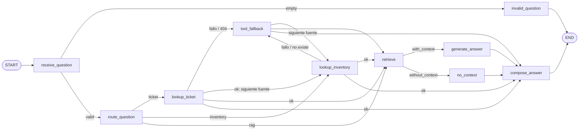

# Agente de soporte de TrackFlow con LangGraph — Parte 2: herramientas fuera del RAG

El agente de la Parte 1 solo sabía buscar en la base de conocimiento. Ahora también consulta **datos operativos en vivo** con dos tools de solo lectura, y decide por sí mismo qué fuente necesita cada pregunta.

- Código: `services/agent/tools.py`, `routing.py`, `answers.py`, `nodes.py`, `graph.py`
- Plan y decisiones: `memory-bank/history/2026-11-21_langgraph-external-tools.md`
- Diseño de la Parte 1 (estado, compilación, checkpointing, trace): `docs/agent/agent-design.md`

## 1. Por qué tools y no "otro RAG"

Los tickets cambian de estado en tiempo real. Si se indexaran en Qdrant, la copia quedaría desactualizada en cuanto alguien moviera un ticket. El RAG se queda para el conocimiento estable (políticas, SLA, tarifas), y las tools leen el dato actual del servicio que ya lo gestiona.

## 2. Grafo

| Nodo | Responsabilidad única |
|---|---|
| `route_question` | Decide las fuentes (LLM + guardas + reglas) |
| `lookup_ticket` | Tool 1: consulta el gestor de incidentes |
| `lookup_inventory` | Tool 2 (extra): consulta el gestor de inventario |
| `tool_fallback` | Redacta la respuesta honesta cuando una tool falla o el recurso no existe |
| `retrieve` / `generate_answer` / `no_context` | El RAG de la Parte 1, sin cambios de lógica |
| `compose_answer` | Une las partes: primero las tools y después el RAG |

El orden de las fuentes es fijo: tickets → inventario → RAG → composición. `next_source()` elige la siguiente fuente pendiente, y `route_after_tool()` desvía a `tool_fallback` cuando el resultado de una tool no es `ok`.

## 3. Tools

Las dos usan el **transporte HTTP** contra la API de TrackFlow (`AGENT_BACKEND_URL`, por defecto `http://localhost:8000`).

| | Tickets (`lookup_tickets`) | Inventario (`lookup_inventory`) |
|---|---|---|
| Entrada | `TicketQuery`: `ticket_id` (≥ 1) **o** filtros `status`, `category`, `origin`, `branch` (los enums del gestor) | `InventoryQuery`: `sku` **o** `product_name` (al menos uno) |
| Endpoint | `GET /api/incidents/{id}` · `GET /api/incidents?…` | `GET /inventory/products` |
| Salida | `TicketRecord`: `id`, `title`, `description`, `category`, `status`, `origin`, `branch`, `created_at`, `updated_at` | `ProductStock`: `id`, `sku`, `name`, `client_name`, `category`, `current_stock` |
| Resultado | `ToolResult`: `status` (`ok` / `not_found` / `unavailable`), `records`, `total`, `error`, `duration_ms` | igual |

- **Solo lectura:** el único punto de salida es `http_get_json()`, que solo hace `GET`. `test_tools_are_read_only` comprueba que todas las peticiones son `GET` y que el módulo no contiene llamadas de escritura.
- **Timeout:** `TOOL_TIMEOUT_SECONDS = 4.0` (connect, read, write y pool). Un timeout se convierte en `unavailable` con el error "timeout: sin respuesta en 4 s".
- **Autenticación:** los `GET` de incidentes e inventario **no exigen auth** en esta API. Si se protegen, basta con poner `AGENT_BACKEND_TOKEN` en el entorno y la tool envía `Authorization: Bearer …`. No hay ningún token en el código.
- **Sin datos simulados:** las tools solo leen de la API. Los tests sustituyen el transporte (`httpx.MockTransport`), nunca la fuente de datos de producción.
- **Las tools nunca lanzan.** Timeout, error de red, 5xx o una respuesta que no cumple el contrato dan `unavailable`; un 404 o una búsqueda vacía dan `not_found`.

## 4. Enrutamiento (híbrido)

1. **LLM** (`classify_with_llm`): el `LLM_MODEL` de 4Geeks recibe un prompt con las tres fuentes y devuelve JSON, que se valida contra `RouteDecision` (dentro van `TicketQuery` / `InventoryQuery`). Temperatura 0 y timeout de 15 s.
2. **Guardas de anclaje** (`parse_llm_decision`): si el LLM propone un `ticket_id`, un `sku` o un `product_name` que no aparece en la pregunta, la decisión se descarta. El agente nunca consulta un recurso que el usuario no ha mencionado.
3. **Reglas** (`classify_with_rules`): si el LLM falla, tarda, devuelve algo no válido o no pasa las guardas, decide un clasificador por patrones (ticket + número, `#123`, estados, sucursales y categorías; stock, SKU y producto; palabras de política para añadir el RAG).

La decisión queda en el estado (`route`) y en el trace, con `decided_by` (`llm` o `rules`) y `reason`.

## 5. Respuestas y fallback

- La parte que viene de una tool se escribe **con plantilla** a partir de los campos devueltos (`answers.py`), sin LLM. Ejemplo: *"El ticket 3 «Caja aplastada» está en curso (categoría: daño; origen: cliente; sucursal: Zaragoza)…"*, seguido de `Fuente: gestor de incidentes de TrackFlow (consulta en tiempo real)`.
- `tool_fallback` responde con honestidad y sin afirmar ningún estado ni stock:
  - servicio caído o timeout: *"No he podido confirmar el estado del ticket 3 ahora mismo: el gestor de incidentes no responde…"*
  - recurso inexistente: *"No encuentro el ticket 999999 en el gestor de incidentes, así que no puedo confirmar su estado…"*
- Si la pregunta también pedía el RAG, la parte del RAG se responde igualmente.
- Estado final: `answered` si alguna fuente dio datos, `tool_fallback` si solo hubo fallos de tools, y `no_context` si solo había RAG y no encontró nada.

## 6. Trace

Cada trace añade:
- `sources`: las fuentes consultadas, en orden, p. ej. `["incidents", "rag"]`;
- `route`: la decisión completa del enrutador.

Además, los eventos de `lookup_ticket` y `lookup_inventory` guardan el `ToolResult` completo (consulta, estado, registros, error y duración), y el `input` de cada evento resume `planned_sources` y `tool_status`. `POST /agent/query` devuelve también `sources`.

Evidencias:
- `docs/agent/trace-ticket-tool.json`: corrida con la tool de tickets;
- `docs/agent/trace-rag-routing.json`: corrida con el RAG y ninguna tool;
- `docs/agent/tools-eval-results.txt`: resultado de los evals.

## 7. Evals (`tests/pipelines/test_agent_evals.py`)

Se graban con `python scripts/agent_record_traces.py` (API, Qdrant y LLM reales). El grabador elige un **ticket y un SKU que existen** en la API. El fallback de "servicio caído" se graba apuntando las tools a un puerto cerrado.

| Eval | Caso | Criterio |
|---|---|---|
| E7 | a07 | Pregunta por un ticket → solo `incidents`, sin `retrieve`; la respuesta es exactamente la plantilla aplicada a los datos reales |
| E8 | a01–a05, a08 | Pregunta de política (a08 menciona "Los Ángeles") → solo `rag`, ningún nodo de tool |
| E9 | a09 | Pregunta mixta → `incidents` y después `rag`; la respuesta contiene el estado real y "30 días" |
| E10 | a10, a11 | Ticket inexistente (`not_found`) y servicio caído (`unavailable`) → `tool_fallback`, respuesta honesta sin ningún estado |
| E11 | a12 | Stock → `inventory`, con el número real de `current_stock` |
| E12 | a07, a09 | El ticket usado es el que devolvió la API al grabar |

E1–E6 (Parte 1) siguen vigentes con las rutas nuevas (`route_question` y `compose_answer`).

## 8. Limitaciones

- La API se llama a sí misma por HTTP (el agente vive en la misma API). Funciona porque `POST /agent/query` es síncrono y FastAPI lo ejecuta en su pool de hilos; con varios workers el comportamiento es el mismo.
- La búsqueda de productos por nombre es por subcadena (sin tildes ni mayúsculas); no hay búsqueda difusa.
- El enrutador LLM añade una llamada al modelo por pregunta (hasta 15 s); si no responde, deciden las reglas.

## 9. Resultados reales (2026-11-21)

- `python -m pytest -q --ignore=tests/pipelines/test_agent_evals.py` → **322 passed**.
- Evals → **50 passed** (`docs/agent/tools-eval-results.txt`).
- Los 12 casos los enrutó el **LLM** (`decided_by = llm`); las reglas de respaldo no hicieron falta.
- Datos: las 3 incidencias del gestor se dieron de alta con su propio `POST /api/incidents` (la tool del agente solo hace `GET`); el SKU es uno real del inventario (`TF-TEE-001`).

| Evidencia | Fichero |
|---|---|
| Trace con la tool de tickets (a07) | `docs/agent/trace-ticket-tool.json` |
| Trace con el RAG, sin tools (a08) | `docs/agent/trace-rag-routing.json` |
| Resultado de los evals | `docs/agent/tools-eval-results.txt` |
| Capturas | `docs/agent/tools-tests-passed.png`, `tools-traces-recorded.png`, `tools-evals-passed.png` |

