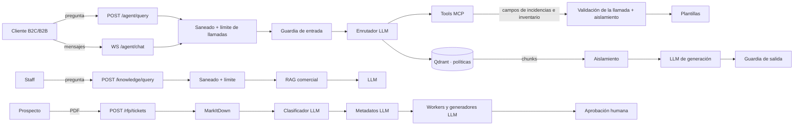

# Prácticas seguras en la integración de IA · TrackFlow (NIST)

Entrega del ticket de Compliance: **auditoría de seguridad de conjunto de los sistemas de IA** de TrackFlow según las seis funciones de NIST, con el inventario, la ruta de mejoras y las protecciones más urgentes implementadas y probadas.

- **Rama:** `feature/nist-security-practices` (desde `feature/owasp-top10-audit`, PR #39) · **Fecha:** 2026-11-27
- **Marco regulatorio (BRIEFING):** RGPD (España/UE, AEPD en 72 h) y CCPA/CPRA (California)

| Documento | Qué contiene |
|---|---|
| [NIST_SECURITY_REPORT.md](NIST_SECURITY_REPORT.md) | **Informe NIST:** Govern, Identify, Protect, Detect, Respond y Recover, con acciones priorizadas, brechas pendientes con su riesgo y mitigación, y la ruta de mejoras |
| [ai-inventory.md](ai-inventory.md) | **Inventario** de los sistemas de IA con responsable por componente y quién responde de cada control cuando lo provee un tercero |
| [verification.md](verification.md) | Guion de verificación: tests, sonda contra la API, comprobación en el backoffice y lista de evidencias |
| [`evidence/`](evidence/) | Capturas y salidas JSON |

**Caso de prueba reproducible de prompt injection:** [`tests/pipelines/test_nist_prompt_injection.py`](../../tests/pipelines/test_nist_prompt_injection.py) (BRIEFING §4, caso 1 por el endpoint real y caso 2) y la comprobación en vivo N2/N3 de [`scripts/nist_security_probe.py`](../../scripts/nist_security_probe.py).

---

## Dónde recibe un modelo input externo

Antes de tocar código, este es el mapa de **todos los puntos** en los que un modelo de lenguaje (o los embeddings) recibe texto que no ha escrito TrackFlow en ese momento. Es la superficie de ataque de la inyección de prompts, directa e indirecta.

| # | Punto de entrada | Quién escribe el texto | Modelo que lo recibe | Riesgo | Controles (fichero) | Estado |
|---|---|---|---|---|---|---|
| E1 | `POST /agent/query` · pregunta | **Cliente final o marca** (cuenta `user`) | Enrutador (`routing.py`) y generación (`harness/generation.py`); embeddings de la búsqueda | Inyección directa, pedido ajeno (BRIEFING §4 caso 1), coste sin límite | JWT, **límite de llamadas** (`harness/usage_limits.py`), **saneado** (`harness/input_sanitizer.py`), guardia de entrada determinista (`harness/input_guard.py`), autorización de pedidos por sesión, `scope` del enrutador, prompt con jerarquía y canario (`harness/prompts.py`), guardia de salida | ✔ |
| E2 | `WS /agent/chat/sessions/{id}/ws` · `user_message` / `new_input` | Cliente final o marca | Igual que E1 (mismo `run_agent`) | Igual que E1 + inundación de mensajes | JWT antes del primer frame, **mismo presupuesto** (`chat_error rate_limited`), un turno por sesión, 500 caracteres | ✔ |
| E3 | `POST /knowledge/query` · pregunta del asistente comercial | Staff (`manager`/`admin`) | `rag.query()` (generación + embeddings) | Coste, inyección de un empleado | `require_staff`, **saneado** y **mismo presupuesto** | ✔ |
| E4 | Chunks de la base de conocimiento (`docs/company-knowledge-base/` → Qdrant) | Equipo de TrackFlow (versionado en el repo) | Generación del agente | Inyección **indirecta** si un documento se envenena; mezcla de políticas por país | Saneado y delimitación `<documentos_no_confiables>` (`harness/isolation.py`), bloqueo por país, Qdrant solo en loopback | ✔ |
| E5 | Resultados de tools MCP (descripción de una incidencia, nombre de producto) | **Cualquiera** que cree una incidencia o un operador de almacén (BRIEFING §4 caso 2) | Ninguno: las respuestas de tools salen de **plantillas** | Inyección indirecta, *excessive agency* | Aislamiento de campos, plantillas sin LLM, ACL por rol (`harness/tool_policy.py`), **validación de cada llamada** (`harness/tool_call_guard.py`), solo tools de lectura | ✔ |
| E6 | Argumentos de las llamadas a tools (salida del enrutador LLM) | El **modelo** | — (se ejecuta contra el MCP) | El modelo propone una tool o argumentos que no tocan | Contrato `RouteDecision`, guardas de anclaje, **`tool_call_guard`** (catálogo, esquema estricto, sin órdenes dentro, confirmación humana para escrituras) | ✔ |
| E7 | Memoria del agente (hechos aprobados en Redis) | Staff que aprueba una propuesta | Ninguno: las notas se muestran con plantilla, fuera del prompt | Envenenamiento de memoria | Solo se guarda lo que aprueba un humano, política determinista de categorías, auditoría append-only | ✔ |
| E8 | `POST /rfp/tickets` · PDF de una RFP → Markdown | **Prospecto externo** | Clasificador, extractor de metadatos, orquestador y generadores de borradores (`data/pipelines/rfp_intake/`) | Inyección indirecta en el PDF | `require_staff`, tipo y tamaño máximo, `<documento>` delimitado, JSON validado con esquema, guardas deterministas (moneda, cifras solo de los metadatos), **aprobación humana por departamento** antes de cerrar | ⚠ parcial: el texto del PDF no pasa por `isolation.sanitize` (brecha **G2** del informe) |

Los componentes del BRIEFING que **no existen** en el fork (motor de selección de carrier, motor de aprobación de devoluciones, API de tracking real con 8 couriers, portales B2B) no tienen punto de entrada. Si se construyen, sus acciones irreversibles ya están en el registro de `tool_call_guard.IRREVERSIBLE_ACTIONS` y exigen confirmación humana.
