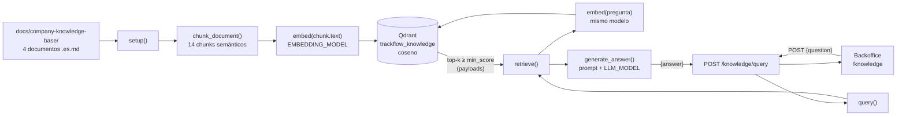

# Diseño del RAG · Asistente comercial de TrackFlow

> **Hito 7 — RAG y Base de Conocimiento.** Ticket del equipo comercial de Miguel
> Torres (Director Comercial): un asistente que cualquier account manager pueda
> usar **como lo haría un vendedor de TrackFlow** en una llamada con un cliente,
> con datos exactos y sin prometer condiciones que no existen en los acuerdos
> estándar.
> Sin frameworks de orquestación: SDK de Qdrant, SDK OpenAI-compatible para el
> acceso LLM de 4Geeks y FastAPI.

| Pieza | Fichero |
|---|---|
| Corpus | `docs/company-knowledge-base/` (4 documentos del BRIEFING, copiados sin cambios) |
| Chunking + `embed()` + `setup()` | `data/process/rag.py` |
| `retrieve()` + `generate_answer()` + `query()` | `data/pipelines/rag.py` |
| Endpoint `POST /knowledge/query` | `services/knowledge/router.py` (+ `schemas.py`) |
| UI | `uis/backoffice/src/app/knowledge/page.tsx` → **Asistente comercial** en el menú |
| Pruebas | `tests/pipelines/test_rag.py`, `tests/test_knowledge_routes.py` |
| Eval de retrieval | `data/eval/test-queries.json`, `scripts/rag_eval.py` → `data/eval/rag_eval_results.json` |
| Qdrant | servicio `qdrant` en `docker-compose.yml`, colección **`trackflow_knowledge`** |

---

## 1. Proceso RAG de extremo a extremo



**Indexación (una vez, o cada vez que cambien los documentos):**

1. `load_documents()` lee los cuatro ficheros del BRIEFING desde
   `docs/company-knowledge-base/` y falla si falta alguno.
2. `chunk_document()` los divide en unidades semánticas (§2) y construye el
   payload del BRIEFING: `company`, `source_document`, `section`, `language`,
   `chunk_index` y `text`.
3. `setup()` llama a `embed(chunk["text"])` para cada chunk, (re)crea la
   colección `trackflow_knowledge` (distancia coseno, dimensión = la del modelo)
   y hace `upsert` con IDs deterministas.

**Consulta (cada pregunta):**

4. La UI envía `POST /knowledge/query {"question": "…"}`, con la sesión del
   backoffice. El router solo valida la entrada y llama a `query()`: no repite
   ninguna lógica de recuperación ni de generación.
5. `query()` = `retrieve()` + `generate_answer()`:
   - `retrieve()` embebe la pregunta con **el mismo `embed()`**, pide a Qdrant
     los `k=5` vecinos más cercanos y **descarta los que no llegan a
     `min_score`**. Devuelve solo payloads (dicts), nunca objetos del SDK, y puede
     devolver menos de 5 resultados o ninguno.
   - `generate_answer()` arma el prompt (§5) con los chunks numerados y su origen,
     y llama al modelo de **generación**.
6. El endpoint devuelve solo `{"answer": "…"}`. Los chunks y las puntuaciones se
   quedan en el log del servidor. Si Qdrant o el LLM fallan, responde 503: un
   error nunca parece una respuesta vacía.

`retrieve()` y `generate_answer()` son funciones públicas separadas: el agente
LangGraph del siguiente proyecto puede llamarlas como nodos distintos sin
repetir la recuperación.

## 2. Estrategia de chunking

**Corpus:** cuatro documentos cortos (0,9-1,3 KB) con un único título `#` y,
debajo, párrafos y listas sin subtítulos. Cada párrafo o lista es una regla
comercial completa: un plazo, una tarifa, una condición o una excepción.

**Estrategia: por unidad semántica (párrafo o lista completa), nunca por número
de caracteres.**

1. Se separa el cuerpo por líneas en blanco: cada bloque es un párrafo o una
   lista.
2. **Una frase introductoria que termina en `:` viaja con el bloque que
   introduce.** "TrackFlow cobra almacenamiento según volumen ocupado…:" va
   junto a sus tres tarifas, y "El proceso estándar de devoluciones funciona
   así:" junto a sus tres pasos. Así ninguna regla queda separada de su
   condición.
3. Las listas no se trocean. La tarifa de larga duración ("150 % sobre la
   tarifa estándar") depende de la tarifa estándar y del periodo de gracia, así
   que las tres viajan juntas.
4. Se deshace el ajuste de línea del Markdown (cada frase completa en una línea)
   y se antepone la **sección** al texto (`Política de Devoluciones › Ventana de
   devolución estándar`). Cada chunk se entiende solo, y ese mismo texto es el
   que se embebe y el que llega al prompt.
5. **Sección:** el título del documento y, si el bloque empieza con una etiqueta
   ("Ventana de devolución estándar:", "España (Zaragoza):"), la etiqueta como
   subsección.

**Resultado: 14 chunks, entre 164 y 542 caracteres cada uno.** El BRIEFING pide
como mínimo 3 por documento.

| `source_document` | Chunks | Unidades preservadas |
|---|---|---|
| `sla-delivery` | 3 | tipos de servicio y plazos · SLA del 90 % y compensación del 5 % · fechas de alta demanda (Black Friday, Navidad, Rebajas) |
| `returns-policy` | 5 | proceso en 3 pasos · ventana de 30 días · costos de devolución · devoluciones internacionales (manuales, equipo de Sofía Ramos) · TrackFlow no reacondiciona ni revende |
| `carrier-coverage` | 3 | Estados Unidos (UPS, FedEx, DHL) · España (MRW, SEUR, DHL, locales) · selección por sistema y excepciones de Carlos Vega |
| `storage-pricing` | 3 | tarifas, periodo de gracia y larga duración · reporte de antigüedad · tarifa preferencial con aprobación de Miguel Torres |

**Por qué no tamaño fijo con solapamiento:** con documentos de 1 KB, un corte
cada 300-500 caracteres separaría, por ejemplo, "Si un país cae por debajo del
90 %…" de "…compensación del 5 %", y el modelo respondería sin la condición.
**Por qué no un documento por chunk:** la pregunta "¿quién paga la devolución?"
traería también la ventana, el proceso y las devoluciones internacionales, y
eso diluye la similitud y el prompt.

**Garantías comprobadas en tests:** cada chunk termina en una frase completa,
ninguno acaba en `:`, el proceso de devoluciones conserva sus 3 pasos y las
tarifas conservan 18 USD, 16 EUR y 150 % juntas.

## 3. Idempotencia de `setup()`

**IDs deterministas + `upsert`.** El ID de cada punto es
`uuid5(namespace, "trackflow:<source_document>:<chunk_index>")`, así que volver
a ejecutar `setup()` sobrescribe los mismos 14 puntos en lugar de duplicarlos.
Además:

- si un documento pierde chunks, los puntos que sobran se borran (`scroll` +
  `delete`);
- si cambia la dimensión del modelo de embeddings, la colección se recrea (los
  vectores viejos serían incompatibles).

Un test lo comprueba con un Qdrant en memoria: dos ejecuciones dejan 14 puntos.

## 4. Prácticas de embeddings

| | Valor |
|---|---|
| **Modelo de embeddings** (`EMBEDDING_MODEL`) | `madrid-spain/openrouter/perplexity/pplx-embed-v1-0.6b` (Perplexity pplx-embed) |
| **Modelo de generación** (`LLM_MODEL`) | `madrid-spain/opnerouter/openai/gpt-6-luna` (la errata `opnerouter` es parte del ID real) |
| Proveedor | Acceso LLM de estudiante de 4Geeks: gateway LiteLLM `https://llm.4geeks.ai`, compatible con OpenAI. La clave se genera en 4geeks.com → Mi perfil → Recursos → Claves API para LLM y va en `LLM_API_KEY` (`.env`) |
| Dimensión del vector | **1024** (la devuelve el modelo; `setup()` crea la colección con esa dimensión) |
| Distancia en Qdrant | **Coseno** (`Distance.COSINE`) |
| `k` | 5 en `query()`; 3 para medir Recall@3 |
| `min_score` | **0,46** (`DEFAULT_MIN_SCORE` en `data/pipelines/rag.py`) |

- **IDs de modelo sin el prefijo `litellm/`.** La web de 4Geeks muestra los modelos como
  `litellm/madrid-spain/…`, pero el gateway los expone sin ese prefijo: con él responde 403.
  Los IDs correctos se comprobaron con `GET /models` usando la propia clave.
- **Dos modelos, dos trabajos.** `embed()` solo usa `EMBEDDING_MODEL` y
  `generate_answer()` solo usa `LLM_MODEL`. `check_models()` lanza un error si
  los dos coinciden o falta alguno, y hay un test que lo verifica.
- **Mismo `embed()` al indexar y al consultar.** `setup()` llama a
  `embed(chunk["text"])` y `retrieve()` a `embed(pregunta)`: el mismo modelo y el
  mismo preprocesado.
- **Preprocesado:** `normalize_text()` colapsa espacios y saltos de línea y quita
  los bordes. No se pasa a minúsculas ni se quitan tildes: los modelos de
  embeddings ya están entrenados con texto natural, y "Aragón" o "SEUR" pierden
  información si se alteran. El texto de cada chunk lleva delante su sección,
  así que el vector incluye el tema del documento ("Tarifas de Almacenamiento",
  "Política de Devoluciones").

**Cómo se eligió `min_score`.** `scripts/rag_eval.py` mide, con el modelo real,
la similitud del chunk correcto en las 16 preguntas de
`data/eval/test-queries.json`. La compara con la mejor similitud de 4 preguntas
**fuera de alcance**, que no tienen respuesta en los documentos ("horario del
almacén los domingos", "seguro de mercancía", "capital de Francia"…). El umbral
se fija entre las dos distribuciones: lo bastante alto para que lo fuera de
alcance devuelva cero chunks (y el modelo diga que no hay información), y lo
bastante bajo para no perder chunks correctos.

| Medida (coseno, `pplx-embed-v1-0.6b`) | Valor |
|---|---|
| Similitud del chunk correcto, 16 preguntas: mínimo | 0,539 (q03, Rebajas de enero) |
| Similitud del chunk correcto: mediana | 0,635 |
| Mejor similitud de las preguntas fuera de alcance: máximo | 0,383 (oos03, "lenguaje de programación del equipo de Zaragoza") |
| Resto de preguntas fuera de alcance | 0,264 · 0,320 · 0,156 |
| **`min_score` elegido** | **0,46**, punto medio entre 0,383 y 0,539 |

Las dos distribuciones no se solapan: hay 0,156 de margen entre la mejor pregunta
fuera de alcance y el peor chunk correcto. Con 0,46, las 16 preguntas de la base
conservan su chunk correcto (Recall@3 con umbral = 100 %) y las 4 preguntas fuera
de alcance no recuperan **ningún** chunk, así que el modelo responde que no hay
información suficiente. Se descartó un umbral más alto (p. ej. 0,55) porque
dejaría fuera la pregunta de Rebajas de enero (0,539). Uno más bajo (≤ 0,38)
dejaría pasar contexto irrelevante a las preguntas fuera de alcance. Si cambia el
modelo de embeddings, hay que repetir `python scripts/rag_eval.py`: las
similitudes no son comparables entre modelos.

## 5. Generación: voz, audiencia y restricciones del BRIEFING

`generate_answer()` envía un mensaje de sistema y otro de usuario al modelo de
generación, con `temperature=0`:

- **Voz y audiencia:** asistente de los account managers y business
  development de Miguel Torres. Responde **como un vendedor de TrackFlow en una
  llamada con una marca cliente**, en tono profesional y cercano, en español, de
  2 a 6 frases.
- **Solo el contexto recuperado:** los chunks llegan numerados con su documento
  y sección. Las cifras, porcentajes, tarifas, monedas y plazos se copian tal
  cual, sin redondear ni convertir monedas (KPI de fidelidad del BRIEFING §4).
- **Restricciones de negocio (BRIEFING §6):**
  - nunca prometer el SLA en fechas de alta demanda declaradas;
  - las devoluciones internacionales nunca son "automáticas": siempre se
    remiten a gestión manual del equipo de Sofía Ramos;
  - ningún descuento de almacenamiento se menciona sin la aprobación de Miguel
    Torres;
  - las excepciones de transportista requieren a Carlos Vega;
  - cualquier condición no documentada se responde como "requiere aprobación".
- **Trazabilidad:** la respuesta termina con una línea `Fuente:` con el
  documento y la sección usados.
- **Sin contexto:** si `retrieve()` no devuelve nada por encima del umbral, el
  modelo recibe `SIN CONTEXTO RELEVANTE` y la instrucción de decir que la base
  de conocimiento no tiene información suficiente, sin dar cifras. La respuesta
  sigue siendo generada por el modelo, nunca un texto fijo ni un chunk crudo.
- **Control de fidelidad:** `query()` comprueba que cada cifra de la respuesta
  aparece en los chunks recuperados (`unsupported_figures`) y registra un aviso
  si no. `scripts/rag_eval.py --answers` lo mide en todas las preguntas.

## 6. Evaluación

`python scripts/rag_eval.py --answers` sobre `data/eval/test-queries.json` (16
preguntas que cubren los cuatro documentos, entre ellas dos sobre picos de
demanda: Black Friday y Rebajas de enero) → `data/eval/rag_eval_results.json`.

| Métrica | Resultado | Umbral del BRIEFING |
|---|---|---|
| **Recall@3** | **100 %** (16/16; el chunk correcto sale **1.º** en las 16) | ≥ 80 % |
| Recall@3 por documento | `sla-delivery` 100 % · `returns-policy` 100 % · `carrier-coverage` 100 % · `storage-pricing` 100 % | — |
| Recall@3 con `min_score` = 0,46 | 100 % | — |
| Chunks recuperados en preguntas fuera de alcance | 0 de 4 preguntas recuperan algo | — |
| Fidelidad de cifras | Todas las cifras de las respuestas están en el contexto recuperado o en la propia pregunta | Ninguna cifra distinta de los chunks |
| Datos clave en las respuestas | 16/16 incluyen el dato esperado (p. ej. "30 días", "SEUR", "Miguel Torres") | — |

En la primera ejecución, la comprobación de fidelidad marcó la q15 por el "60" de
"una marca con 60 metros cúbicos al mes". Ese número lo da el account manager en
la pregunta, no lo inventa el modelo, así que `unsupported_figures()` cuenta
ahora también los números de la pregunta.

**Ejemplo (q15, restricción de descuentos del BRIEFING §6):**

> **Pregunta:** ¿Podemos ofrecer un descuento en almacenamiento a una marca con 60 metros cúbicos al mes?
>
> **Respuesta generada:** La marca, con 60 metros cúbicos al mes, cumple el umbral para negociar una tarifa preferencial, pero no podemos ofrecer el descuento directamente: requiere la aprobación de Miguel Torres.
> Fuente: Tarifas de Almacenamiento (storage-pricing) · Sección: Tarifas de Almacenamiento

**Ejemplo sin contexto** (`generate_answer(pregunta, [])`): "La base de
conocimiento no tiene información suficiente para responder con seguridad cuál es
la ventana de devolución estándar. Te recomiendo consultarlo con el responsable
del área antes de confirmárselo al cliente. Fuente: ninguna (sin información en
la base de conocimiento)".

## 7. Cómo ejecutarlo

```bash
docker compose up -d qdrant                 # Qdrant local en :6333
python -m data.process.rag                  # setup(): indexa y muestra el conteo de chunks
python scripts/rag_eval.py --answers        # Recall@3, umbral y fidelidad
python -m pytest tests/pipelines/test_rag.py tests/test_knowledge_routes.py
```

Variables en `.env` (ver `.env.example`): `LLM_API_URL`, `LLM_API_KEY`,
`LLM_MODEL`, `EMBEDDING_MODEL`, `QDRANT_URL` (`EMBEDDING_API_*` y
`QDRANT_API_KEY` son opcionales).
