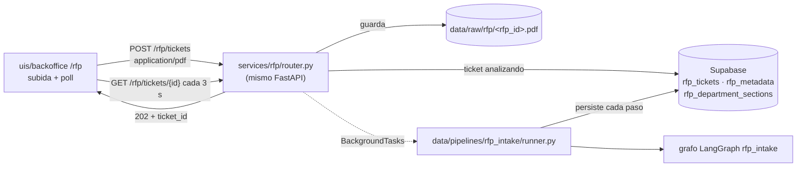
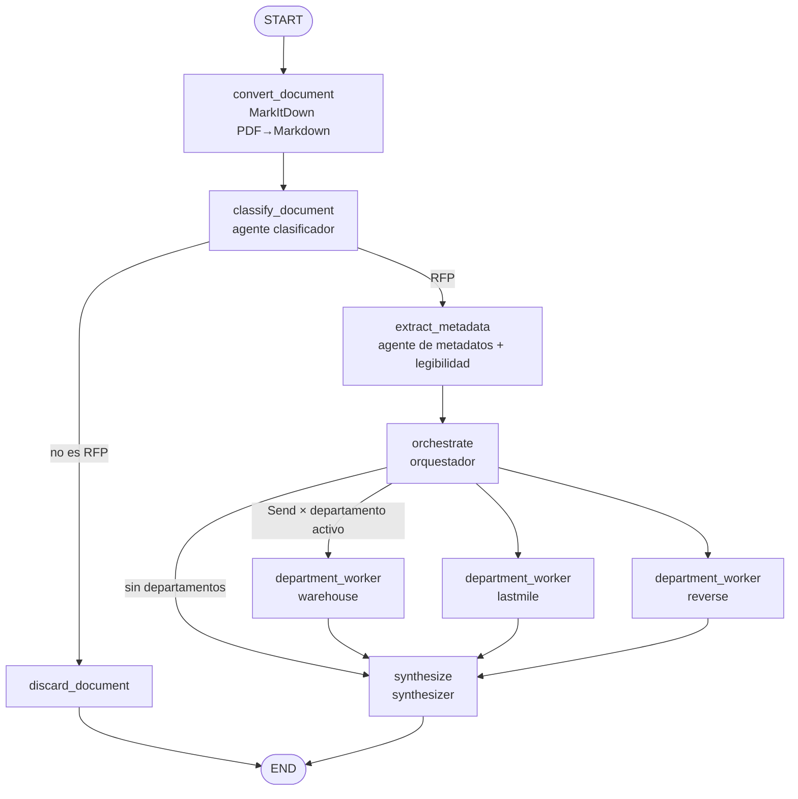

# Flujo agéntico de RFPs — Parte 1: recepción y enrutamiento (TrackFlow)

> **Proyecto 4Geeks:** "Hito — Flujo Agéntico de RFPs: Recepción y Enrutamiento (Parte 1 de 3)".
> **Rama:** `feature/rfp-intake`. **BRIEFING:** `content/contexts/09-agentic-workflows/trackflow-BRIEFING.es.md` del syllabus (resumido en §1).
> **Código:** grafo y agentes en `data/pipelines/rfp_intake/`; rutas HTTP en `services/rfp/` (mismo backend, sin API nuevo); UI en `uis/backoffice/src/app/rfp/`; CLI en `scripts/rfp_intake_run.py`; SQL en `services/sql/003_rfp_intake.sql`.

## 1. Fuente de verdad (BRIEFING)

Las RFPs llegan al equipo de **Miguel Torres, Commercial Director**: marcas de e-commerce que quieren tercerizar almacenamiento, última milla y/o devoluciones en EE. UU., España o ambos. Hoy cada account manager arma la propuesta a mano coordinando por correo con tres departamentos:

| `department_id` | Departamento | Responsable | Qué aporta | Servicio que lo activa |
|---|---|---|---|---|
| `warehouse` | Warehouse Operations | Ana Whitfield | Capacidad de almacenamiento, costo por pallet/SKU, tiempo de onboarding | `warehousing` |
| `lastmile` | Last Mile and Carrier Management | Carlos Vega | Costo por envío, transportistas por destino, SLA de entrega | `last_mile` |
| `reverse` | Reverse Logistics | Sofía Ramos | Costo y tiempo de procesamiento de devoluciones | `reverse_logistics` |

- No toda RFP necesita los tres: el orquestador activa solo los que pide el alcance.
- País → moneda: **Estados Unidos → USD, España → EUR** (§5).
- Estados del ticket en la Parte 1: `analizando` → `analisis_completo` | `descartado`. El resto del vocabulario (`generando_borrador`, `en_evaluación`, `needs_human_review`, `esperando_aprobación`, `terminado`) lo admite la tabla para las Partes 2 y 3, pero esta parte no lo escribe.
- Los workers reciben **metadatos compartidos + extractos de su departamento** y **nunca inventan** pallets, SKUs ni pedidos: si falta el volumen, es una pregunta abierta.

Muestras (`rfp-requests/trackflow/`, se suben por la UI):

| PDF | Qué es | Resultado esperado |
|---|---|---|
| `trackflow-request-1.pdf` | RFP formal de **ModaViva** (España): almacenamiento + devoluciones, transportista propio | aceptar · `warehouse` + `reverse`, sin `lastmile` · EUR |
| `trackflow-request-2.pdf` | Correo informal de **Luna Cosmetics** (LA): almacenamiento + última milla EE. UU., ~5.000 pedidos/mes | aceptar · `warehouse` + `lastmile` · USD |
| `trackflow-request-3.pdf` | Pitch de tarifas de **RapidShip Carriers** a TrackFlow | rechazar · `descartado` |

## 2. Arquitectura





- **Grafo dedicado** `rfp_intake` (`graph.py`): no comparte nodos ni estado con el grafo del agente de CX (`services/agent/graph.py`). Se compila la primera vez que se usa.
- **Los routers solo disparan y consultan**: `services/rfp/router.py` valida, crea el ticket con `intake.accept_upload()` y encola `runner.process_ticket_safely`.
- **Nodos puros**: devuelven actualizaciones de estado; el runner las persiste según las emite el grafo (`stream_mode="updates"`), así el ticket siempre refleja la última etapa terminada.
- **Workers en paralelo** con la API `Send` de LangGraph; cada uno recibe su propio `WorkerInput` (`workstream` + `metadata`), nunca el estado completo. `sections` se acumula con un reductor de suma.
- **LLM**: el mismo acceso de 4Geeks del RAG (`LLM_API_URL`, `LLM_API_KEY`, `LLM_MODEL`), temperatura 0, salida JSON validada. Sin variables nuevas.

## 3. Agentes

Todos siguen el mismo patrón del enrutador del agente de CX: **LLM primero, salida validada contra un contrato, guardas deterministas y respaldo por reglas** si el LLM cae o no cumple. Con o sin LLM el ticket termina en un estado coherente.

| Agente | Entrada | Salida | Guardas | Respaldo |
|---|---|---|---|---|
| Clasificador (`classifier.py`) | Markdown completo | `Classification` (`is_rfp`, `document_type`, `confidence`, `reason`) | JSON válido; `is_rfp` coherente con `document_type`; confianza ≥ 0,6 | reglas: pide propuesta + servicios vs. señales de pitch de proveedor |
| Metadatos (`metadata.py`) | Markdown completo | `RfpMetadata` (§2.3 del BRIEFING) | todo texto anclado en la RFP; volumen presente en el documento; fecha solo con día, mes y año; servicio excluido explícitamente se quita; moneda y departamentos por mapeo fijo | regex de `signals.py` |
| Orquestador (`orchestrator.py`) | Markdown + metadatos | un `Workstream` por departamento activo, inactivos con motivo, `unassigned_requests` | solo departamentos de `departments_needed`; departamento inexistente → sin asignar (Miguel Torres); extractos anclados | extractos por palabras clave del departamento |
| Worker (`workers.py`) × 3 roles | su `Workstream` + metadatos | `DepartmentSection` (`key_aspects` con evidencia, `open_questions`) | evidencia en sus extractos; ninguna cifra fuera de extractos/metadatos; responsable del BRIEFING; preguntas obligatorias deterministas | aspectos = extractos literales |
| Synthesizer (`synthesizer.py`) | secciones + metadatos | handoff `v1` (§6) con «qué pedir a quién», conflictos y resumen | el resumen del LLM no puede añadir cifras y debe nombrar a cada responsable | resumen por plantilla |

La exclusión explícita es la regla clave de ModaViva: «mantenemos nuestro propio transportista para el reparto de última milla» y «No se requiere gestión de transportistas ni última milla» se detectan cláusula a cláusula (`signals.detect_services`) y **ganan** a cualquier mención de la última milla, aunque el LLM la pida.

## 4. Persistencia (PostgreSQL / Supabase)

`services/sql/003_rfp_intake.sql` (idempotente, con checks, índices y RLS) y las mismas tablas en SQLModel (`sql_store.py`). TinyDB y JSON no se usan para estas entidades.

| Tabla | Contenido |
|---|---|
| `rfp_tickets` | `ticket_id`, `rfp_id`, `status`, `stage`, `raw_pdf_path`, nombre original, sha256, tamaño, quién lo subió, **Markdown convertido**, `classification`, `error_stage`/`error_message`, `handoff`, `ready_for_drafting`, `created_at`, `updated_at` |
| `rfp_metadata` | metadatos del BRIEFING §2.3 (`client_name`, `client_country`, `currency`, `services_requested`, `monthly_volume`, `deadline`, `budget_range`, `departments_needed`…), contacto, avisos de las guardas y **métricas de legibilidad** (`readability`, `word_count`, `estimated_tokens`) |
| `rfp_department_sections` | una fila por departamento activo: `key_aspects`, `open_questions`, extractos, fuente; `draft_content`, `evaluation_results`, `approval_status`, `approver`, `approved_at` a `NULL` para las Partes 2 y 3 |

`stage` (interno) dice dónde está el pipeline mientras el estado es `analizando`: `recibido → convirtiendo → clasificando → extrayendo_metadatos → orquestando → analizando_departamentos → sintetizando → completado` (o `descartado`, o `error`).

## 5. Legibilidad y costo de procesamiento

`metrics.py` calcula sobre el Markdown (no sobre el PDF): palabras, frases, `estimated_tokens` (caracteres / 4), `estimated_llm_input_tokens` (× 3 agentes que leen el documento completo), Flesch-Kincaid, Gunning Fog y Flesch Reading Ease con **`py-readability-metrics`** cuando aplica (≥ 100 palabras y NLTK `punkt`), o con las mismas fórmulas internas si no; y **Fernández Huerta** para RFPs en español. `cost_tier` (`bajo`/`medio`/`alto`) combina tamaño y densidad: anticipa cuánto costará la RFP y cuántas iteraciones pedirá en la Parte 2.

## 6. Enrutamiento: contrato de handoff a la Parte 2

Sin segundo API: **campo en DB + bandera de cola**. Al terminar el synthesizer:

- `rfp_tickets.status = 'analisis_completo'`, `ready_for_drafting = true` (índice parcial `rfp_tickets_ready_for_drafting_idx` = la cola).
- `rfp_tickets.handoff` = payload `trackflow.rfp_intake.handoff/v1`. La Parte 2 hace `select … where ready_for_drafting and status = 'analisis_completo'`, pasa el ticket a `next_status` (`generando_borrador`) y genera las secciones **sin re-parsear el PDF** (tiene el Markdown en `rfp_tickets.markdown` y los aspectos aquí).

```json
{
  "contract": "trackflow.rfp_intake.handoff/v1",
  "ticket_id": 1,
  "rfp_id": "970d3a1e-…",
  "next_status": "generando_borrador",
  "ready_for_drafting": true,
  "client": {"name": "Luna Cosmetics", "reference": null, "country": "United States", "currency": "USD",
             "contact": {"name": "Maya Chen", "role": "Founder, Luna Cosmetics", "email": null}},
  "services_requested": ["warehousing", "last_mile"],
  "monthly_volume": 5000,
  "deadline": null,
  "deadline_text": "up and running within the next 3 weeks (around August 24th)",
  "budget_range": null,
  "departments": [
    {"department_id": "warehouse", "department_name": "Warehouse Operations", "responsible": "Ana Whitfield",
     "ask": "Pedir a Ana Whitfield (Warehouse Operations): Volumen mensual, Almacenamiento — 1 pregunta abierta para el cliente.",
     "key_aspects": [{"topic": "Volumen mensual", "detail": "5000 pedidos al mes según la RFP.",
                      "evidence": "… we just crossed 5,000 orders a month and it's not sustainable anymore."}],
     "open_questions": ["¿Cuántos SKUs, pallets o m³ hay que almacenar?"]},
    {"department_id": "lastmile", "responsible": "Carlos Vega", "…": "…"}
  ],
  "inactive_departments": [{"department_id": "reverse", "reason": "el cliente no lo solicita", "evidence": ""}],
  "unassigned_requests": [],
  "conflicts": [],
  "summary": "Luna Cosmetics (EE. UU.) pide almacenamiento y última milla; se cotiza en USD. …",
  "summary_source": "llm | rules",
  "readability": {"language": "en", "word_count": 120, "estimated_tokens": 176, "cost_tier": "bajo", "…": "…"},
  "generated_at": "2026-11-22T12:29:10+00:00"
}
```

(Ejemplo del modo `--offline`; con el LLM, los aspectos tienen temas y frases redactados por cada worker.)

## 7. Asíncrono y fallos

- `POST /rfp/tickets` solo valida (PDF real por *magic bytes*, ≤ 10 MB), guarda `data/raw/rfp/<rfp_id>.pdf` (escritura atómica `.tmp` + `os.replace`), crea el ticket y responde **202** `{ticket_id, rfp_id, status, stage, status_url}` en milisegundos. El nombre del usuario nunca decide la ruta en disco.
- El pipeline corre en `BackgroundTasks` de FastAPI, en el mismo proceso (sin worker aparte ni segundo servicio): cada ticket es su propia tarea y `process_ticket_safely` nunca deja escapar una excepción, así que un descarte o un fallo no afecta a otros tickets.
- **Si falla a mitad**, el ticket sigue en `analizando` con `stage = error`, `error_stage` (la etapa que falló) y `error_message`; lo ya hecho (Markdown, clasificación, metadatos) queda guardado. Nunca se marca completo algo que no terminó.
- **Si el proceso muere** (reinicio de uvicorn) y no llega a registrar el error, la API marca el ticket como `stale` cuando lleva más de `RFP_STALE_AFTER_MINUTES` (10) sin actividad; la UI lo muestra en rojo.
- Ambos casos se reprocesan con `python scripts/rfp_intake_run.py --ticket-id N` (idempotente: borra el análisis previo y vuelve a empezar desde el PDF guardado).
- Evolución: si el volumen crece, la misma función `process_ticket` puede ejecutarse como tarea de Celery (ya hay Redis + worker del proyecto de colas) sin tocar el grafo.

## 8. Preguntas de diseño

**¿Qué pasa si una RFP menciona un departamento que no existe en el BRIEFING?** No se inventa un worker. El orquestador solo puede activar `warehouse`, `lastmile` y `reverse` y solo si el cliente pidió su servicio. Si el LLM propone otro (`customs`, `marketing`…) o la RFP pide algo que no cubre ninguno (aduanas, transporte internacional, seguros…), va a `unassigned_requests` con su cita y `ask = Miguel Torres`, el Director Comercial dueño de la RFP. Ventas lo ve en la UI y decide; la Parte 2 no lo redacta.

**¿Qué necesita cada worker del estado compartido?** Solo sus extractos y los metadatos compartidos (cliente, país, moneda, servicios, volumen, fecha). No recibe el documento completo ni las secciones de los demás: menos tokens, menos ruido y menos tentación de opinar sobre otro departamento. Si falta una cifra requerida (volumen mensual para `warehouse`/`lastmile`, tasa de devoluciones para `reverse`…), se registra una pregunta abierta de forma determinista y cualquier número que el LLM escriba sin respaldo se descarta.

**¿Cómo se decide que un documento «no es una RFP»? ¿Y un falso negativo?** Es RFP cuando alguien pide **a TrackFlow** una propuesta de sus servicios (formal o informal); no lo es cuando alguien **le vende** algo a TrackFlow (el pitch de RapidShip), o no pide nada. Para reducir falsos negativos: el LLM necesita confianza ≥ 0,6 para decidir solo (si duda, deciden las reglas), la otra vía queda en `second_opinion`, el motivo se muestra en la UI y el Markdown del descartado se conserva en la BD. Un falso negativo se corrige reprocesando el ticket (o subiendo de nuevo el PDF); un falso positivo es menos grave: produce un análisis que Ventas descarta.

**¿Qué pasa si dos workers devuelven información contradictoria?** El synthesizer no la resuelve: la señala en `conflicts` (`volume-mismatch` si los volúmenes difieren entre sí o de los metadatos, `excluded-service-active`, `currency-unknown`) con `ask = Miguel Torres`, y conserva cada sección tal cual. Es la base del nodo de arbitraje fijo de la Parte 3 (triggers `volume-vs-capacity`, `returns-sla-breach`, `currency-mismatch`): los agentes señalan, no negocian.

**¿Dónde corre el trabajo async y cómo el ticket sigue siendo verdad si el job falla?** Ver §7: `BackgroundTasks` en el mismo backend, persistencia paso a paso, `stage = error` + `error_stage`, detección de `stale` y reproceso idempotente por CLI.

## 9. Verificación

| # | Comprobación | Dónde |
|---|---|---|
| V1 | Tests deterministas del clasificador, workers, metadatos, orquestador, synthesizer, grafo y almacén SQL | `tests/pipelines/test_rfp_intake_*.py` (en CI) |
| V2 | Endpoints: 202 rápido, PDF en `data/raw/rfp/`, rechazos 415/413/422, 401, 404, 503 | `tests/test_rfp_routes.py` |
| V3 | Tablas en Supabase con 18/18/16 columnas | `services/sql/003_rfp_intake.sql` (consulta final) |
| V4 | Las tres muestras subidas por la UI: formal y informal en `analisis_completo` con los departamentos correctos; el pitch en `descartado` | `docs/rfp-intake/evidence/` |

## 10. Limitaciones

- Sin OCR: un PDF escaneado sin texto termina en `error` en la etapa `convirtiendo` con un mensaje claro.
- Las fórmulas de legibilidad clásicas están pensadas para inglés; por eso se añade Fernández Huerta y el idioma detectado.
- El resumen del LLM puede caer a la plantilla si menciona cifras que no están en las secciones: es intencionado.
