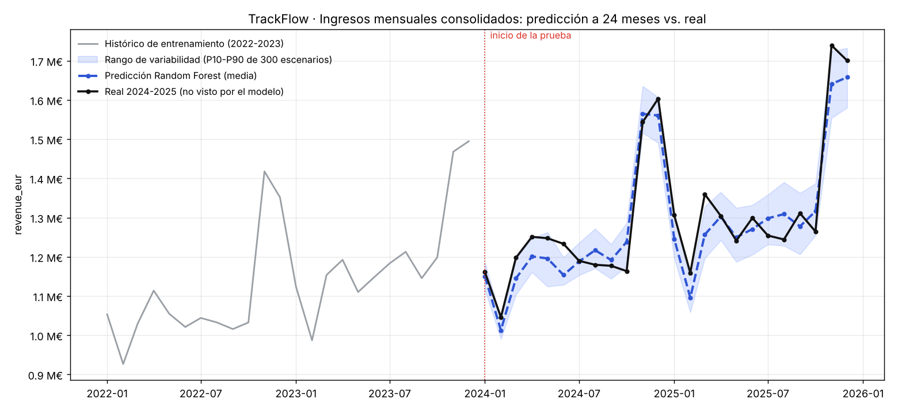

# Predicción de ventas de TrackFlow · Random Forest

Respuesta al ticket del tech lead (RFI de Finanzas): **¿podemos predecir los
ingresos de los próximos meses con un error aceptable antes de construir el
dashboard ejecutivo de Thomas?**

**Respuesta corta: sí.** Prediciendo 24 meses seguidos sin ver ni un solo dato
real de 2024-2025, el modelo se equivoca de media un **3,4 % al mes**
(≈ 44.600 € sobre un mes medio de 1,30 M€) y un **1,2-1,6 % en el total
anual**. Esa es la cifra que se puede llevar a Finanzas.

| Artefacto | Qué es |
|---|---|
| `scripts/sales_forecast.py` | Carga, limpieza, split 8/2, features, entrenamiento, pronóstico, métricas y gráfico |
| `docs/sales-forecast/forecast.png` | Predicción + rango de variabilidad frente a los reales de 2024-2025 |
| `docs/sales-forecast/metrics.json` | Todas las métricas (prueba, línea base y ajuste en entrenamiento) |
| `docs/sales-forecast/test_predictions.csv` | Mes a mes: predicción, P10, P90, real y línea base |
| `tests/pipelines/test_sales_forecast_split.py` | Split 8/2 y ausencia de fuga de datos |

```bash
python scripts/sales_forecast.py
python -m pytest tests/pipelines/test_sales_forecast_split.py
```

---

## 1. Datos (BRIEFING de TrackFlow)

- `data/raw/trackflow_sales.csv`, copiado **sin alterar** del syllabus de 4Geeks
  (`content/contexts/sales-forecasting/trackflow/trackflow_sales.csv`).
- Columnas exactas: `month`, `revenue_eur`, `shipments_processed`,
  `avg_revenue_per_shipment_eur`, `market`. Se usa la fila `consolidated`;
  el **target** es `revenue_eur`.
- 120 meses (2016-01 → 2025-12). Crecimiento anual que alterna ~9 % / ~3 %;
  pico de noviembre-diciembre (+25-35 %, Black Friday y Navidad) y valle de
  febrero (-10-15 %).

**Nulos.** El CSV entregado no tiene nulos ni meses faltantes (lo comprueba
`clean_sales` y queda en `metrics.json → dataset.cleaning`). Aun así el
pipeline los trata: reindexa a una serie mensual completa e **interpola en el
tiempo** entre los meses vecinos. No se usa la media global porque aplanaría
los picos estacionales. Un test lo verifica con un nulo y un mes borrado.

**Escalado.** Las features se escalan con `StandardScaler` dentro de un
`Pipeline` ajustado **solo con entrenamiento**. Random Forest es invariante a
la escala (cada corte compara una variable consigo misma), así que no cambia la
predicción; se deja para cumplir el requisito y para poder cambiar de modelo
sin tocar nada más. Lo que sí resuelve el problema de magnitudes es el target
en ratio (ver §3).

## 2. Split 8 años / 2 años

| Conjunto | Periodo | Meses |
|---|---|---|
| Entrenamiento | 2016-01 → 2023-12 | 96 (72 con features; los 24 primeros solo dan historia a los lags) |
| Prueba | 2024-01 → 2025-12 | 24 |

`split_train_test` corta por **años naturales** (no por posición) y falla si
el dataset no tiene exactamente 10 años o si algún mes de entrenamiento es
posterior a la prueba.

## 3. Modelo: por qué Random Forest y no XGBoost

| Criterio | Random Forest | XGBoost |
|---|---|---|
| Tamaño de datos (72 filas de entrenamiento) | Bagging: robusto con valores por defecto | Boosting: tiende a sobreajustar sin afinar learning rate, profundidad y early stopping, y no hay datos para validarlo bien |
| Explicabilidad para Finanzas | "300 árboles, cada uno con una muestra distinta del histórico; la predicción es su media" | Árboles secuenciales que corrigen al anterior: más difícil de contar |
| Rango de variabilidad | Sale gratis: el abanico de escenarios de los 300 árboles | Necesita modelos de cuantiles adicionales |
| Tiempo de ajuste | Sin búsqueda de hiperparámetros | Requiere tuning |

La prioridad del stakeholder es **explicabilidad y honestidad**, no exprimir
el último punto de precisión. XGBoost queda como siguiente paso si Finanzas
pide más precisión.

**El problema de los árboles con series que crecen.** Un árbol nunca predice
fuera del rango que vio, y todos los meses de 2024-2025 superan al mejor mes de
2016-2023. Si el target fuera `revenue_eur`, el modelo quedaría "pegado" al
techo de 2023. Por eso predice el **ratio interanual**
`revenue_t / revenue_{t-12}` (≈ 1,03-1,10, dentro del rango de
entrenamiento) y la cifra en euros se reconstruye multiplicando por el mismo
mes del año anterior.

**Features (todas causales: solo usan meses anteriores al que se predice).**

| Feature | Qué captura | Importancia |
|---|---|---|
| `yoy_same_month_last_year` | Crecimiento del mismo mes el año pasado → alternancia 9 % / 3 % | 0,52 |
| `seasonal_index_last_year` | Peso del mismo mes del año pasado sobre su media anual | 0,17 |
| `trailing_growth` | Crecimiento de los últimos 12 meses frente a los 12 anteriores | 0,12 |
| `yoy_last_month` | Crecimiento interanual del último mes conocido | 0,11 |
| `month_sin`, `month_cos` | Posición del mes en el calendario | 0,09 |
| `is_peak_season`, `is_february` | Pico nov-dic y valle de febrero del BRIEFING | < 0,01 |

Las marcas de calendario pesan poco porque el ratio interanual ya cancela la
estacionalidad: la estacionalidad entra a través de `revenue_{t-12}`.

**Semilla:** `random_state=42` (`RANDOM_STATE` en el script); un test comprueba
que dos entrenamientos dan exactamente la misma predicción.

## 4. Evaluación honesta

- **Pronóstico recursivo a 24 meses.** Para predecir, por ejemplo, marzo de
  2025 el modelo necesita marzo de 2024: usa **su propia predicción**, no el
  real. Es el escenario real de Finanzas: el modelo no conoce el futuro.
  Un test cambia los ingresos reales de 2024-2025 y comprueba que la
  predicción no se mueve ni un céntimo.
- **Línea base.** Se compara con el "naive estacional" (cada mes = el mismo mes
  del año anterior). Si el modelo no le gana, no aporta nada.
- **Ajuste en entrenamiento.** Se reporta solo para mostrar la diferencia entre
  memorizar el pasado y predecir el futuro.

| Métrica (conjunto de prueba 2024-2025) | Random Forest | Naive estacional | Ajuste en train |
|---|---|---|---|
| **MSE** | 2.728.405.048 EUR² | 15.355.054.004 EUR² | 346.408.269 EUR² |
| RMSE (√MSE) | 52.234 € · **4,0 % del ingreso medio** | 123.916 € · 9,5 % | 18.612 € · 1,8 % |
| MAE | 44.621 € | 103.201 € | 15.152 € |
| **MAPE** | **3,43 %** | 7,68 % | 1,47 % |
| **K2 Score (R²)** | **0,907** | 0,475 | 0,987 |
| **Gini normalizado** | **0,920** | 0,727 | 0,993 |
| Cobertura de la banda P10-P90 | 67 % (16 de 24 meses) | — | — |

Total anual: 2024 predicho 14,82 M€ frente a 14,99 M€ reales (-1,2 %);
2025 predicho 15,92 M€ frente a 16,18 M€ (-1,6 %).

**PSI (entrenamiento → prueba, 5 cortes por cuantiles de entrenamiento)**

| Variable | PSI | Lectura |
|---|---|---|
| `revenue_eur` | 5,89 | Cambio significativo **esperado**: es el crecimiento, no una anomalía. Por eso el modelo no predice euros directamente |
| `avg_revenue_per_shipment_eur` | 0,48 | Significativo sobre el papel, pero la media solo sube de 14,96 € a 15,18 € (+1,5 %); con 24 meses de prueba el PSI se infla. A vigilar |
| `target_yoy_ratio` (lo que aprende el modelo) | 0,13 | Moderado: 2024-2025 crecen 4 % y 8 %, dentro del rango 3-10 % visto en entrenamiento |
| Predicción vs. real en prueba | 0,04 | Estable: la distribución de lo predicho coincide con la real |

> **Mezcla Los Ángeles / Zaragoza.** El BRIEFING pide usar el PSI para detectar
> cambios en la mezcla entre países, pero el CSV entregado solo trae la fila
> `consolidated`: **no se puede calcular**. Se usa el ingreso por envío como
> indicador indirecto de la mezcla (los dos mercados tienen precios distintos) y
> se deja anotado para cuando lleguen las filas `us` y `spain` (referencia 60/40).

## 5. Qué mide cada métrica y por qué un MSE bajo no basta

- **MSE (error cuadrático medio).** Media de los errores al cuadrado, en EUR².
  Penaliza mucho los fallos grandes, pero sus unidades no se pueden explicar a
  Finanzas ("2.700 millones de euros al cuadrado"). Por eso se acompaña de su
  raíz (RMSE, en €) y del **% sobre el ingreso mensual medio**, como pide el
  BRIEFING.
- **MAPE (error porcentual medio).** "De media, nos equivocamos un 3,4 % al
  mes." Es **la métrica para Finanzas**: sin cajas negras.
- **K2 Score.** Se interpreta como el **R² (coeficiente de determinación)**,
  la métrica de regresión estándar de scikit-learn (`r2_score`); el enunciado
  no define "K2" y no existe una métrica con ese nombre en la librería. Mide qué
  parte de la variación mes a mes explica el modelo: 0,91 = el 91 %. 1 es
  perfecto; 0 es lo mismo que predecir siempre la media.
- **Gini normalizado.** Mide si el modelo **ordena** bien los meses (cuáles
  serán altos y cuáles bajos), aunque falle en el importe exacto. 0,92 significa
  que distingue con confianza un febrero normal de temporada baja de un mes de
  pico: lo que Thomas necesita para separar un valle esperado de una caída
  atípica. 1 = mismo orden que la realidad; 0 = al azar.
- **PSI (índice de estabilidad poblacional).** Compara la distribución de una
  variable entre entrenamiento y prueba. < 0,10 estable; 0,10-0,25 moderado;
  > 0,25 significativo. Avisa de que el mundo cambió y el modelo puede quedar
  desfasado aunque su error histórico fuera bueno.

**Por qué un MSE bajo no es suficiente:**

1. **Puede ser memoria.** En entrenamiento el MSE es 8 veces menor que en
   prueba (346 M frente a 2.728 M EUR²). Si solo hubiéramos reportado ese,
   habríamos prometido un error del 1,5 % que no es real.
2. **No tiene referencia.** Un MSE solo dice algo comparado con una línea base:
   aquí el modelo reduce el MSE del naive estacional un 82 %.
3. **No dice si el orden es correcto ni si el futuro se parece al pasado.** Eso
   lo cubren el Gini y el PSI.
4. **Esconde el sesgo.** El modelo **se queda corto** en 16 de 24 meses (total
   anual -1,2 % y -1,6 %): el MSE no distingue quedarse corto de pasarse, y para
   presupuestar sí importa.

## 6. Visualización



La línea discontinua es la predicción (media de 300 escenarios recursivos, uno
por árbol); el área azul, el rango entre el percentil 10 y el 90 de esos
escenarios; la línea negra, el real que el modelo no vio.

**Lectura honesta de la banda.** Una banda P10-P90 bien calibrada debería
contener ~80 % de los meses; contiene el 67 %. Los árboles se parecen entre sí
porque comparten historia, así que la banda es algo estrecha: hay que leerla
como "rango probable", no como garantía. Los fallos se concentran en primavera
y en el pico de noviembre de 2025 (-5,7 %).

## 7. Conclusión para Finanzas y siguientes pasos

- Es **viable**: error mensual medio del 3,4 % y anual del 1-2 %, la mitad que
  la regla "igual que el año pasado".
- El modelo tiende a **quedarse corto**: para presupuestar, usar la predicción
  como escenario prudente y el P90 como optimista.
- Siguientes pasos: reentrenar cada mes con el dato nuevo (pronóstico a 1-3
  meses, más preciso que a 24), recibir las filas `us`/`spain` para el PSI de
  mezcla y calibrar la banda con los residuos de una validación temporal.
