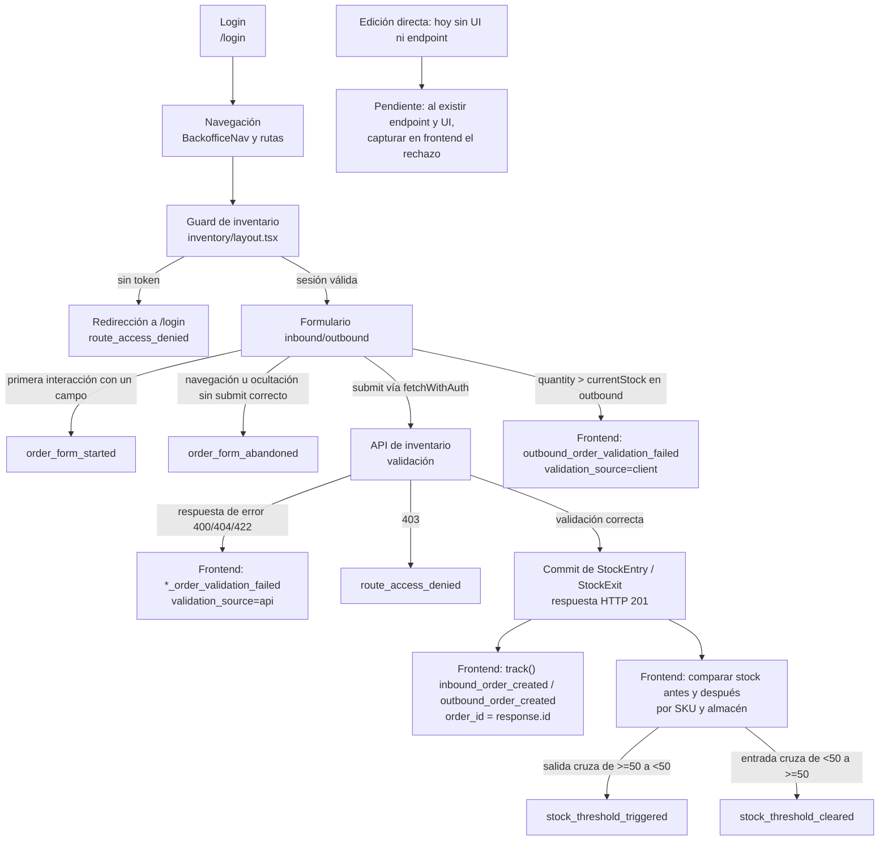

# Plan de telemetría de TrackFlow

## Índice

1. Contexto y alcance
2. Flujo de inventario
3. Catálogo de eventos
   3.1. Métricas obligatorias
   3.2. Oportunidades identificadas
   3.3. Oportunidades futuras de catálogo
   3.4. Resumen cuantitativo
4. Event Envelope
5. Convenciones de nombres, enums y versionado
6. Esquemas de eventos
7. Estrategia de entrega: stream y batch
8. Throttle y debounce
9. Privacidad y tratamiento de PII
10. Riesgos, eventos descartados y exclusiones
11. Mapeo previsto al almacenamiento
12. Guía de instrumentación por evento

## 1. Contexto y alcance

Este plan responde al RFI de TrackFlow: definir una telemetría de producto consistente para observar el inventario de sus almacenes de Los Ángeles y Zaragoza, y permitir decisiones operativas y ejecutivas basadas en datos agregables y comparables.

Los consumidores principales son:

- **Ana, Operaciones de Almacén:** planifica capacidad y personal, detecta cuellos de botella y prioriza auditorías.
- **Thomas, Dirección Ejecutiva:** compara volumen y SLA entre Estados Unidos y España.
- **Miguel, Comercial y Relación con Clientes:** identifica riesgos de rotura de stock y coordina avisos a clientes.
- **Andrés y Tecnología:** investigan errores y rendimiento y mantienen la instrumentación.

Los eventos de inventario se podrán agregar por **almacén**, **cliente**, **país**, **SKU** y **categoría de producto**. `country` se deriva del almacén (`los_angeles` → `US`, `zaragoza` → `ES`); `client_id` y `product_id` seguirán los mapeos provisionales documentados en §2 y sus discrepancias se conservarán visibles.

El alcance de este proyecto es el diseño de contratos y puntos de captura para el backoffice y la API de inventario. No implementa instrumentación, almacenamiento ni dashboards. Los eventos no incluirán datos de consumidores finales, transportistas o destinatarios; esos ámbitos quedan fuera de este plan.

## 2. Flujo de inventario

### 2.1 Recorrido y puntos de instrumentación



Los eventos de este plan se emitirán desde el backoffice con `track()` del futuro `TelemetryService`; esa instrumentación aún no está desplegada. El backend se reserva como fuente autoritativa recomendada a futuro, no como punto de captura de esta versión:

| Punto | Punto de captura (frontend, esta versión) | Fuente autoritativa futura (backend) | Condición de captura |
|---|---|---|---|
| Login correcto o fallido | `/login`, después del resultado de autenticación. | Resultado autoritativo futuro del endpoint de autenticación. | El evento no incluye email, nombre, contraseña ni hash. |
| Acceso a inventario sin sesión | `uis/backoffice/src/app/inventory/layout.tsx`, cuando el guard redirige a `/login`. | Resultado autoritativo futuro del control de sesión del backend, cuando aplique. | El guard no encuentra token. |
| Inicio o abandono de una orden | Formularios `uis/backoffice/src/app/inventory/orders/inbound/page.tsx` y `outbound/page.tsx`. | No aplica: interacción de interfaz sin equivalente autoritativo en backend. | `order_form_started` en la primera interacción con un campo; abandono tras `started` si el formulario se desmonta por navegación o se oculta la pestaña sin submit correcto. |
| Validación de orden por API | Catch del submit en los formularios inbound/outbound. | Resultado autoritativo futuro de validación en `services/api/routes/inventory.py`. | Capturar `*_order_validation_failed` ante `ApiError` HTTP 400, 404 o 422; `validation_source: api`. |
| Validación local de outbound | `uis/backoffice/src/app/inventory/orders/outbound/page.tsx`, antes de llamar a la API. | No aplica: validación local de interfaz. | Capturar `outbound_order_validation_failed` cuando `quantity > currentStock`; `validation_source: client`. |
| Creación de inbound/outbound | `inbound/page.tsx` y `outbound/page.tsx`, después de respuesta HTTP 201 de `createInboundOrder` / `createOutboundOrder`; `order_id` sale del `id` de la respuesta. | `services/api/routes/inventory.py` y el commit de `StockEntry` / `StockExit`, como fuente autoritativa futura. | Emitir `inbound_order_created` o `outbound_order_created` solo tras éxito. |
| Cambio de umbral | Frontend después de respuesta HTTP 201, comparando el stock previo y posterior por SKU y almacén. `outbound/page.tsx` ya dispone de `stockIndex`; `inbound/page.tsx` no tiene cálculo equivalente y deberá incorporarlo como requisito de captura. | Balance autoritativo futuro tras el commit en `services/api/routes/inventory.py`. | Emitir solo al cruzar el umbral global de 50; no repetir mientras el stock permanezca en el mismo lado. |
| Rechazo de edición directa | Captura frontend pendiente: al existir UI y endpoint, emitir al recibir el rechazo. Hoy no hay UI ni endpoint. | Futuro endpoint que rechace la modificación directa, aún inexistente. | `direct_stock_edit_rejected` permanece pendiente de implementar; no registrar el cuerpo de la petición. |
| Discrepancia de inventario | Captura frontend pendiente: cuando exista conteo, emitir al recibir su resultado. Hoy no hay UI ni endpoint. | Resultado autoritativo futuro del conteo físico/auditoría, aún inexistente. | `inventory_discrepancy_detected` permanece pendiente de implementar. |
| Denegación de acceso | `uis/backoffice/src/lib/api.ts` (`fetchWithAuth`) ante HTTP 403 y guard de `uis/backoffice/src/app/inventory/layout.tsx` cuando falta token. | Resultado autoritativo futuro de autenticación/autorización del backend para HTTP 403. | Usar los motivos acotados de §3.2; no copiar el detalle literal de la API. |

### 2.2 Decisiones de auditoría incorporadas

- **D2 — `userId`:** string opaco con el identificador interno que devuelve `_user_uuid`: UUID cuando existe o, en su defecto, ID de TinyDB convertido a texto. Nunca email ni nombre. En el contrato será `type: string`, `minLength: 1`, sin `format: uuid`; se anota como discrepancia y conviene unificar el identificador a UUID en el futuro.
- **D15 — `product_category`:** `Apparel` y `Accessories` se normalizan a `fashion`; `Electronics` a `electronics`; `Beauty` a `cosmetics`. `Home`, `Sports`, `Packaging` y `Toys` aparecen solo en SKUs sintéticos `LOAD-` pendientes de purga: no emitir eventos para esos SKUs. El enum permanece limitado a `fashion`, `electronics` y `cosmetics`; se registrará en §10 el riesgo de catálogo y la recomendación de normalizarlo a las tres categorías del BRIEFING.
- **D16 — umbral:** hasta que exista configuración por cliente, el mínimo es el valor global 50 (`LOW_STOCK_THRESHOLD` en `uis/backoffice/src/app/inventory/products/page.tsx`) con `threshold_source: global_default`. `stock_threshold_triggered` añade `min_threshold` (integer) y `threshold_source` (`global_default` | `client_config`). Se emite después del commit de una salida solo al cruzar de `>=` a `<`; `stock_threshold_cleared` se emite después del commit de una entrada al cruzar de `<` a `>=`. No se repite mientras el stock siga bajo. No existe mínimo por cliente; el umbral global deja el evento obligatorio implementable ahora.
- **D17 — búsqueda:** no existe búsqueda de inventario en el backoffice. `inventory_search_performed` pasa a §3.3 como oportunidad futura de catálogo, sin captura ni esquema en esta versión.
- **D18 — formularios:** `order_form_started` comienza con la primera interacción con un campo. `order_form_abandoned` requiere un `started` previo y se produce al desmontar el formulario por navegación o al ocultarse la pestaña sin submit correcto. Sus propiedades serán `order_kind` (`inbound` | `outbound`), `last_field_touched` (nombre lógico del campo, nunca su valor), `fields_completed` (integer) y `time_in_form_ms` (integer).
- **D19 — acceso denegado:** se captura en `fetchWithAuth` ante HTTP 403 y en el guard de `uis/backoffice/src/app/inventory/layout.tsx` cuando falta token y se redirige a `/login`. Propiedades: `route` (plantilla sin query params, obligatoria), `reason` (`insufficient_permissions` | `inactive_user` | `no_session`, obligatoria) y `api_endpoint` (plantilla opcional, solo para 403). Nunca se copia el `detail` literal de la API ni información del usuario. La respuesta 403 cubre “Inactive user” (`auth.py`) y “Insufficient permissions” (`users.py`/`profiles.py`); entrega stream, nivel `warn`.
- **D20 — `requestId`:** hoy no existe `X-Request-ID` en cliente ni backend. En la futura captura, el servicio de telemetría genera un UUID por llamada en `fetchWithAuth`, lo envía en esa cabecera y asigna ese mismo `requestId` a los eventos nacidos de la llamada. Se recomienda que el middleware de `services/api/main.py` lea la cabecera y la registre en logs. Ese middleware registra hoy la ruta con query string; la telemetría usará siempre plantillas sin query params, riesgo que se desarrollará en §10.
- **D21 — emisor en esta versión:** todos los eventos de este plan se emitirán desde el backoffice mediante `track()` del futuro `TelemetryService`; esto es un requisito del siguiente proyecto, no instrumentación ya existente. El backend no es el punto de captura de esta versión: queda como fuente autoritativa recomendada a futuro cuando el evento tenga un resultado de negocio equivalente.

## 3. Catálogo de eventos

### 3.1 Métricas obligatorias del BRIEFING

Todos los eventos de inventario requieren `warehouse`, `client_id`, `product_id`, `product_category`, `quantity` y `country`, además del envelope común. `warehouse` usa `los_angeles` o `zaragoza`; `country` se deriva como `US` o `ES`. `client_id` es el slug provisional derivado de `client_name`; `product_id` es el código `sku`, no el ID entero de la tabla. Las categorías se normalizan según D15 y el enum no admite valores fuera de `fashion`, `electronics` y `cosmetics`.

| `event_type` | Categoría | Origen | Punto de captura (frontend, esta versión) | Fuente autoritativa futura (backend) | Propiedades adicionales y semántica de `quantity` | Entrega | Regla de oro |
|---|---|---|---|---|---|---|---|
| `inbound_order_created` | Negocio/inventario | Obligatorio (BRIEFING) | `uis/backoffice/src/app/inventory/orders/inbound/page.tsx`, tras la respuesta HTTP 201 de `createInboundOrder`; `order_id` es el `id` de la respuesta. | `services/api/routes/inventory.py` y commit de `StockEntry`. | `order_id`, `country`. `quantity` son las unidades de la orden, que hoy contiene un único SKU. | Batch (horario) | Capturamos `inbound_order_created` porque necesitamos saber cuánto inventario entra por almacén, cliente y país, lo que nos permite planificar la capacidad y el personal del almacén. |
| `outbound_order_created` | Negocio/inventario | Obligatorio (BRIEFING) | `uis/backoffice/src/app/inventory/orders/outbound/page.tsx`, tras la respuesta HTTP 201 de `createOutboundOrder`; `order_id` es el `id` de la respuesta. | `services/api/routes/inventory.py` y commit de `StockExit`. | `order_id`, `exit_type`, `country`. `quantity` son las unidades despachadas de la orden, que hoy contiene un único SKU. Se excluyen `tracking_number` y los datos del destinatario. | Stream | Capturamos `outbound_order_created` porque necesitamos detectar el volumen y el ritmo de despacho por almacén, cliente y país, lo que nos permite identificar cuellos de botella antes de que afecten al SLA de entrega. |
| `stock_threshold_triggered` | Negocio/inventario | Obligatorio (BRIEFING) | Frontend outbound tras respuesta HTTP 201, al comparar stock previo y posterior del SKU en ese almacén. El `stockIndex` actual permite calcular el stock; el evento aún requiere instrumentación. | Balance autoritativo futuro tras el commit de `StockExit` en `services/api/routes/inventory.py`. | `min_threshold` (integer), `threshold_source` (`global_default` \| `client_config`), `trigger_order_id`, `country`. `quantity` es el stock resultante tras la orden que provocó el cruce. Umbral global 50; no existe mínimo configurable por cliente. No se repite mientras siga por debajo del umbral. | Stream | Capturamos `stock_threshold_triggered` porque necesitamos saber cuándo un SKU cruza su mínimo de stock, lo que nos permite avisar al cliente y al equipo comercial antes de una rotura de stock. |
| `direct_stock_edit_rejected` | Negocio/seguridad | Obligatorio (BRIEFING) | Pendiente de implementar: cuando existan UI y endpoint, el frontend capturará el rechazo recibido. Hoy no hay UI ni endpoint de edición directa. | Futuro endpoint que rechace la modificación directa, aún inexistente. | `rejection_reason`, `attempted_delta`, `country`. `quantity` representa la cantidad que se intentó fijar; `attempted_delta` puede expresar el cambio intentado. No registrar el cuerpo de la petición. | Batch (diario) | Capturamos `direct_stock_edit_rejected` porque necesitamos saber dónde se intenta modificar stock fuera de una orden, lo que nos permite reforzar la formación o revisar permisos en los almacenes donde más ocurre. |
| `inventory_discrepancy_detected` | Negocio/inventario | Obligatorio (BRIEFING) | Pendiente de implementar: cuando exista conteo, el frontend capturará el resultado recibido. Hoy no hay UI ni endpoint para conteo físico/auditoría. | Resultado autoritativo futuro del conteo físico/auditoría, aún inexistente. | `system_quantity`, `counted_quantity`, `detection_source`, `country`. `quantity` es `counted_quantity - system_quantity`, con signo. | Batch (diario) | Capturamos `inventory_discrepancy_detected` porque necesitamos conocer las diferencias entre el stock registrado y el real, lo que nos permite priorizar auditorías en los SKUs con mayor tasa de discrepancia. |

Si en el futuro una orden contiene varias líneas, se emitirá un evento por línea, conservando el mismo `order_id`. Los esquemas y allowlists completos de estos eventos se detallan en la Fase 2.

### 3.2 Oportunidades identificadas

`inbound_order_validation_failed` y `outbound_order_validation_failed` incluyen `validation_source` con el enum `client` | `api`, para distinguir la validación local de la respuesta de la API.

#### Negocio, inventario y UX de órdenes

| `event_type` | Categoría | Origen | Hipótesis y decisión | Punto de captura (frontend, esta versión) | Fuente autoritativa futura (backend) | Entrega | Regla de oro |
|---|---|---|---|---|---|---|---|
| `inbound_order_validation_failed` | Negocio/calidad de datos | Oportunidad identificada | Los errores de recepción se concentran en ciertos SKUs o clientes; corregir los maestros de producto o formar al cliente. | Catch del submit inbound ante `ApiError` HTTP 400, 404 o 422; propiedad prevista `validation_source: api`. | Resultado autoritativo futuro de validación en `services/api/routes/inventory.py`. | Batch (diario) | Capturamos `inbound_order_validation_failed` porque necesitamos saber qué datos de recepción fallan y con qué frecuencia, lo que nos permite corregir los maestros de producto o formar al cliente. |
| `outbound_order_validation_failed` | Negocio/calidad de datos | Oportunidad identificada | Los errores de salida, en especial `insufficient_stock`, identifican SKUs que se intentan despachar sin existencias; revisar disponibilidad y operación. | `outbound/page.tsx`: capturar en la validación local cuando `quantity > currentStock` (`validation_source: client`) y en el catch ante `ApiError` HTTP 400, 404 o 422 (`validation_source: api`). No copiar mensajes literales. | Resultado autoritativo futuro de validación en `services/api/routes/inventory.py`; la validación local no tiene equivalente backend. | Batch (diario) | Capturamos `outbound_order_validation_failed` porque necesitamos identificar qué SKUs se intentan despachar sin stock y qué validaciones fallan, lo que nos permite corregir disponibilidad y procesos de salida. |
| `order_form_started` | UX/flujos | Oportunidad identificada | Medir cuántos formularios iniciados llegan a submit correcto; detectar fricción por tipo de orden. | Formularios inbound/outbound; disparar en la primera interacción con un campo, nunca al renderizar. | No aplica: evento exclusivo de interacción de interfaz. | Batch (diario) | Capturamos `order_form_started` porque necesitamos conocer cuántas órdenes empieza a registrar el personal, lo que nos permite medir el abandono y priorizar mejoras del formulario. |
| `order_form_abandoned` | UX/flujos | Oportunidad identificada | Localizar el paso en que se abandonan órdenes y simplificarlo; `last_field_touched` contiene solo el nombre del campo, nunca su valor. | Formularios inbound/outbound; requiere `order_form_started` previo y se dispara al desmontar por navegación o al ocultarse la pestaña sin submit correcto. Propiedades previstas: `order_kind` (`inbound` \| `outbound`), `last_field_touched` (string), `fields_completed` (integer), `time_in_form_ms` (integer). | No aplica: evento exclusivo de interacción de interfaz. | Batch (diario) | Capturamos `order_form_abandoned` porque necesitamos saber en qué paso se dejan incompletas las órdenes, lo que nos permite simplificar ese paso del formulario. |
| `stock_threshold_cleared` | Negocio/inventario | Oportunidad identificada | Medir cuánto tarda un SKU en reponerse tras la alerta y establecer un SLA de reposición con cada cliente. | Frontend inbound tras respuesta HTTP 201, comparando stock previo y posterior por SKU y almacén. `inbound/page.tsx` no dispone de cálculo equivalente y deberá incorporarlo como requisito de captura; rige el umbral global de 50. | Balance autoritativo futuro tras el commit de `StockEntry` en `services/api/routes/inventory.py`. | Stream (cierra la alerta) | Capturamos `stock_threshold_cleared` porque necesitamos saber cuándo se repone un SKU que estaba bajo el umbral y cuánto tarda, lo que nos permite medir el SLA de reposición con cada cliente. |

`inventory_search_performed` no forma parte de estas oportunidades identificadas: el backoffice no tiene búsqueda y el evento queda solo en el catálogo futuro de §3.3 (D17).

#### Autenticación y seguridad

| `event_type` | Categoría | Origen | Hipótesis y decisión | Punto de captura (frontend, esta versión) | Fuente autoritativa futura (backend) | Entrega | Regla de oro |
|---|---|---|---|---|---|---|---|
| `user_login_succeeded` | Autenticación | Oportunidad identificada | Comparar el uso real del backoffice por almacén y detectar dónde hace falta formación. | `/login`, después de respuesta correcta y almacenamiento del token; rotar `sessionId` en el login correcto. Usar `userId` opaco según D2. | Resultado autoritativo futuro del endpoint de autenticación. | Batch (diario) | Capturamos `user_login_succeeded` porque necesitamos saber qué almacenes usan el backoffice, lo que nos permite dirigir la formación a los equipos que lo usan menos. |
| `user_login_failed` | Autenticación/seguridad | Oportunidad identificada | Detectar picos de fallos que puedan indicar fuerza bruta o problemas de credenciales. | `/login`, ante un fallo de autenticación; `failure_reason` solo puede ser `invalid_credentials`, `session_expired`, `network_error` o `account_locked`. No capturar email, contraseña, hash ni el detalle literal. | Resultado autoritativo futuro del endpoint de autenticación. | Stream | Capturamos `user_login_failed` porque necesitamos detectar picos de intentos fallidos sin exponer credenciales, lo que nos permite investigar actividad sospechosa o problemas de acceso. |
| `session_expired` | Autenticación | Oportunidad identificada | Saber si las sesiones caducan durante una orden y ajustar el TTL de sesión. | `uis/backoffice/src/lib/api.ts` (`fetchWithAuth`), respuesta HTTP 401 de una llamada protegida antes de limpiar tokens y redirigir a `/login`. | Resultado autoritativo futuro de autenticación del endpoint protegido. | Batch (diario) | Capturamos `session_expired` porque necesitamos saber si las sesiones caducan mientras se trabaja en una orden, lo que nos permite ajustar su duración. |
| `user_logged_out` | Autenticación | Oportunidad identificada | Medir duración de sesión y dimensionar turnos y TTL. | `uis/backoffice/src/components/BackofficeNav.tsx`, en `handleLogout` antes de eliminar el token y navegar a `/login`. | No aplica: acción de interfaz sin resultado autoritativo en backend. | Batch (diario) | Capturamos `user_logged_out` porque necesitamos conocer la duración de las sesiones operativas, lo que nos permite dimensionar turnos y ajustar el TTL. |
| `route_access_denied` | Seguridad/permisos | Oportunidad identificada | Detectar intentos de entrar en secciones sin permiso y revisar roles. | `fetchWithAuth` ante HTTP 403 y guard `uis/backoffice/src/app/inventory/layout.tsx` cuando falta token y redirige. Propiedades: `route` (plantilla sin query params), `reason` (`insufficient_permissions` \| `inactive_user` \| `no_session`) y `api_endpoint` (plantilla opcional, solo para 403). Nunca incluir el `detail` literal ni datos de usuario. | Resultado autoritativo futuro de autenticación/autorización para HTTP 403. | Stream | Capturamos `route_access_denied` porque necesitamos saber cuándo se intenta acceder a una ruta sin autorización, lo que nos permite revisar permisos y roles en el backoffice. |

#### Rendimiento, errores y navegación

| `event_type` | Categoría | Origen | Hipótesis y decisión | Punto de captura (frontend, esta versión) | Fuente autoritativa futura (backend) | Entrega | Regla de oro |
|---|---|---|---|---|---|---|---|
| `page_viewed` | Navegación | Oportunidad identificada | Identificar las secciones del backoffice más y menos utilizadas para priorizar mejoras. | Cambio de ruta en el backoffice; capturar la ruta como plantilla, sin query params. No existe aún instrumentación de vistas. | No aplica: evento exclusivo de navegación en interfaz. | Batch (diario) | Capturamos `page_viewed` porque necesitamos saber qué secciones usan los operadores, lo que nos permite priorizar mejoras del backoffice. |
| `api_latency_recorded` | Rendimiento | Oportunidad identificada | Identificar endpoints lentos por p95 y priorizar optimización o caché. | `uis/backoffice/src/lib/api.ts` (`fetchWithAuth`), medir duración de cada llamada y conservar solo la plantilla del endpoint. | El middleware de `services/api/main.py` aporta la fuente futura de timing del servidor. | Batch (ventanas de 5 min) | Capturamos `api_latency_recorded` porque necesitamos comparar la latencia de los endpoints por operación, lo que nos permite priorizar optimizaciones que mejoren el servicio. |
| `web_vital_recorded` | Rendimiento | Oportunidad identificada | Comparar LCP, INP y CLS por ruta para priorizar mejoras de experiencia web. | Punto futuro: integración de medición de Web Vitals en el backoffice; no existe `reportWebVitals` actualmente. La ruta se registra como plantilla. | No aplica: métrica de rendimiento percibido en interfaz. | Batch (diario) | Capturamos `web_vital_recorded` porque necesitamos conocer el rendimiento percibido por ruta, lo que nos permite priorizar mejoras frontend. |
| `frontend_error_captured` | Errores | Oportunidad identificada | Detectar errores JavaScript no capturados tras un despliegue y decidir rollback o hotfix. | Punto futuro: Error Boundary global y captura de errores no controlados; no existe un Error Boundary global localizado. Mensaje sanitizado y truncado, y stack reducido a `archivo:línea`, según §6. | No aplica: error originado en la interfaz. | Stream | Capturamos `frontend_error_captured` porque necesitamos detectar errores de interfaz después de un despliegue, lo que nos permite decidir si aplicar un hotfix o revertirlo. |
| `api_request_failed` | Errores | Oportunidad identificada | Detectar errores 5xx o fallos de red antes de que lleguen como tickets de usuario. | `uis/backoffice/src/lib/api.ts` (`fetchWithAuth`), para respuestas 5xx y fallos de red; separar los 401/403 y los errores de validación que tienen eventos específicos. No incluir mensajes literales ni payloads. | Estado y logs del servidor como fuente futura para respuestas HTTP; no aplica a fallos de red sin respuesta. | Stream | Capturamos `api_request_failed` porque necesitamos detectar fallos de API o de red que afectan al backoffice, lo que nos permite investigar la incidencia antes de que llegue un ticket. |

Con las cinco oportunidades de negocio/UX, las cinco de autenticación/seguridad y estas cinco oportunidades técnicas, el catálogo contiene **15 oportunidades identificadas con esquema previsto para la Fase 2**, además de las cinco métricas obligatorias. `inventory_search_performed` queda fuera de este total, en §3.3.

### 3.3 Oportunidades futuras de catálogo

Estos eventos quedan como hipótesis de versiones futuras y no forman parte de las 15 oportunidades con esquema de esta versión:

| `event_type` | Estado frente al código | Hipótesis y decisión | Regla de oro |
|---|---|---|---|
| `product_min_threshold_updated` | Futuro: no existe mínimo configurable por cliente. | Auditar cambios de mínimos cuando se incorpore esa configuración; atribuirlos al usuario sin guardar PII. | Capturamos `product_min_threshold_updated` porque necesitamos saber quién cambia los mínimos y cuándo, lo que nos permite auditar la configuración de alertas por cliente. |
| `product_created` | Existe `POST /inventory/products`, pero no hay captura de telemetría prevista en esta versión. | Medir el alta de SKUs y detectar problemas de calidad o incorporación de catálogo. | Capturamos `product_created` porque necesitamos conocer cuándo se incorporan SKUs, lo que nos permite mejorar la calidad del catálogo y el proceso de alta. |
| `order_list_filtered` | Futuro: no hay filtro de historial considerado en este diseño. | Saber qué filtros facilitan encontrar órdenes y priorizar mejoras del historial. | Capturamos `order_list_filtered` porque necesitamos saber cómo se consulta el historial, lo que nos permite priorizar los filtros que más ayudan a la operación. |
| `inventory_export_downloaded` | Futuro: no se ha identificado una función de exportación en el alcance revisado. | Medir demanda de exportaciones y decidir qué informes facilitar a operaciones. | Capturamos `inventory_export_downloaded` porque necesitamos saber cuándo se requiere extraer inventario, lo que nos permite priorizar informes útiles para operaciones. |
| `warehouse_view_switched` | Futuro: el selector de almacén de un formulario no es una vista de almacén ni un dashboard. | Comparar el uso de vistas operativas por almacén y mejorar la navegación. | Capturamos `warehouse_view_switched` porque necesitamos saber qué vistas de almacén consulta cada operador, lo que nos permite mejorar la navegación entre operaciones. |
| `telemetry_batch_discarded` | Futuro: aún no existe el servicio de telemetría ni su política de reintentos. | Hacer visible la pérdida de lotes tras agotar reintentos y detectar problemas de entrega. | Capturamos `telemetry_batch_discarded` porque necesitamos saber cuándo se pierden eventos tras reintentos, lo que nos permite investigar fallos de entrega de telemetría. |
| `inventory_search_performed` | Futuro: no existe búsqueda en el backoffice; no emitir eventos de búsqueda en esta versión. | Analizar búsquedas sin resultados cuando se implemente la función; limitar las propiedades futuras a `query_length` y `results_count`, nunca al texto buscado. | Capturamos `inventory_search_performed` porque necesitamos saber si las búsquedas encuentran productos, lo que nos permite mejorar el buscador o los maestros de SKU. |

### 3.4 Resumen cuantitativo

El catálogo de esta versión contiene **20 eventos con esquema**: **5 obligatorios** del BRIEFING y **15 oportunidades identificadas**. Además, §3.3 registra **7 eventos de catálogo futuro**, sin esquema en esta versión.

| Categoría | Eventos con esquema |
|---|---:|
| Negocio/inventario | 5 |
| Negocio/seguridad | 1 |
| Negocio/calidad de datos | 2 |
| UX/flujos | 2 |
| Autenticación | 3 |
| Autenticación/seguridad | 1 |
| Seguridad/permisos | 1 |
| Navegación | 1 |
| Rendimiento | 2 |
| Errores | 2 |
| **Total** | **20** |

## 4. Event Envelope

Cada evento usa el mismo envelope. El futuro `TelemetryService` genera y valida los campos comunes; el punto de captura solo le proporciona el contexto de la acción y las propiedades permitidas. El componente no genera identificadores del envelope ni la marca temporal.

| Campo | Tipo y formato | Obligatorio | Generación y reglas |
|---|---|---:|---|
| `eventId` | `string`, UUID | Sí | UUID único generado por `TelemetryService` para cada evento. |
| `timestamp` | `string`, ISO 8601 UTC con milisegundos (`YYYY-MM-DDTHH:mm:ss.sssZ`) | Sí | Momento de captura generado por `TelemetryService`, no momento de envío. |
| `sessionId` | `string`, UUID | Sí | Lo genera el servicio al cargar la aplicación; se rota tras un login correcto. |
| `userId` | `string` opaco o `null` antes de autenticarse | Sí | Lo obtiene el servicio del contexto autenticado; nunca email ni nombre. No se fuerza formato UUID porque el identificador real puede proceder del ID de TinyDB convertido a texto (D2). |
| `event_type` | `string`, taxonomía `entidad_acción` | Sí | Constante del contrato del evento, fijada por `TelemetryService`. |
| `schemaVersion` | `string`, semver | Sí | Valor compartido constante: `1.0.0`. |
| `requestId` | `string`, UUID | Sí | En eventos de API, el mismo UUID que `X-Request-ID`; para eventos solo de interfaz, UUID nuevo generado por el servicio. |
| `properties` | `object`, allowlist específica del evento | Sí | El servicio valida las propiedades contra el esquema del evento y descarta claves no permitidas; nunca se envían propiedades arbitrarias. |

`properties` contiene los datos de negocio del evento, no otro envelope. Todas sus claves y tipos están definidos por evento en §6 y en `event-schemas.json`.

Ejemplo completo:

```json
{
  "eventId": "550e8400-e29b-41d4-a716-446655440000",
  "timestamp": "2026-11-18T12:34:56.789Z",
  "sessionId": "550e8400-e29b-41d4-a716-446655440001",
  "userId": "usr_7b2c9f",
  "event_type": "outbound_order_created",
  "schemaVersion": "1.0.0",
  "requestId": "550e8400-e29b-41d4-a716-446655440002",
  "properties": {
    "warehouse": "los_angeles",
    "client_id": "nova_beauty",
    "product_id": "TF-COS-001",
    "product_category": "cosmetics",
    "quantity": 12,
    "country": "US",
    "order_id": 381,
    "exit_type": "B2C Order"
  }
}
```

## 5. Convenciones de nombres, enums y versionado

### Taxonomía

`event_type` sigue `entidad_acción`: minúsculas ASCII separadas por `_`, con el verbo en participio pasado y perteneciente al conjunto cerrado definido en D7. La expresión regular es `^[a-z]+(_[a-z]+)+$`; ejemplos válidos son `inbound_order_created`, `stock_threshold_cleared` y `user_logged_out`. No se crean sinónimos ni variantes de un evento ya definido.

### Enums y tipos compartidos

| Propiedad | Tipo | Valores o regla |
|---|---|---|
| `warehouse` | `string` | `los_angeles` \| `zaragoza`; normalizar los valores reales `Los Angeles` y `Zaragoza`. |
| `country` | `string` | `US` \| `ES`; derivar de `warehouse` (`los_angeles` → `US`, `zaragoza` → `ES`). |
| `product_category` | `string` | `fashion` \| `electronics` \| `cosmetics`; normalizar el catálogo real según D15 y excluir los SKUs sintéticos `LOAD-`. |
| `client_id` | `string` | Slug estable en minúsculas, espacios convertidos en `_` (`Nova Beauty` → `nova_beauty`), hasta que exista un ID propio de cliente (D11). |
| `product_id` | `string` | Código `sku` (`TF-ELEC-001`), nunca el ID entero de la tabla (D12). |
| `quantity` | `integer` | Unidades; su semántica se documenta por evento. En discrepancias puede ser negativo (`counted_quantity - system_quantity`). |
| `validation_source` | `string` | `client` \| `api`; fuente de la validación de una orden. |
| `order_kind` | `string` | `inbound` \| `outbound`. |
| `threshold_source` | `string` | `global_default` \| `client_config`; el valor actual es `global_default`. |

Los enums propios de autenticación, permisos, errores, conteos y tipo de salida se definen en §6 y se cierran en el esquema correspondiente. Los campos `client_id` y `product_id` no contienen nombres libres adicionales ni datos del consumidor final.

### Allowlist y versionado

Cada `properties` tiene un allowlist explícito y `additionalProperties: false`. Una instrumentación solo envía las claves definidas para su `event_type`; no copia objetos de API, datos de formulario ni errores sin clasificar.

`schemaVersion` es semver compartido, inicialmente `1.0.0`. Añadir una propiedad permitida es un cambio minor; cambiar el tipo o eliminar una propiedad es un cambio major. El valor se mantiene constante entre eventos para una misma versión de contrato.

## 6. Esquemas de eventos

Las tablas siguientes especifican los allowlists de `properties`. Los campos mínimos de inventario se repiten en cada evento aplicable: `warehouse`, `client_id`, `product_id`, `product_category`, `quantity` y `country` son obligatorios (BRIEFING y D1). `client_id` es el slug provisional (D11), `product_id` es el código SKU (D12), y las categorías se normalizan según D13/D15.

### 6.1 Métricas obligatorias

#### `inbound_order_created`

- **Descripción:** recepción de inventario completada para un único SKU.
- **Disparo:** después de la respuesta HTTP 201 de `createInboundOrder`; `order_id` procede del `id` de esa respuesta.

| Propiedad | Tipo | Obligatoria | Descripción | Ejemplo |
|---|---|---:|---|---|
| `warehouse` | enum `los_angeles` \| `zaragoza` | Sí | Almacén receptor, normalizado. | `los_angeles` |
| `client_id` | string slug | Sí | Marca propietaria del SKU, sin nombre libre. | `nova_beauty` |
| `product_id` | string | Sí | Código SKU, no ID interno. | `TF-COS-001` |
| `product_category` | enum `fashion` \| `electronics` \| `cosmetics` | Sí | Categoría normalizada. | `cosmetics` |
| `quantity` | integer ≥ 1 | Sí | Unidades recibidas en la orden. | `12` |
| `country` | enum `US` \| `ES` | Sí | País derivado de `warehouse`. | `US` |
| `order_id` | integer ≥ 1 | Sí | `id` devuelto por la respuesta de creación. | `381` |

**Allowlist:** `warehouse`, `client_id`, `product_id`, `product_category`, `quantity`, `country`, `order_id`. **PII:** no en las propiedades; el `userId` opaco del envelope es seudónimo. No enviar nombre/email, consumidor final, transportista ni destinatario.
**Nivel:** `info`. **Propiedad `value`:** `quantity`.

#### `outbound_order_created`

- **Descripción:** despacho completado para un único SKU.
- **Disparo:** después de la respuesta HTTP 201 de `createOutboundOrder`; `order_id` procede del `id` de esa respuesta.

| Propiedad | Tipo | Obligatoria | Descripción | Ejemplo |
|---|---|---:|---|---|
| `warehouse` | enum `los_angeles` \| `zaragoza` | Sí | Almacén de salida, normalizado. | `zaragoza` |
| `client_id` | string slug | Sí | Marca propietaria del SKU. | `nova_beauty` |
| `product_id` | string | Sí | Código SKU, no ID interno. | `TF-COS-001` |
| `product_category` | enum `fashion` \| `electronics` \| `cosmetics` | Sí | Categoría normalizada. | `cosmetics` |
| `quantity` | integer ≥ 1 | Sí | Unidades despachadas. | `3` |
| `country` | enum `US` \| `ES` | Sí | País derivado de `warehouse`. | `ES` |
| `order_id` | integer ≥ 1 | Sí | `id` devuelto por la respuesta de creación. | `382` |
| `exit_type` | enum `B2C Order` \| `B2B Transfer` \| `Return / Damaged` | Sí | Tipo de salida; no incluir tracking ni datos del destinatario (D14). | `B2C Order` |

**Allowlist:** `warehouse`, `client_id`, `product_id`, `product_category`, `quantity`, `country`, `order_id`, `exit_type`. **PII:** no en las propiedades; `userId` es seudónimo en el envelope. Excluir `tracking_number`, transportista y destinatario.
**Nivel:** `info`. **Propiedad `value`:** `quantity`.

#### `stock_threshold_triggered`

- **Descripción:** el stock cae por debajo del umbral vigente.
- **Disparo:** después de la respuesta HTTP 201 outbound, solo si el stock previo era `>= min_threshold` y el posterior es `< min_threshold`. En esta versión el umbral es global 50.

| Propiedad | Tipo | Obligatoria | Descripción | Ejemplo |
|---|---|---:|---|---|
| `warehouse` | enum `los_angeles` \| `zaragoza` | Sí | Almacén del SKU, normalizado. | `los_angeles` |
| `client_id` | string slug | Sí | Marca propietaria del SKU. | `nova_beauty` |
| `product_id` | string | Sí | Código SKU. | `TF-COS-001` |
| `product_category` | enum `fashion` \| `electronics` \| `cosmetics` | Sí | Categoría normalizada. | `cosmetics` |
| `quantity` | integer ≥ 0 | Sí | Stock resultante después de la orden. | `49` |
| `country` | enum `US` \| `ES` | Sí | País derivado de `warehouse`. | `US` |
| `min_threshold` | integer ≥ 0 | Sí | Mínimo usado para evaluar el cruce. | `50` |
| `threshold_source` | enum `global_default` \| `client_config` | Sí | Origen del mínimo; hoy siempre `global_default`. | `global_default` |
| `trigger_order_id` | integer ≥ 1 | Sí | Orden outbound cuya aplicación produjo el cruce. | `383` |

**Allowlist:** `warehouse`, `client_id`, `product_id`, `product_category`, `quantity`, `country`, `min_threshold`, `threshold_source`, `trigger_order_id`. **PII:** no en las propiedades; `userId` es seudónimo. No agregar datos libres del cliente.
**Nivel:** `warn`. **Propiedad `value`:** `quantity`.

#### `direct_stock_edit_rejected`

- **Descripción:** intento de fijar stock fuera de una orden que el sistema rechaza.
- **Disparo:** pendiente de implementar; no existe UI ni endpoint. Cuando existan, capturar desde frontend al recibir el rechazo.

| Propiedad | Tipo | Obligatoria | Descripción | Ejemplo |
|---|---|---:|---|---|
| `warehouse` | enum `los_angeles` \| `zaragoza` | Sí | Almacén afectado, normalizado. | `zaragoza` |
| `client_id` | string slug | Sí | Marca propietaria del SKU. | `nova_beauty` |
| `product_id` | string | Sí | Código SKU. | `TF-COS-001` |
| `product_category` | enum `fashion` \| `electronics` \| `cosmetics` | Sí | Categoría normalizada. | `cosmetics` |
| `quantity` | integer ≥ 0 | Sí | Cantidad absoluta que se intentó fijar. | `18` |
| `country` | enum `US` \| `ES` | Sí | País derivado de `warehouse`. | `ES` |
| `rejection_reason` | enum `http_404` \| `http_405` \| `http_422` | Sí | Clase de rechazo; no copiar el cuerpo de la petición. | `http_405` |
| `attempted_delta` | integer | No | Cambio neto intentado, si puede calcularse sin guardar el payload. | `-4` |

**Allowlist:** `warehouse`, `client_id`, `product_id`, `product_category`, `quantity`, `country`, `rejection_reason`, `attempted_delta`. **PII:** no en las propiedades; `userId` es seudónimo. Nunca registrar payload, nombre/email ni credenciales.
**Nivel:** `warn`. **Propiedad `value`:** `quantity`.

#### `inventory_discrepancy_detected`

- **Descripción:** un conteo físico/auditoría detecta diferencia entre stock registrado y contado.
- **Disparo:** pendiente de implementar; cuando exista conteo, capturar desde frontend al recibir el resultado.

| Propiedad | Tipo | Obligatoria | Descripción | Ejemplo |
|---|---|---:|---|---|
| `warehouse` | enum `los_angeles` \| `zaragoza` | Sí | Almacén auditado, normalizado. | `los_angeles` |
| `client_id` | string slug | Sí | Marca propietaria del SKU. | `nova_beauty` |
| `product_id` | string | Sí | Código SKU. | `TF-COS-001` |
| `product_category` | enum `fashion` \| `electronics` \| `cosmetics` | Sí | Categoría normalizada. | `cosmetics` |
| `quantity` | integer | Sí | Diferencia con signo: `counted_quantity - system_quantity`. | `-2` |
| `country` | enum `US` \| `ES` | Sí | País derivado de `warehouse`. | `US` |
| `system_quantity` | integer ≥ 0 | Sí | Stock que constaba en el sistema al contar. | `20` |
| `counted_quantity` | integer ≥ 0 | Sí | Unidades verificadas físicamente. | `18` |
| `detection_source` | enum `physical_count` \| `audit` | Sí | Procedencia del hallazgo. | `physical_count` |

**Allowlist:** `warehouse`, `client_id`, `product_id`, `product_category`, `quantity`, `country`, `system_quantity`, `counted_quantity`, `detection_source`. **PII:** no en las propiedades; `userId` es seudónimo. No incluir observaciones libres del operario.
**Nivel:** `warn`. **Propiedad `value`:** `quantity`.
