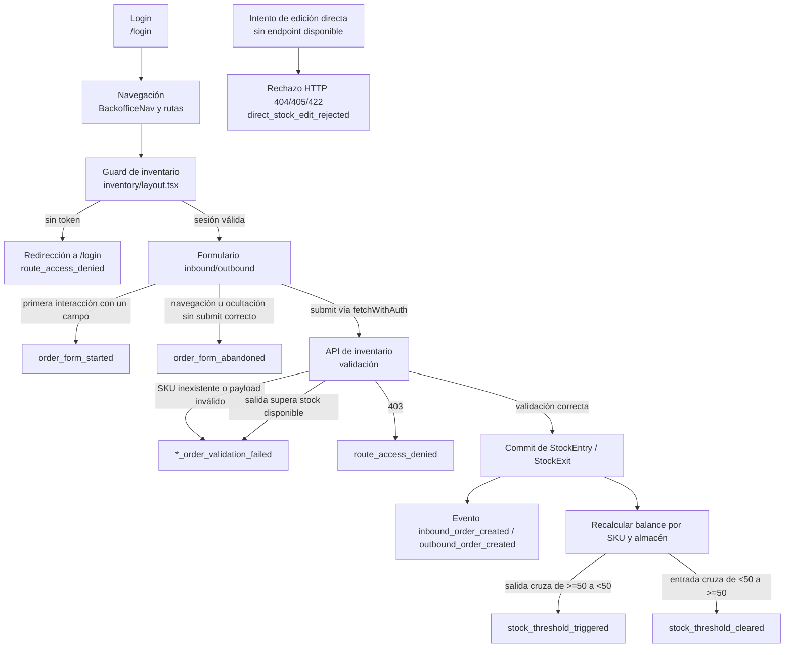

# Plan de telemetría de TrackFlow

## Índice

1. Contexto y alcance
2. Flujo de inventario
3. Catálogo de eventos
   3.1. Métricas obligatorias
   3.2. Oportunidades identificadas
   3.3. Oportunidades futuras de catálogo
   3.4. Resumen cuantitativo
4. Event Envelope
5. Convenciones de nombres, enums y versionado
6. Esquemas de eventos
7. Estrategia de entrega: stream y batch
8. Throttle y debounce
9. Privacidad y tratamiento de PII
10. Riesgos, eventos descartados y exclusiones
11. Mapeo previsto al almacenamiento
12. Guía de instrumentación por evento

## 1. Contexto y alcance

Este plan responde al RFI de TrackFlow: definir una telemetría de producto consistente para observar el inventario de sus almacenes de Los Ángeles y Zaragoza, y permitir decisiones operativas y ejecutivas basadas en datos agregables y comparables.

Los consumidores principales son:

- **Ana, Operaciones de Almacén:** planifica capacidad y personal, detecta cuellos de botella y prioriza auditorías.
- **Thomas, Dirección Ejecutiva:** compara volumen y SLA entre Estados Unidos y España.
- **Miguel, Comercial y Relación con Clientes:** identifica riesgos de rotura de stock y coordina avisos a clientes.
- **Andrés y Tecnología:** investigan errores y rendimiento y mantienen la instrumentación.

Los eventos de inventario se podrán agregar por **almacén**, **cliente**, **país**, **SKU** y **categoría de producto**. `country` se deriva del almacén (`los_angeles` → `US`, `zaragoza` → `ES`); `client_id` y `product_id` seguirán los mapeos provisionales documentados en §2 y sus discrepancias se conservarán visibles.

El alcance de este proyecto es el diseño de contratos y puntos de captura para el backoffice y la API de inventario. No implementa instrumentación, almacenamiento ni dashboards. Los eventos no incluirán datos de consumidores finales, transportistas o destinatarios; esos ámbitos quedan fuera de este plan.

## 2. Flujo de inventario

### 2.1 Recorrido y puntos de instrumentación

Los puntos de instrumentación se asignan a componentes existentes cuando existen; los eventos de producto son propuestas, no instrumentación ya desplegada:

| Punto | Origen real o previsto | Condición de captura |
|---|---|---|
| Login correcto o fallido | `/login` y endpoint de autenticación | Resultado del intento; el evento no incluye email, nombre, contraseña ni hash. |
| Acceso a inventario sin sesión | `uis/backoffice/src/app/inventory/layout.tsx` | El guard no encuentra token y redirige a `/login`. |
| Inicio o abandono de una orden | Formularios `uis/backoffice/src/app/inventory/orders/inbound/page.tsx` y `outbound/page.tsx` | `order_form_started` en la primera interacción con un campo, no al renderizar. Abandono tras `started` si el formulario se desmonta por navegación o se oculta la pestaña sin submit correcto. |
| Validación y creación de órdenes | `uis/backoffice/src/lib/api.ts` (`fetchWithAuth`) y `services/api/routes/inventory.py` | Fallo de validación tras respuesta de error; creación tras el commit de `StockEntry` o `StockExit`. |
| Rechazo de edición directa | API de inventario; no hay endpoint de edición directa | Propuesta de captura en el manejo backend de solicitudes identificables que intenten fijar stock y reciban 404/405/422; requiere reconocer el intento sin registrar su payload. |
| Cambio de umbral | `services/api/routes/inventory.py`, después del commit de la orden | Comparar balance previo y resultante del SKU en ese almacén; emitir solo en el cruce del umbral, no en cada movimiento posterior. |
| Denegación de acceso | `uis/backoffice/src/lib/api.ts` y `uis/backoffice/src/app/inventory/layout.tsx` | Respuesta HTTP 403 o redirección del guard por falta de token, con los motivos acotados de §3.2. |

### 2.2 Decisiones de auditoría incorporadas

- **D2 — `userId`:** string opaco con el identificador interno que devuelve `_user_uuid`: UUID cuando existe o, en su defecto, ID de TinyDB convertido a texto. Nunca email ni nombre. En el contrato será `type: string`, `minLength: 1`, sin `format: uuid`; se anota como discrepancia y conviene unificar el identificador a UUID en el futuro.
- **D15 — `product_category`:** `Apparel` y `Accessories` se normalizan a `fashion`; `Electronics` a `electronics`; `Beauty` a `cosmetics`. `Home`, `Sports`, `Packaging` y `Toys` aparecen solo en SKUs sintéticos `LOAD-` pendientes de purga: no emitir eventos para esos SKUs. El enum permanece limitado a `fashion`, `electronics` y `cosmetics`; se registrará en §10 el riesgo de catálogo y la recomendación de normalizarlo a las tres categorías del BRIEFING.
- **D16 — umbral:** hasta que exista configuración por cliente, el mínimo es el valor global 50 (`LOW_STOCK_THRESHOLD` en `uis/backoffice/src/app/inventory/products/page.tsx`) con `threshold_source: global_default`. `stock_threshold_triggered` añade `min_threshold` (integer) y `threshold_source` (`global_default` | `client_config`). Se emite después del commit de una salida solo al cruzar de `>=` a `<`; `stock_threshold_cleared` se emite después del commit de una entrada al cruzar de `<` a `>=`. No se repite mientras el stock siga bajo. No existe mínimo por cliente; el umbral global deja el evento obligatorio implementable ahora.
- **D17 — búsqueda:** no existe búsqueda de inventario en el backoffice. `inventory_search_performed` pasa a §3.3 como oportunidad futura de catálogo, sin captura ni esquema en esta versión.
- **D18 — formularios:** `order_form_started` comienza con la primera interacción con un campo. `order_form_abandoned` requiere un `started` previo y se produce al desmontar el formulario por navegación o al ocultarse la pestaña sin submit correcto. Sus propiedades serán `order_kind` (`inbound` | `outbound`), `last_field_touched` (nombre lógico del campo, nunca su valor), `fields_completed` (integer) y `time_in_form_ms` (integer).
- **D19 — acceso denegado:** se captura en `fetchWithAuth` ante HTTP 403 y en el guard de `uis/backoffice/src/app/inventory/layout.tsx` cuando falta token y se redirige a `/login`. Propiedades: `route` (plantilla sin query params, obligatoria), `reason` (`insufficient_permissions` | `inactive_user` | `no_session`, obligatoria) y `api_endpoint` (plantilla opcional, solo para 403). Nunca se copia el `detail` literal de la API ni información del usuario. La respuesta 403 cubre “Inactive user” (`auth.py`) y “Insufficient permissions” (`users.py`/`profiles.py`); entrega stream, nivel `warn`.
- **D20 — `requestId`:** hoy no existe `X-Request-ID` en cliente ni backend. En la futura captura, el servicio de telemetría genera un UUID por llamada en `fetchWithAuth`, lo envía en esa cabecera y asigna ese mismo `requestId` a los eventos nacidos de la llamada. Se recomienda que el middleware de `services/api/main.py` lea la cabecera y la registre en logs. Ese middleware registra hoy la ruta con query string; la telemetría usará siempre plantillas sin query params, riesgo que se desarrollará en §10.

## 3. Catálogo de eventos

### 3.1 Métricas obligatorias del BRIEFING

Todos los eventos de inventario requieren `warehouse`, `client_id`, `product_id`, `product_category`, `quantity` y `country`, además del envelope común. `warehouse` usa `los_angeles` o `zaragoza`; `country` se deriva como `US` o `ES`. `client_id` es el slug provisional derivado de `client_name`; `product_id` es el código `sku`, no el ID entero de la tabla. Las categorías se normalizan según D15 y el enum no admite valores fuera de `fashion`, `electronics` y `cosmetics`.

| `event_type` | Categoría | Origen | Punto de captura y estado real | Propiedades adicionales y semántica de `quantity` | Entrega | Regla de oro |
|---|---|---|---|---|---|---|
| `inbound_order_created` | Negocio/inventario | Obligatorio (BRIEFING) | Backend, `services/api/routes/inventory.py`, después del commit de `StockEntry`. | `order_id`, `country`. `quantity` son las unidades de la orden, que hoy contiene un único SKU. | Batch (horario) | Capturamos `inbound_order_created` porque necesitamos saber cuánto inventario entra por almacén, cliente y país, lo que nos permite planificar la capacidad y el personal del almacén. |
| `outbound_order_created` | Negocio/inventario | Obligatorio (BRIEFING) | Backend, `services/api/routes/inventory.py`, después del commit de `StockExit`. | `order_id`, `exit_type`, `country`. `quantity` son las unidades despachadas de la orden, que hoy contiene un único SKU. Se excluyen `tracking_number` y los datos del destinatario. | Stream | Capturamos `outbound_order_created` porque necesitamos detectar el volumen y el ritmo de despacho por almacén, cliente y país, lo que nos permite identificar cuellos de botella antes de que afecten al SLA de entrega. |
| `stock_threshold_triggered` | Negocio/inventario | Obligatorio (BRIEFING) | Backend, `services/api/routes/inventory.py`, tras el commit de una salida y el cruce del balance del SKU en ese almacén de `>= min_threshold` a `< min_threshold`. Implementable con el umbral global de 50; no existe mínimo configurable por cliente. | `min_threshold` (integer), `threshold_source` (`global_default` \| `client_config`), `trigger_order_id`, `country`. `quantity` es el stock resultante tras la orden que provocó el cruce. No se repite mientras siga por debajo del umbral. | Stream | Capturamos `stock_threshold_triggered` porque necesitamos saber cuándo un SKU cruza su mínimo de stock, lo que nos permite avisar al cliente y al equipo comercial antes de una rotura de stock. |
| `direct_stock_edit_rejected` | Negocio/seguridad | Obligatorio (BRIEFING) | Backend; no existe endpoint de edición directa. La detección del intento y su captura ante rechazo HTTP 404/405/422 quedan pendientes de implementar. | `rejection_reason`, `attempted_delta`, `country`. `quantity` representa la cantidad que se intentó fijar; `attempted_delta` puede expresar el cambio intentado. No registrar el cuerpo de la petición. | Batch (diario) | Capturamos `direct_stock_edit_rejected` porque necesitamos saber dónde se intenta modificar stock fuera de una orden, lo que nos permite reforzar la formación o revisar permisos en los almacenes donde más ocurre. |
| `inventory_discrepancy_detected` | Negocio/inventario | Obligatorio (BRIEFING) | Punto de captura pendiente de implementar: no existe lógica de conteo físico ni auditoría. | `system_quantity`, `counted_quantity`, `detection_source`, `country`. `quantity` es `counted_quantity - system_quantity`, con signo. | Batch (diario) | Capturamos `inventory_discrepancy_detected` porque necesitamos conocer las diferencias entre el stock registrado y el real, lo que nos permite priorizar auditorías en los SKUs con mayor tasa de discrepancia. |

Si en el futuro una orden contiene varias líneas, se emitirá un evento por línea, conservando el mismo `order_id`. Los esquemas y allowlists completos de estos eventos se detallan en la Fase 2.

### 3.2 Oportunidades identificadas

#### Negocio, inventario y UX de órdenes

| `event_type` | Categoría | Origen | Hipótesis y decisión | Punto de captura y condición | Entrega | Regla de oro |
|---|---|---|---|---|---|---|
| `inbound_order_validation_failed` | Negocio/calidad de datos | Oportunidad identificada | Los errores de recepción se concentran en ciertos SKUs o clientes; corregir los maestros de producto o formar al cliente. | `services/api/routes/inventory.py`, cuando la validación de una orden inbound falla; clasificar solo razones permitidas, sin incluir el detalle libre de la API. | Batch (diario) | Capturamos `inbound_order_validation_failed` porque necesitamos saber qué datos de recepción fallan y con qué frecuencia, lo que nos permite corregir los maestros de producto o formar al cliente. |
| `outbound_order_validation_failed` | Negocio/calidad de datos | Oportunidad identificada | Los errores de salida, en especial `insufficient_stock`, identifican SKUs que se intentan despachar sin existencias; revisar disponibilidad y operación. | `services/api/routes/inventory.py`, cuando falla la validación outbound por SKU inexistente, stock insuficiente o payload inválido; sin copiar mensajes literales. | Batch (diario) | Capturamos `outbound_order_validation_failed` porque necesitamos identificar qué SKUs se intentan despachar sin stock y qué validaciones fallan, lo que nos permite corregir disponibilidad y procesos de salida. |
| `order_form_started` | UX/flujos | Oportunidad identificada | Medir cuántos formularios iniciados llegan a submit correcto; detectar fricción por tipo de orden. | Formularios inbound/outbound; disparar en la primera interacción con un campo, nunca al renderizar. | Batch (diario) | Capturamos `order_form_started` porque necesitamos conocer cuántas órdenes empieza a registrar el personal, lo que nos permite medir el abandono y priorizar mejoras del formulario. |
| `order_form_abandoned` | UX/flujos | Oportunidad identificada | Localizar el paso en que se abandonan órdenes y simplificarlo; `last_field_touched` contiene solo el nombre del campo, nunca su valor. | Formularios inbound/outbound; requiere `order_form_started` previo y se dispara al desmontar por navegación o al ocultarse la pestaña sin submit correcto. Propiedades previstas: `order_kind` (`inbound` \| `outbound`), `last_field_touched` (string), `fields_completed` (integer), `time_in_form_ms` (integer). | Batch (diario) | Capturamos `order_form_abandoned` porque necesitamos saber en qué paso se dejan incompletas las órdenes, lo que nos permite simplificar ese paso del formulario. |
| `stock_threshold_cleared` | Negocio/inventario | Oportunidad identificada | Medir cuánto tarda un SKU en reponerse tras la alerta y establecer un SLA de reposición con cada cliente. | Backend, `services/api/routes/inventory.py`, después del commit de una entrada que cruza el balance por almacén de `<50` a `>=50`; no existe mínimo por cliente y rige el umbral global de 50. | Stream (cierra la alerta) | Capturamos `stock_threshold_cleared` porque necesitamos saber cuándo se repone un SKU que estaba bajo el umbral y cuánto tarda, lo que nos permite medir el SLA de reposición con cada cliente. |

`inventory_search_performed` no forma parte de estas oportunidades identificadas: el backoffice no tiene búsqueda y el evento queda solo en el catálogo futuro de §3.3 (D17).

#### Autenticación y seguridad

| `event_type` | Categoría | Origen | Hipótesis y decisión | Punto de captura y condición | Entrega | Regla de oro |
|---|---|---|---|---|---|---|
| `user_login_succeeded` | Autenticación | Oportunidad identificada | Comparar el uso real del backoffice por almacén y detectar dónde hace falta formación. | Flujo de login de `/login`, después de respuesta correcta y almacenamiento del token; rotar `sessionId` en el login correcto. Usar `userId` opaco según D2. | Batch (diario) | Capturamos `user_login_succeeded` porque necesitamos saber qué almacenes usan el backoffice, lo que nos permite dirigir la formación a los equipos que lo usan menos. |
| `user_login_failed` | Autenticación/seguridad | Oportunidad identificada | Detectar picos de fallos que puedan indicar fuerza bruta o problemas de credenciales. | Flujo de login, ante un fallo de autenticación; `failure_reason` solo puede ser `invalid_credentials`, `session_expired`, `network_error` o `account_locked`. No capturar email, contraseña, hash ni el detalle literal. | Stream | Capturamos `user_login_failed` porque necesitamos detectar picos de intentos fallidos sin exponer credenciales, lo que nos permite investigar actividad sospechosa o problemas de acceso. |
| `session_expired` | Autenticación | Oportunidad identificada | Saber si las sesiones caducan durante una orden y ajustar el TTL de sesión. | `uis/backoffice/src/lib/api.ts` (`fetchWithAuth`), respuesta HTTP 401 de una llamada protegida antes de limpiar tokens y redirigir a `/login`. | Batch (diario) | Capturamos `session_expired` porque necesitamos saber si las sesiones caducan mientras se trabaja en una orden, lo que nos permite ajustar su duración. |
| `user_logged_out` | Autenticación | Oportunidad identificada | Medir duración de sesión y dimensionar turnos y TTL. | `uis/backoffice/src/components/BackofficeNav.tsx`, en `handleLogout` antes de eliminar el token y navegar a `/login`. | Batch (diario) | Capturamos `user_logged_out` porque necesitamos conocer la duración de las sesiones operativas, lo que nos permite dimensionar turnos y ajustar el TTL. |
| `route_access_denied` | Seguridad/permisos | Oportunidad identificada | Detectar intentos de entrar en secciones sin permiso y revisar roles. | Dos puntos: `fetchWithAuth` ante HTTP 403 (incluye usuario inactivo y permisos insuficientes) y el guard `uis/backoffice/src/app/inventory/layout.tsx` cuando falta token y redirige. Propiedades: `route` (plantilla sin query params, obligatoria), `reason` (`insufficient_permissions` \| `inactive_user` \| `no_session`, obligatoria) y `api_endpoint` (plantilla opcional, solo para 403). Nunca incluir el `detail` literal ni datos de usuario. | Stream | Capturamos `route_access_denied` porque necesitamos saber cuándo se intenta acceder a una ruta sin autorización, lo que nos permite revisar permisos y roles en el backoffice. |

#### Rendimiento, errores y navegación

| `event_type` | Categoría | Origen | Hipótesis y decisión | Punto de captura y condición | Entrega | Regla de oro |
|---|---|---|---|---|---|---|
| `page_viewed` | Navegación | Oportunidad identificada | Identificar las secciones del backoffice más y menos utilizadas para priorizar mejoras. | Cambio de ruta en el backoffice; capturar la ruta como plantilla, sin query params. No existe aún instrumentación de vistas. | Batch (diario) | Capturamos `page_viewed` porque necesitamos saber qué secciones usan los operadores, lo que nos permite priorizar mejoras del backoffice. |
| `api_latency_recorded` | Rendimiento | Oportunidad identificada | Identificar endpoints lentos por p95 y priorizar optimización o caché. | `uis/backoffice/src/lib/api.ts` (`fetchWithAuth`), medir duración de cada llamada y conservar solo la plantilla del endpoint; el middleware de `services/api/main.py` aporta referencia de timing del servidor. | Batch (ventanas de 5 min) | Capturamos `api_latency_recorded` porque necesitamos comparar la latencia de los endpoints por operación, lo que nos permite priorizar optimizaciones que mejoren el servicio. |
| `web_vital_recorded` | Rendimiento | Oportunidad identificada | Comparar LCP, INP y CLS por ruta para priorizar mejoras de experiencia web. | Punto futuro: integración de medición de Web Vitals en el backoffice; no existe `reportWebVitals` actualmente. La ruta se registra como plantilla. | Batch (diario) | Capturamos `web_vital_recorded` porque necesitamos conocer el rendimiento percibido por ruta, lo que nos permite priorizar mejoras frontend. |
| `frontend_error_captured` | Errores | Oportunidad identificada | Detectar errores JavaScript no capturados tras un despliegue y decidir rollback o hotfix. | Punto futuro: Error Boundary global y captura de errores no controlados; no existe un Error Boundary global localizado. Mensaje sanitizado y truncado, y stack reducido a `archivo:línea`, según §6. | Stream | Capturamos `frontend_error_captured` porque necesitamos detectar errores de interfaz después de un despliegue, lo que nos permite decidir si aplicar un hotfix o revertirlo. |
| `api_request_failed` | Errores | Oportunidad identificada | Detectar errores 5xx o fallos de red antes de que lleguen como tickets de usuario. | `uis/backoffice/src/lib/api.ts` (`fetchWithAuth`), para respuestas 5xx y fallos de red; separar los 401/403 y los errores de validación que tienen eventos específicos. No incluir mensajes literales ni payloads. | Stream | Capturamos `api_request_failed` porque necesitamos detectar fallos de API o de red que afectan al backoffice, lo que nos permite investigar la incidencia antes de que llegue un ticket. |

Con las cinco oportunidades de negocio/UX, las cinco de autenticación/seguridad y estas cinco oportunidades técnicas, el catálogo contiene **15 oportunidades identificadas con esquema previsto para la Fase 2**, además de las cinco métricas obligatorias. `inventory_search_performed` queda fuera de este total, en §3.3.

### 3.3 Oportunidades futuras de catálogo

Estos eventos quedan como hipótesis de versiones futuras y no forman parte de las 15 oportunidades con esquema de esta versión:

| `event_type` | Estado frente al código | Hipótesis y decisión | Regla de oro |
|---|---|---|---|
| `product_min_threshold_updated` | Futuro: no existe mínimo configurable por cliente. | Auditar cambios de mínimos cuando se incorpore esa configuración; atribuirlos al usuario sin guardar PII. | Capturamos `product_min_threshold_updated` porque necesitamos saber quién cambia los mínimos y cuándo, lo que nos permite auditar la configuración de alertas por cliente. |
| `product_created` | Existe `POST /inventory/products`, pero no hay captura de telemetría prevista en esta versión. | Medir el alta de SKUs y detectar problemas de calidad o incorporación de catálogo. | Capturamos `product_created` porque necesitamos conocer cuándo se incorporan SKUs, lo que nos permite mejorar la calidad del catálogo y el proceso de alta. |
| `order_list_filtered` | Futuro: no hay filtro de historial considerado en este diseño. | Saber qué filtros facilitan encontrar órdenes y priorizar mejoras del historial. | Capturamos `order_list_filtered` porque necesitamos saber cómo se consulta el historial, lo que nos permite priorizar los filtros que más ayudan a la operación. |
| `inventory_export_downloaded` | Futuro: no se ha identificado una función de exportación en el alcance revisado. | Medir demanda de exportaciones y decidir qué informes facilitar a operaciones. | Capturamos `inventory_export_downloaded` porque necesitamos saber cuándo se requiere extraer inventario, lo que nos permite priorizar informes útiles para operaciones. |
| `warehouse_view_switched` | Futuro: el selector de almacén de un formulario no es una vista de almacén ni un dashboard. | Comparar el uso de vistas operativas por almacén y mejorar la navegación. | Capturamos `warehouse_view_switched` porque necesitamos saber qué vistas de almacén consulta cada operador, lo que nos permite mejorar la navegación entre operaciones. |
| `telemetry_batch_discarded` | Futuro: aún no existe el servicio de telemetría ni su política de reintentos. | Hacer visible la pérdida de lotes tras agotar reintentos y detectar problemas de entrega. | Capturamos `telemetry_batch_discarded` porque necesitamos saber cuándo se pierden eventos tras reintentos, lo que nos permite investigar fallos de entrega de telemetría. |
| `inventory_search_performed` | Futuro: no existe búsqueda en el backoffice; no emitir eventos de búsqueda en esta versión. | Analizar búsquedas sin resultados cuando se implemente la función; limitar las propiedades futuras a `query_length` y `results_count`, nunca al texto buscado. | Capturamos `inventory_search_performed` porque necesitamos saber si las búsquedas encuentran productos, lo que nos permite mejorar el buscador o los maestros de SKU. |
