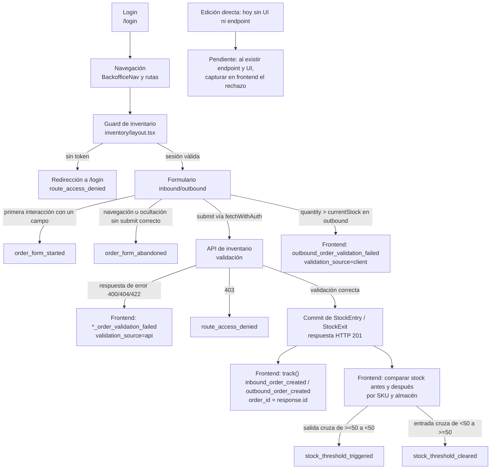

# Plan de telemetría de TrackFlow

## Índice

1. Contexto y alcance
2. Flujo de inventario
3. Catálogo de eventos
   3.1. Métricas obligatorias
   3.2. Oportunidades identificadas
   3.3. Oportunidades futuras de catálogo
   3.4. Resumen cuantitativo
4. Event Envelope
5. Convenciones de nombres, enums y versionado
6. Esquemas de eventos
7. Estrategia de entrega: stream y batch
8. Throttle y debounce
9. Privacidad y tratamiento de PII
10. Riesgos, eventos descartados y exclusiones
11. Mapeo previsto al almacenamiento
12. Guía de instrumentación por evento

## 1. Contexto y alcance

Este plan responde al RFI de TrackFlow: definir una telemetría de producto consistente para observar el inventario de sus almacenes de Los Ángeles y Zaragoza, y permitir decisiones operativas y ejecutivas basadas en datos agregables y comparables.

Los consumidores principales son:

- **Ana, Operaciones de Almacén:** planifica capacidad y personal, detecta cuellos de botella y prioriza auditorías.
- **Thomas, Dirección Ejecutiva:** compara volumen y SLA entre Estados Unidos y España.
- **Miguel, Comercial y Relación con Clientes:** identifica riesgos de rotura de stock y coordina avisos a clientes.
- **Andrés y Tecnología:** investigan errores y rendimiento y mantienen la instrumentación.

Los eventos de inventario se podrán agregar por **almacén**, **cliente**, **país**, **SKU** y **categoría de producto**. `country` se deriva del almacén (`los_angeles` → `US`, `zaragoza` → `ES`); `client_id` y `product_id` seguirán los mapeos provisionales documentados en §2 y sus discrepancias se conservarán visibles.

El alcance de este proyecto es el diseño de contratos y puntos de captura para el backoffice y la API de inventario. No implementa instrumentación, almacenamiento ni dashboards. Los eventos no incluirán datos de consumidores finales, transportistas o destinatarios; esos ámbitos quedan fuera de este plan.

## 2. Flujo de inventario

### 2.1 Recorrido y puntos de instrumentación



Los eventos de este plan se emitirán desde el backoffice con `track()` del futuro `TelemetryService`; esa instrumentación aún no está desplegada. El backend se reserva como fuente autoritativa recomendada a futuro, no como punto de captura de esta versión:

| Punto | Punto de captura (frontend, esta versión) | Fuente autoritativa futura (backend) | Condición de captura |
|---|---|---|---|
| Login correcto o fallido | `/login`, después del resultado de autenticación. | Resultado autoritativo futuro del endpoint de autenticación. | El evento no incluye email, nombre, contraseña ni hash. |
| Acceso a inventario sin sesión | `uis/backoffice/src/app/inventory/layout.tsx`, cuando el guard redirige a `/login`. | Resultado autoritativo futuro del control de sesión del backend, cuando aplique. | El guard no encuentra token. |
| Inicio o abandono de una orden | Formularios `uis/backoffice/src/app/inventory/orders/inbound/page.tsx` y `outbound/page.tsx`. | No aplica: interacción de interfaz sin equivalente autoritativo en backend. | `order_form_started` en la primera interacción con un campo; abandono tras `started` si el formulario se desmonta por navegación o se oculta la pestaña sin submit correcto. |
| Validación de orden por API | Catch del submit en los formularios inbound/outbound. | Resultado autoritativo futuro de validación en `services/api/routes/inventory.py`. | Capturar `*_order_validation_failed` ante `ApiError` HTTP 400, 404 o 422; `validation_source: api`. |
| Validación local de outbound | `uis/backoffice/src/app/inventory/orders/outbound/page.tsx`, antes de llamar a la API. | No aplica: validación local de interfaz. | Capturar `outbound_order_validation_failed` cuando `quantity > currentStock`; `validation_source: client`. |
| Creación de inbound/outbound | `inbound/page.tsx` y `outbound/page.tsx`, después de respuesta HTTP 201 de `createInboundOrder` / `createOutboundOrder`; `order_id` sale del `id` de la respuesta. | `services/api/routes/inventory.py` y el commit de `StockEntry` / `StockExit`, como fuente autoritativa futura. | Emitir `inbound_order_created` o `outbound_order_created` solo tras éxito. |
| Cambio de umbral | Frontend después de respuesta HTTP 201, comparando el stock previo y posterior por SKU y almacén. `outbound/page.tsx` ya dispone de `stockIndex`; `inbound/page.tsx` no tiene cálculo equivalente y deberá incorporarlo como requisito de captura. | Balance autoritativo futuro tras el commit en `services/api/routes/inventory.py`. | Emitir solo al cruzar el umbral global de 50; no repetir mientras el stock permanezca en el mismo lado. |
| Rechazo de edición directa | Captura frontend pendiente: al existir UI y endpoint, emitir al recibir el rechazo. Hoy no hay UI ni endpoint. | Futuro endpoint que rechace la modificación directa, aún inexistente. | `direct_stock_edit_rejected` permanece pendiente de implementar; no registrar el cuerpo de la petición. |
| Discrepancia de inventario | Captura frontend pendiente: cuando exista conteo, emitir al recibir su resultado. Hoy no hay UI ni endpoint. | Resultado autoritativo futuro del conteo físico/auditoría, aún inexistente. | `inventory_discrepancy_detected` permanece pendiente de implementar. |
| Denegación de acceso | `uis/backoffice/src/lib/api.ts` (`fetchWithAuth`) ante HTTP 403 y guard de `uis/backoffice/src/app/inventory/layout.tsx` cuando falta token. | Resultado autoritativo futuro de autenticación/autorización del backend para HTTP 403. | Usar los motivos acotados de §3.2; no copiar el detalle literal de la API. |

### 2.2 Decisiones de auditoría incorporadas

- **D2 — `userId`:** string opaco con el identificador interno que devuelve `_user_uuid`: UUID cuando existe o, en su defecto, ID de TinyDB convertido a texto. Nunca email ni nombre. En el contrato será `type: string`, `minLength: 1`, sin `format: uuid`; se anota como discrepancia y conviene unificar el identificador a UUID en el futuro.
- **D15 — `product_category`:** `Apparel` y `Accessories` se normalizan a `fashion`; `Electronics` a `electronics`; `Beauty` a `cosmetics`. `Home`, `Sports`, `Packaging` y `Toys` aparecen solo en SKUs sintéticos `LOAD-` pendientes de purga: no emitir eventos para esos SKUs. El enum permanece limitado a `fashion`, `electronics` y `cosmetics`; se registrará en §10 el riesgo de catálogo y la recomendación de normalizarlo a las tres categorías del BRIEFING.
- **D16 — umbral:** hasta que exista configuración por cliente, el mínimo es el valor global 50 (`LOW_STOCK_THRESHOLD` en `uis/backoffice/src/app/inventory/products/page.tsx`) con `threshold_source: global_default`. `stock_threshold_triggered` añade `min_threshold` (integer) y `threshold_source` (`global_default` | `client_config`). Se emite después del commit de una salida solo al cruzar de `>=` a `<`; `stock_threshold_cleared` se emite después del commit de una entrada al cruzar de `<` a `>=`. No se repite mientras el stock siga bajo. No existe mínimo por cliente; el umbral global deja el evento obligatorio implementable ahora.
- **D17 — búsqueda:** no existe búsqueda de inventario en el backoffice. `inventory_search_performed` pasa a §3.3 como oportunidad futura de catálogo, sin captura ni esquema en esta versión.
- **D18 — formularios:** `order_form_started` comienza con la primera interacción con un campo. `order_form_abandoned` requiere un `started` previo y se produce al desmontar el formulario por navegación o al ocultarse la pestaña sin submit correcto. Sus propiedades serán `order_kind` (`inbound` | `outbound`), `last_field_touched` (nombre lógico del campo, nunca su valor), `fields_completed` (integer) y `time_in_form_ms` (integer).
- **D19 — acceso denegado:** se captura en `fetchWithAuth` ante HTTP 403 y en el guard de `uis/backoffice/src/app/inventory/layout.tsx` cuando falta token y se redirige a `/login`. Propiedades: `route` (plantilla sin query params, obligatoria), `reason` (`insufficient_permissions` | `inactive_user` | `no_session`, obligatoria) y `api_endpoint` (plantilla opcional, solo para 403). Nunca se copia el `detail` literal de la API ni información del usuario. La respuesta 403 cubre “Inactive user” (`auth.py`) y “Insufficient permissions” (`users.py`/`profiles.py`); entrega stream, nivel `warn`.
- **D20 — `requestId`:** hoy no existe `X-Request-ID` en cliente ni backend. En la futura captura, el servicio de telemetría genera un UUID por llamada en `fetchWithAuth`, lo envía en esa cabecera y asigna ese mismo `requestId` a los eventos nacidos de la llamada. Se recomienda que el middleware de `services/api/main.py` lea la cabecera y la registre en logs. Ese middleware registra hoy la ruta con query string; la telemetría usará siempre plantillas sin query params, riesgo que se desarrollará en §10.
- **D21 — emisor en esta versión:** todos los eventos de este plan se emitirán desde el backoffice mediante `track()` del futuro `TelemetryService`; esto es un requisito del siguiente proyecto, no instrumentación ya existente. El backend no es el punto de captura de esta versión: queda como fuente autoritativa recomendada a futuro cuando el evento tenga un resultado de negocio equivalente.

## 3. Catálogo de eventos

### 3.1 Métricas obligatorias del BRIEFING

Las cinco métricas obligatorias de inventario requieren `warehouse`, `client_id`, `product_id`, `product_category`, `quantity` y `country`, además del envelope común. `warehouse` usa `los_angeles` o `zaragoza`; `country` se deriva como `US` o `ES`. `client_id` es el slug provisional derivado de `client_name`; `product_id` es el código `sku`, no el ID entero de la tabla. Las categorías se normalizan según D15 y el enum no admite valores fuera de `fashion`, `electronics` y `cosmetics`.

| `event_type` | Categoría | Origen | Punto de captura (frontend, esta versión) | Fuente autoritativa futura (backend) | Propiedades adicionales y semántica de `quantity` | Entrega | Regla de oro |
|---|---|---|---|---|---|---|---|
| `inbound_order_created` | Negocio/inventario | Obligatorio (BRIEFING) | `uis/backoffice/src/app/inventory/orders/inbound/page.tsx`, tras la respuesta HTTP 201 de `createInboundOrder`; `order_id` es el `id` de la respuesta. | `services/api/routes/inventory.py` y commit de `StockEntry`. | `order_id`, `country`. `quantity` son las unidades de la orden, que hoy contiene un único SKU. | Batch (horario) | Capturamos `inbound_order_created` porque necesitamos saber cuánto inventario entra por almacén, cliente y país, lo que nos permite planificar la capacidad y el personal del almacén. |
| `outbound_order_created` | Negocio/inventario | Obligatorio (BRIEFING) | `uis/backoffice/src/app/inventory/orders/outbound/page.tsx`, tras la respuesta HTTP 201 de `createOutboundOrder`; `order_id` es el `id` de la respuesta. | `services/api/routes/inventory.py` y commit de `StockExit`. | `order_id`, `exit_type`, `country`. `quantity` son las unidades despachadas de la orden, que hoy contiene un único SKU. Se excluyen `tracking_number` y los datos del destinatario. | Stream | Capturamos `outbound_order_created` porque necesitamos detectar el volumen y el ritmo de despacho por almacén, cliente y país, lo que nos permite identificar cuellos de botella antes de que afecten al SLA de entrega. |
| `stock_threshold_triggered` | Negocio/inventario | Obligatorio (BRIEFING) | Frontend outbound tras respuesta HTTP 201, al comparar stock previo y posterior del SKU en ese almacén. El `stockIndex` actual permite calcular el stock; el evento aún requiere instrumentación. | Balance autoritativo futuro tras el commit de `StockExit` en `services/api/routes/inventory.py`. | `min_threshold` (integer), `threshold_source` (`global_default` \| `client_config`), `trigger_order_id`, `country`. `quantity` es el stock resultante tras la orden que provocó el cruce. Umbral global 50; no existe mínimo configurable por cliente. No se repite mientras siga por debajo del umbral. | Stream | Capturamos `stock_threshold_triggered` porque necesitamos saber cuándo un SKU cruza su mínimo de stock, lo que nos permite avisar al cliente y al equipo comercial antes de una rotura de stock. |
| `direct_stock_edit_rejected` | Negocio/seguridad | Obligatorio (BRIEFING) | Pendiente de implementar: cuando existan UI y endpoint, el frontend capturará el rechazo recibido. Hoy no hay UI ni endpoint de edición directa. | Futuro endpoint que rechace la modificación directa, aún inexistente. | `rejection_reason`, `attempted_delta`, `country`. `quantity` representa la cantidad que se intentó fijar; `attempted_delta` puede expresar el cambio intentado. No registrar el cuerpo de la petición. | Batch (diario) | Capturamos `direct_stock_edit_rejected` porque necesitamos saber dónde se intenta modificar stock fuera de una orden, lo que nos permite reforzar la formación o revisar permisos en los almacenes donde más ocurre. |
| `inventory_discrepancy_detected` | Negocio/inventario | Obligatorio (BRIEFING) | Pendiente de implementar: cuando exista conteo, el frontend capturará el resultado recibido. Hoy no hay UI ni endpoint para conteo físico/auditoría. | Resultado autoritativo futuro del conteo físico/auditoría, aún inexistente. | `system_quantity`, `counted_quantity`, `detection_source`, `country`. `quantity` es `counted_quantity - system_quantity`, con signo. | Batch (diario) | Capturamos `inventory_discrepancy_detected` porque necesitamos conocer las diferencias entre el stock registrado y el real, lo que nos permite priorizar auditorías en los SKUs con mayor tasa de discrepancia. |

Si en el futuro una orden contiene varias líneas, se emitirá un evento por línea, conservando el mismo `order_id`. Los esquemas y allowlists completos de estos eventos se detallan en la Fase 2.

### 3.2 Oportunidades identificadas

`inbound_order_validation_failed` y `outbound_order_validation_failed` incluyen `validation_source` con el enum `client` | `api`, para distinguir la validación local de la respuesta de la API.
En ambos eventos `quantity` es un entero opcional sin mínimo: se conserva si el valor rechazado es un entero y se omite si falta o no es entero.

#### Negocio, inventario y UX de órdenes

| `event_type` | Categoría | Origen | Hipótesis y decisión | Punto de captura (frontend, esta versión) | Fuente autoritativa futura (backend) | Entrega | Regla de oro |
|---|---|---|---|---|---|---|---|
| `inbound_order_validation_failed` | Negocio/calidad de datos | Oportunidad identificada | Los errores de recepción se concentran en ciertos SKUs o clientes; corregir los maestros de producto o formar al cliente. | Catch del submit inbound ante `ApiError` HTTP 400, 404 o 422; propiedad prevista `validation_source: api`. | Resultado autoritativo futuro de validación en `services/api/routes/inventory.py`. | Batch (diario) | Capturamos `inbound_order_validation_failed` porque necesitamos saber qué datos de recepción fallan y con qué frecuencia, lo que nos permite corregir los maestros de producto o formar al cliente. |
| `outbound_order_validation_failed` | Negocio/calidad de datos | Oportunidad identificada | Los errores de salida, en especial `insufficient_stock`, identifican SKUs que se intentan despachar sin existencias; revisar disponibilidad y operación. | `outbound/page.tsx`: capturar en la validación local cuando `quantity > currentStock` (`validation_source: client`) y en el catch ante `ApiError` HTTP 400, 404 o 422 (`validation_source: api`). No copiar mensajes literales. | Resultado autoritativo futuro de validación en `services/api/routes/inventory.py`; la validación local no tiene equivalente backend. | Batch (diario) | Capturamos `outbound_order_validation_failed` porque necesitamos identificar qué SKUs se intentan despachar sin stock y qué validaciones fallan, lo que nos permite corregir disponibilidad y procesos de salida. |
| `order_form_started` | UX/flujos | Oportunidad identificada | Medir cuántos formularios iniciados llegan a submit correcto; detectar fricción por tipo de orden. | Formularios inbound/outbound; disparar en la primera interacción con un campo, nunca al renderizar. | No aplica: evento exclusivo de interacción de interfaz. | Batch (diario) | Capturamos `order_form_started` porque necesitamos conocer cuántas órdenes empieza a registrar el personal, lo que nos permite medir el abandono y priorizar mejoras del formulario. |
| `order_form_abandoned` | UX/flujos | Oportunidad identificada | Localizar el paso en que se abandonan órdenes y simplificarlo; `last_field_touched` contiene solo el nombre del campo, nunca su valor. | Formularios inbound/outbound; requiere `order_form_started` previo y se dispara al desmontar por navegación o al ocultarse la pestaña sin submit correcto. Propiedades previstas: `order_kind` (`inbound` \| `outbound`), `last_field_touched` (string), `fields_completed` (integer), `time_in_form_ms` (integer). | No aplica: evento exclusivo de interacción de interfaz. | Batch (diario) | Capturamos `order_form_abandoned` porque necesitamos saber en qué paso se dejan incompletas las órdenes, lo que nos permite simplificar ese paso del formulario. |
| `stock_threshold_cleared` | Negocio/inventario | Oportunidad identificada | Medir cuánto tarda un SKU en reponerse tras la alerta y establecer un SLA de reposición con cada cliente. | Frontend inbound tras respuesta HTTP 201, comparando stock previo y posterior por SKU y almacén. `inbound/page.tsx` no dispone de cálculo equivalente y deberá incorporarlo como requisito de captura; rige el umbral global de 50. | Balance autoritativo futuro tras el commit de `StockEntry` en `services/api/routes/inventory.py`. | Stream (cierra la alerta) | Capturamos `stock_threshold_cleared` porque necesitamos saber cuándo se repone un SKU que estaba bajo el umbral y cuánto tarda, lo que nos permite medir el SLA de reposición con cada cliente. |

`inventory_search_performed` no forma parte de estas oportunidades identificadas: el backoffice no tiene búsqueda y el evento queda solo en el catálogo futuro de §3.3 (D17).

#### Autenticación y seguridad

| `event_type` | Categoría | Origen | Hipótesis y decisión | Punto de captura (frontend, esta versión) | Fuente autoritativa futura (backend) | Entrega | Regla de oro |
|---|---|---|---|---|---|---|---|
| `user_login_succeeded` | Autenticación | Oportunidad identificada | Contar usuarios únicos diarios y comparar los accesos correctos con los intentos fallidos para medir adopción y detectar problemas de acceso. | `/login`, después de respuesta correcta y almacenamiento del token; rotar `sessionId` en el login correcto. Usar `userId` opaco según D2. | Resultado autoritativo futuro del endpoint de autenticación. | Batch (diario) | Capturamos `user_login_succeeded` porque necesitamos saber cuántos usuarios distintos acceden cada día y su proporción frente a `user_login_failed`, lo que nos permite medir la adopción del backoffice y detectar problemas de acceso. |
| `user_login_failed` | Autenticación/seguridad | Oportunidad identificada | Detectar picos de fallos que puedan indicar fuerza bruta o problemas de credenciales. | `/login`, ante un fallo de autenticación; `failure_reason` solo puede ser `invalid_credentials`, `session_expired`, `network_error` o `account_locked`. No capturar email, contraseña, hash ni el detalle literal. | Resultado autoritativo futuro del endpoint de autenticación. | Stream | Capturamos `user_login_failed` porque necesitamos detectar picos de intentos fallidos sin exponer credenciales, lo que nos permite investigar actividad sospechosa o problemas de acceso. |
| `session_expired` | Autenticación | Oportunidad identificada | Saber si las sesiones caducan durante una orden y ajustar el TTL de sesión. | `uis/backoffice/src/lib/api.ts` (`fetchWithAuth`), respuesta HTTP 401 de una llamada protegida antes de limpiar tokens y redirigir a `/login`. | Resultado autoritativo futuro de autenticación del endpoint protegido. | Batch (diario) | Capturamos `session_expired` porque necesitamos saber si las sesiones caducan mientras se trabaja en una orden, lo que nos permite ajustar su duración. |
| `user_logged_out` | Autenticación | Oportunidad identificada | Medir duración de sesión y dimensionar turnos y TTL. | `uis/backoffice/src/components/BackofficeNav.tsx`, en `handleLogout` antes de eliminar el token y navegar a `/login`. | No aplica: acción de interfaz sin resultado autoritativo en backend. | Batch (diario) | Capturamos `user_logged_out` porque necesitamos conocer la duración de las sesiones operativas, lo que nos permite dimensionar turnos y ajustar el TTL. |
| `route_access_denied` | Seguridad/permisos | Oportunidad identificada | Detectar intentos de entrar en secciones sin permiso y revisar roles. | `fetchWithAuth` ante HTTP 403 y guard `uis/backoffice/src/app/inventory/layout.tsx` cuando falta token y redirige. Propiedades: `route` (plantilla sin query params), `reason` (`insufficient_permissions` \| `inactive_user` \| `no_session`) y `api_endpoint` (plantilla opcional, solo para 403). Nunca incluir el `detail` literal ni datos de usuario. | Resultado autoritativo futuro de autenticación/autorización para HTTP 403. | Stream | Capturamos `route_access_denied` porque necesitamos saber cuándo se intenta acceder a una ruta sin autorización, lo que nos permite revisar permisos y roles en el backoffice. |

#### Rendimiento, errores y navegación

| `event_type` | Categoría | Origen | Hipótesis y decisión | Punto de captura (frontend, esta versión) | Fuente autoritativa futura (backend) | Entrega | Regla de oro |
|---|---|---|---|---|---|---|---|
| `page_viewed` | Navegación | Oportunidad identificada | Identificar las secciones del backoffice más y menos utilizadas para priorizar mejoras. | Cambio de ruta en el backoffice; capturar la ruta como plantilla, sin query params. No existe aún instrumentación de vistas. | No aplica: evento exclusivo de navegación en interfaz. | Batch (diario) | Capturamos `page_viewed` porque necesitamos saber qué secciones usan los operadores, lo que nos permite priorizar mejoras del backoffice. |
| `api_latency_recorded` | Rendimiento | Oportunidad identificada | Identificar endpoints lentos por p95 y priorizar optimización o caché. | `uis/backoffice/src/lib/api.ts` (`fetchWithAuth`), medir la duración de las llamadas con respuesta HTTP y registrar la plantilla del endpoint, `http_method`, `status_code` y `sample_rate`. | El middleware de `services/api/main.py` aporta la fuente futura de timing del servidor. | Batch (ventanas de 5 min) | Capturamos `api_latency_recorded` porque necesitamos comparar la latencia de los endpoints por operación, lo que nos permite priorizar optimizaciones que mejoren el servicio. |
| `web_vital_recorded` | Rendimiento | Oportunidad identificada | Comparar LCP, INP y CLS por ruta para priorizar mejoras de experiencia web. | Punto futuro: integración de medición de Web Vitals en el backoffice; no existe `reportWebVitals` actualmente. La ruta se registra como plantilla. | No aplica: métrica de rendimiento percibido en interfaz. | Batch (diario) | Capturamos `web_vital_recorded` porque necesitamos conocer el rendimiento percibido por ruta, lo que nos permite priorizar mejoras frontend. |
| `frontend_error_captured` | Errores | Oportunidad identificada | Detectar errores JavaScript no capturados tras un despliegue y decidir rollback o hotfix. | Punto futuro: captura desde `window_error`, `unhandled_rejection` o `error_boundary`. Registrar `error_source` y `error_fingerprint`, sanitizar el mensaje y reducir el stack a `archivo:línea` según §6. | No aplica: error originado en la interfaz. | Stream | Capturamos `frontend_error_captured` porque necesitamos detectar errores de interfaz después de un despliegue, lo que nos permite decidir si aplicar un hotfix o revertirlo. |
| `api_request_failed` | Errores | Oportunidad identificada | Detectar errores 5xx o fallos de red antes de que lleguen como tickets de usuario. | `uis/backoffice/src/lib/api.ts` (`fetchWithAuth`), para respuestas 5xx y fallos de red; separar los 401/403 y los errores de validación que tienen eventos específicos. No incluir mensajes literales ni payloads. | Estado y logs del servidor como fuente futura para respuestas HTTP; no aplica a fallos de red sin respuesta. | Stream | Capturamos `api_request_failed` porque necesitamos detectar fallos de API o de red que afectan al backoffice, lo que nos permite investigar la incidencia antes de que llegue un ticket. |

Con las cinco oportunidades de negocio/UX, las cinco de autenticación/seguridad y estas cinco oportunidades técnicas, el catálogo contiene **15 oportunidades identificadas con esquema previsto para la Fase 2**, además de las cinco métricas obligatorias. `inventory_search_performed` queda fuera de este total, en §3.3.

### 3.3 Oportunidades futuras de catálogo

Estos eventos quedan como hipótesis de versiones futuras y no forman parte de las 15 oportunidades con esquema de esta versión:

| `event_type` | Estado frente al código | Hipótesis y decisión | Regla de oro |
|---|---|---|---|
| `product_min_threshold_updated` | Futuro: no existe mínimo configurable por cliente. | Auditar cambios de mínimos cuando se incorpore esa configuración; atribuirlos al usuario sin guardar PII. | Capturamos `product_min_threshold_updated` porque necesitamos saber quién cambia los mínimos y cuándo, lo que nos permite auditar la configuración de alertas por cliente. |
| `product_created` | Existe `POST /inventory/products`, pero no hay captura de telemetría prevista en esta versión. | Medir el alta de SKUs y detectar problemas de calidad o incorporación de catálogo. | Capturamos `product_created` porque necesitamos conocer cuándo se incorporan SKUs, lo que nos permite mejorar la calidad del catálogo y el proceso de alta. |
| `order_list_filtered` | Futuro: no hay filtro de historial considerado en este diseño. | Saber qué filtros facilitan encontrar órdenes y priorizar mejoras del historial. | Capturamos `order_list_filtered` porque necesitamos saber cómo se consulta el historial, lo que nos permite priorizar los filtros que más ayudan a la operación. |
| `inventory_export_downloaded` | Futuro: no se ha identificado una función de exportación en el alcance revisado. | Medir demanda de exportaciones y decidir qué informes facilitar a operaciones. | Capturamos `inventory_export_downloaded` porque necesitamos saber cuándo se requiere extraer inventario, lo que nos permite priorizar informes útiles para operaciones. |
| `warehouse_view_switched` | Futuro: el selector de almacén de un formulario no es una vista de almacén ni un dashboard. | Comparar el uso de vistas operativas por almacén y mejorar la navegación. | Capturamos `warehouse_view_switched` porque necesitamos saber qué vistas de almacén consulta cada operador, lo que nos permite mejorar la navegación entre operaciones. |
| `telemetry_batch_discarded` | Futuro: aún no existe el servicio de telemetría ni su política de reintentos. | Hacer visible la pérdida de lotes tras agotar reintentos y detectar problemas de entrega. | Capturamos `telemetry_batch_discarded` porque necesitamos saber cuándo se pierden eventos tras reintentos, lo que nos permite investigar fallos de entrega de telemetría. |
| `inventory_search_performed` | Futuro: no existe búsqueda en el backoffice; no emitir eventos de búsqueda en esta versión. | Analizar búsquedas sin resultados cuando se implemente la función; limitar las propiedades futuras a `query_length` y `results_count`, nunca al texto buscado. | Capturamos `inventory_search_performed` porque necesitamos saber si las búsquedas encuentran productos, lo que nos permite mejorar el buscador o los maestros de SKU. |

### 3.4 Resumen cuantitativo

El catálogo de esta versión contiene **20 eventos con esquema**: **5 obligatorios** del BRIEFING y **15 oportunidades identificadas**. Además, §3.3 registra **7 eventos de catálogo futuro**, sin esquema en esta versión.

| Categoría | Eventos con esquema |
|---|---:|
| Negocio/inventario | 5 |
| Negocio/seguridad | 1 |
| Negocio/calidad de datos | 2 |
| UX/flujos | 2 |
| Autenticación | 3 |
| Autenticación/seguridad | 1 |
| Seguridad/permisos | 1 |
| Navegación | 1 |
| Rendimiento | 2 |
| Errores | 2 |
| **Total** | **20** |

## 4. Event Envelope

Cada evento usa el mismo envelope. El futuro `TelemetryService` genera y valida los campos comunes; el punto de captura solo le proporciona el contexto de la acción y las propiedades permitidas. El componente no genera identificadores del envelope ni la marca temporal.

| Campo | Tipo y formato | Obligatorio | Generación y reglas |
|---|---|---:|---|
| `eventId` | `string`, UUID | Sí | UUID único generado por `TelemetryService` para cada evento. |
| `timestamp` | `string`, ISO 8601 UTC con milisegundos (`YYYY-MM-DDTHH:mm:ss.sssZ`) | Sí | Momento de captura generado por `TelemetryService`, no momento de envío. |
| `sessionId` | `string`, UUID | Sí | Lo genera el servicio al cargar la aplicación; se rota tras un login correcto. |
| `userId` | `string` opaco o `null` antes de autenticarse | Sí | Lo obtiene el servicio del contexto autenticado; nunca email ni nombre. No se fuerza formato UUID porque el identificador real puede proceder del ID de TinyDB convertido a texto (D2). |
| `event_type` | `string`, taxonomía `entidad_acción` | Sí | Constante del contrato del evento, fijada por `TelemetryService`. |
| `schemaVersion` | `string`, semver | Sí | Valor compartido constante: `1.0.0`. |
| `requestId` | `string`, UUID | Sí | En eventos de API, el mismo UUID que `X-Request-ID`; para eventos solo de interfaz, UUID nuevo generado por el servicio. |
| `properties` | `object`, allowlist específica del evento | Sí | El servicio valida las propiedades contra el esquema del evento y descarta claves no permitidas; nunca se envían propiedades arbitrarias. |

`properties` contiene los datos de negocio del evento, no otro envelope. Todas sus claves y tipos están definidos por evento en §6 y en `event-schemas.json`.

Ejemplo completo:

```json
{
  "eventId": "550e8400-e29b-41d4-a716-446655440000",
  "timestamp": "2026-11-18T12:34:56.789Z",
  "sessionId": "550e8400-e29b-41d4-a716-446655440001",
  "userId": "usr_7b2c9f",
  "event_type": "outbound_order_created",
  "schemaVersion": "1.0.0",
  "requestId": "550e8400-e29b-41d4-a716-446655440002",
  "properties": {
    "warehouse": "los_angeles",
    "client_id": "nova_beauty",
    "product_id": "TF-COS-001",
    "product_category": "cosmetics",
    "quantity": 12,
    "country": "US",
    "order_id": 381,
    "exit_type": "b2c_order"
  }
}
```

## 5. Convenciones de nombres, enums y versionado

### Taxonomía

`event_type` sigue `entidad_acción`: minúsculas ASCII separadas por `_`, con el verbo en participio pasado y perteneciente al conjunto cerrado definido en D7. La expresión regular es `^[a-z]+(_[a-z]+)+$`; ejemplos válidos son `inbound_order_created`, `stock_threshold_cleared` y `user_logged_out`. No se crean sinónimos ni variantes de un evento ya definido.

### Enums y tipos compartidos

| Propiedad | Tipo | Valores o regla |
|---|---|---|
| `warehouse` | `string` | `los_angeles` \| `zaragoza`; normalizar los valores reales `Los Angeles` y `Zaragoza`. |
| `country` | `string` | `US` \| `ES`; derivar de `warehouse` (`los_angeles` → `US`, `zaragoza` → `ES`). |
| `product_category` | `string` | `fashion` \| `electronics` \| `cosmetics`; normalizar el catálogo real según D15 y excluir los SKUs sintéticos `LOAD-`. |
| `client_id` | `string` | Slug estable en minúsculas, espacios convertidos en `_` (`Nova Beauty` → `nova_beauty`), hasta que exista un ID propio de cliente (D11). |
| `product_id` | `string` | Código `sku` (`TF-ELEC-001`), nunca el ID entero de la tabla (D12). |
| `quantity` | `integer` | Unidades; su semántica se documenta por evento. En discrepancias puede ser negativo (`counted_quantity - system_quantity`). |
| `validation_source` | `string` | `client` \| `api`; fuente de la validación de una orden. |
| `order_kind` | `string` | `inbound` \| `outbound`. |
| `threshold_source` | `string` | `global_default` \| `client_config`; el valor actual es `global_default`. |
| `exit_type` | `string` | **D22:** normalizar a snake_case como en D13: `B2C Order` → `b2c_order`, `B2B Transfer` → `b2b_transfer`, `Return / Damaged` → `return_damaged`. |

Los enums propios de autenticación, permisos, errores y conteos se definen en §6 y se cierran en el esquema correspondiente. Los campos `client_id` y `product_id` no contienen nombres libres adicionales ni datos del consumidor final.

### Allowlist y versionado

Cada `properties` tiene un allowlist explícito y `additionalProperties: false`. Una instrumentación solo envía las claves definidas para su `event_type`; no copia objetos de API, datos de formulario ni errores sin clasificar.

`schemaVersion` es semver compartido, inicialmente `1.0.0`. Añadir una propiedad permitida es un cambio minor; cambiar el tipo o eliminar una propiedad es un cambio major. El valor se mantiene constante entre eventos para una misma versión de contrato.

## 6. Esquemas de eventos

Las tablas siguientes especifican los allowlists de `properties`. En las cinco métricas obligatorias de inventario se requieren `warehouse`, `client_id`, `product_id`, `product_category`, `quantity` y `country` (BRIEFING y D1). `client_id` es el slug provisional (D11), `product_id` es el código SKU (D12), y las categorías se normalizan según D13/D15.

### 6.1 Métricas obligatorias

#### `inbound_order_created`

- **Descripción:** recepción de inventario completada para un único SKU.
- **Disparo:** después de la respuesta HTTP 201 de `createInboundOrder`; `order_id` procede del `id` de esa respuesta.

| Propiedad | Tipo | Obligatoria | Descripción | Ejemplo |
|---|---|---:|---|---|
| `warehouse` | enum `los_angeles` \| `zaragoza` | Sí | Almacén receptor, normalizado. | `los_angeles` |
| `client_id` | string slug | Sí | Marca propietaria del SKU, sin nombre libre. | `nova_beauty` |
| `product_id` | string | Sí | Código SKU, no ID interno. | `TF-COS-001` |
| `product_category` | enum `fashion` \| `electronics` \| `cosmetics` | Sí | Categoría normalizada. | `cosmetics` |
| `quantity` | integer ≥ 1 | Sí | Unidades recibidas en la orden. | `12` |
| `country` | enum `US` \| `ES` | Sí | País derivado de `warehouse`. | `US` |
| `order_id` | integer ≥ 1 | Sí | `id` devuelto por la respuesta de creación. | `381` |

**Allowlist:** `warehouse`, `client_id`, `product_id`, `product_category`, `quantity`, `country`, `order_id`. **PII:** no en las propiedades; el `userId` opaco del envelope es seudónimo. No enviar nombre/email, consumidor final, transportista ni destinatario.
**Nivel:** `info`. **Propiedad `value`:** `quantity`.

#### `outbound_order_created`

- **Descripción:** despacho completado para un único SKU.
- **Disparo:** después de la respuesta HTTP 201 de `createOutboundOrder`; `order_id` procede del `id` de esa respuesta.

| Propiedad | Tipo | Obligatoria | Descripción | Ejemplo |
|---|---|---:|---|---|
| `warehouse` | enum `los_angeles` \| `zaragoza` | Sí | Almacén de salida, normalizado. | `zaragoza` |
| `client_id` | string slug | Sí | Marca propietaria del SKU. | `nova_beauty` |
| `product_id` | string | Sí | Código SKU, no ID interno. | `TF-COS-001` |
| `product_category` | enum `fashion` \| `electronics` \| `cosmetics` | Sí | Categoría normalizada. | `cosmetics` |
| `quantity` | integer ≥ 1 | Sí | Unidades despachadas. | `3` |
| `country` | enum `US` \| `ES` | Sí | País derivado de `warehouse`. | `ES` |
| `order_id` | integer ≥ 1 | Sí | `id` devuelto por la respuesta de creación. | `382` |
| `exit_type` | enum `b2c_order` \| `b2b_transfer` \| `return_damaged` | Sí | Tipo de salida normalizado según D22 (§5); no incluir tracking ni datos del destinatario (D14). | `b2c_order` |

**Allowlist:** `warehouse`, `client_id`, `product_id`, `product_category`, `quantity`, `country`, `order_id`, `exit_type`. **PII:** no en las propiedades; `userId` es seudónimo en el envelope. Excluir `tracking_number`, transportista y destinatario.
**Nivel:** `info`. **Propiedad `value`:** `quantity`.

#### `stock_threshold_triggered`

- **Descripción:** el stock cae por debajo del umbral vigente.
- **Disparo:** después de la respuesta HTTP 201 outbound, solo si el stock previo era `>= min_threshold` y el posterior es `< min_threshold`. En esta versión el umbral es global 50.

| Propiedad | Tipo | Obligatoria | Descripción | Ejemplo |
|---|---|---:|---|---|
| `warehouse` | enum `los_angeles` \| `zaragoza` | Sí | Almacén del SKU, normalizado. | `los_angeles` |
| `client_id` | string slug | Sí | Marca propietaria del SKU. | `nova_beauty` |
| `product_id` | string | Sí | Código SKU. | `TF-COS-001` |
| `product_category` | enum `fashion` \| `electronics` \| `cosmetics` | Sí | Categoría normalizada. | `cosmetics` |
| `quantity` | integer ≥ 0 | Sí | Stock resultante después de la orden. | `49` |
| `country` | enum `US` \| `ES` | Sí | País derivado de `warehouse`. | `US` |
| `min_threshold` | integer ≥ 0 | Sí | Mínimo usado para evaluar el cruce. | `50` |
| `threshold_source` | enum `global_default` \| `client_config` | Sí | Origen del mínimo; hoy siempre `global_default`. | `global_default` |
| `trigger_order_id` | integer ≥ 1 | Sí | Orden outbound cuya aplicación produjo el cruce. | `383` |

**Allowlist:** `warehouse`, `client_id`, `product_id`, `product_category`, `quantity`, `country`, `min_threshold`, `threshold_source`, `trigger_order_id`. **PII:** no en las propiedades; `userId` es seudónimo. No agregar datos libres del cliente.
**Nivel:** `warn`. **Propiedad `value`:** `quantity`.

#### `direct_stock_edit_rejected`

- **Descripción:** intento de fijar stock fuera de una orden que el sistema rechaza.
- **Disparo:** pendiente de implementar; no existe UI ni endpoint. Cuando existan, capturar desde frontend al recibir el rechazo.

| Propiedad | Tipo | Obligatoria | Descripción | Ejemplo |
|---|---|---:|---|---|
| `warehouse` | enum `los_angeles` \| `zaragoza` | Sí | Almacén afectado, normalizado. | `zaragoza` |
| `client_id` | string slug | Sí | Marca propietaria del SKU. | `nova_beauty` |
| `product_id` | string | Sí | Código SKU. | `TF-COS-001` |
| `product_category` | enum `fashion` \| `electronics` \| `cosmetics` | Sí | Categoría normalizada. | `cosmetics` |
| `quantity` | integer ≥ 0 | Sí | Cantidad absoluta que se intentó fijar. | `18` |
| `country` | enum `US` \| `ES` | Sí | País derivado de `warehouse`. | `ES` |
| `rejection_reason` | enum `http_404` \| `http_405` \| `http_422` | Sí | Clase de rechazo; no copiar el cuerpo de la petición. | `http_405` |
| `attempted_delta` | integer | No | Cambio neto intentado, si puede calcularse sin guardar el payload. | `-4` |

**Allowlist:** `warehouse`, `client_id`, `product_id`, `product_category`, `quantity`, `country`, `rejection_reason`, `attempted_delta`. **PII:** no en las propiedades; `userId` es seudónimo. Nunca registrar payload, nombre/email ni credenciales.
**Nivel:** `warn`. **Propiedad `value`:** `quantity`.

#### `inventory_discrepancy_detected`

- **Descripción:** un conteo físico/auditoría detecta diferencia entre stock registrado y contado.
- **Disparo:** pendiente de implementar; cuando exista conteo, capturar desde frontend al recibir el resultado.

| Propiedad | Tipo | Obligatoria | Descripción | Ejemplo |
|---|---|---:|---|---|
| `warehouse` | enum `los_angeles` \| `zaragoza` | Sí | Almacén auditado, normalizado. | `los_angeles` |
| `client_id` | string slug | Sí | Marca propietaria del SKU. | `nova_beauty` |
| `product_id` | string | Sí | Código SKU. | `TF-COS-001` |
| `product_category` | enum `fashion` \| `electronics` \| `cosmetics` | Sí | Categoría normalizada. | `cosmetics` |
| `quantity` | integer | Sí | Diferencia con signo: `counted_quantity - system_quantity`. | `-2` |
| `country` | enum `US` \| `ES` | Sí | País derivado de `warehouse`. | `US` |
| `system_quantity` | integer ≥ 0 | Sí | Stock que constaba en el sistema al contar. | `20` |
| `counted_quantity` | integer ≥ 0 | Sí | Unidades verificadas físicamente. | `18` |
| `detection_source` | enum `physical_count` \| `audit` | Sí | Procedencia del hallazgo. | `physical_count` |

**Allowlist:** `warehouse`, `client_id`, `product_id`, `product_category`, `quantity`, `country`, `system_quantity`, `counted_quantity`, `detection_source`. **PII:** no en las propiedades; `userId` es seudónimo. No incluir observaciones libres del operario.

### 6.2 Oportunidades identificadas

Se detallan las **15 oportunidades identificadas con esquema** de §3.2. `inventory_search_performed` queda fuera de esta versión, sin esquema, según D17.

#### `inbound_order_validation_failed`

- **Descripción:** una recepción no supera las validaciones de la API.
- **Disparo:** en el catch del submit inbound ante `ApiError` HTTP 400, 404 o 422.

| Propiedad | Tipo | Obligatoria | Descripción | Ejemplo |
|---|---|---:|---|---|
| `warehouse` | enum `los_angeles` \| `zaragoza` | Sí | Almacén previsto para la recepción. | `los_angeles` |
| `client_id` | string slug | Sí | Marca propietaria del SKU. | `nova_beauty` |
| `product_id` | string | Sí | Código SKU. | `TF-COS-001` |
| `product_category` | enum `fashion` \| `electronics` \| `cosmetics` | Sí | Categoría normalizada. | `cosmetics` |
| `quantity` | integer | No | Cantidad solicitada si es un entero, incluso si es inválida para la orden. Omitir si falta o no es entera. | `0` |
| `country` | enum `US` \| `ES` | Sí | País derivado del almacén. | `US` |
| `failure_reason` | enum `schema_invalid` \| `sku_not_found` \| `insufficient_stock` | Sí | Clasificación cerrada del error API; no copiar `detail`. | `sku_not_found` |
| `validation_source` | enum `client` \| `api` | Sí | Fuente del rechazo; inbound usa `api`. | `api` |

**Allowlist:** `warehouse`, `client_id`, `product_id`, `product_category`, `quantity`, `country`, `failure_reason`, `validation_source`. **PII:** no en las propiedades; `userId` es seudónimo. **Nivel:** `warn`. **Propiedad `value`:** `quantity`.

#### `outbound_order_validation_failed`

- **Descripción:** una salida se bloquea por validación local o por rechazo de la API.
- **Disparo:** en el guard local si `quantity > currentStock` (`client`), o en el catch del submit ante `ApiError` HTTP 400, 404 o 422 (`api`).

| Propiedad | Tipo | Obligatoria | Descripción | Ejemplo |
|---|---|---:|---|---|
| `warehouse` | enum `los_angeles` \| `zaragoza` | Sí | Almacén de salida. | `los_angeles` |
| `client_id` | string slug | Sí | Marca propietaria del SKU. | `nova_beauty` |
| `product_id` | string | Sí | Código SKU. | `TF-COS-001` |
| `product_category` | enum `fashion` \| `electronics` \| `cosmetics` | Sí | Categoría normalizada. | `cosmetics` |
| `quantity` | integer | No | Cantidad solicitada si es un entero, incluso si es inválida para la orden. Omitir si falta o no es entera. | `10` |
| `country` | enum `US` \| `ES` | Sí | País derivado del almacén. | `US` |
| `failure_reason` | enum `schema_invalid` \| `sku_not_found` \| `insufficient_stock` | Sí | Razón clasificada sin texto libre. | `insufficient_stock` |
| `validation_source` | enum `client` \| `api` | Sí | Validación de cliente o respuesta de API. | `client` |

**Allowlist:** `warehouse`, `client_id`, `product_id`, `product_category`, `quantity`, `country`, `failure_reason`, `validation_source`. **PII:** no en las propiedades; `userId` es seudónimo. **Nivel:** `warn`. **Propiedad `value`:** `quantity`.

#### `order_form_started`

- **Descripción:** el operador empieza a interactuar con un formulario de orden.
- **Disparo:** primera interacción con un campo del formulario inbound u outbound, nunca al renderizar.

| Propiedad | Tipo | Obligatoria | Descripción | Ejemplo |
|---|---|---:|---|---|
| `order_kind` | enum `inbound` \| `outbound` | Sí | Tipo de formulario iniciado. | `inbound` |

**Allowlist:** `order_kind`. **PII:** no; no se registran valores de campos. **Nivel:** `info`. **Propiedad `value`:** ninguna.

#### `order_form_abandoned`

- **Descripción:** formulario iniciado que se abandona sin submit correcto.
- **Disparo:** tras `order_form_started`, al desmontarse por navegación o al ocultarse la pestaña sin éxito.

| Propiedad | Tipo | Obligatoria | Descripción | Ejemplo |
|---|---|---:|---|---|
| `order_kind` | enum `inbound` \| `outbound` | Sí | Tipo de formulario. | `outbound` |
| `last_field_touched` | enum `sku` \| `warehouse` \| `quantity` \| `exit_type` \| `tracking_number` | Sí | Nombre lógico del último campo, nunca su valor. | `quantity` |
| `fields_completed` | integer ≥ 0 | Sí | Número de campos completados. | `3` |
| `time_in_form_ms` | integer ≥ 0 | Sí | Tiempo entre inicio y abandono. | `42000` |

**Allowlist:** `order_kind`, `last_field_touched`, `fields_completed`, `time_in_form_ms`. **PII:** no; `last_field_touched` solo identifica el campo, nunca el valor de `tracking_number` ni de otro campo. **Nivel:** `info`. **Propiedad `value`:** `time_in_form_ms`.

#### `stock_threshold_cleared`

- **Descripción:** un SKU vuelve a estar en el umbral o por encima después de una alerta.
- **Disparo:** tras respuesta HTTP 201 inbound, si el stock previo era `< min_threshold` y el posterior es `>= min_threshold`; requiere implementar cálculo de stock en inbound.

| Propiedad | Tipo | Obligatoria | Descripción | Ejemplo |
|---|---|---:|---|---|
| `warehouse` | enum `los_angeles` \| `zaragoza` | Sí | Almacén del SKU. | `zaragoza` |
| `client_id` | string slug | Sí | Marca propietaria del SKU. | `nova_beauty` |
| `product_id` | string | Sí | Código SKU. | `TF-COS-001` |
| `product_category` | enum `fashion` \| `electronics` \| `cosmetics` | Sí | Categoría normalizada. | `cosmetics` |
| `quantity` | integer ≥ 0 | Sí | Stock resultante tras la entrada. | `55` |
| `country` | enum `US` \| `ES` | Sí | País derivado del almacén. | `ES` |
| `min_threshold` | integer ≥ 0 | Sí | Umbral que se cruzó. | `50` |
| `threshold_source` | enum `global_default` \| `client_config` | Sí | Origen del umbral; hoy `global_default`. | `global_default` |
| `trigger_order_id` | integer ≥ 1 | Sí | `id` de la orden inbound que produjo el cruce. | `384` |

**Allowlist:** `warehouse`, `client_id`, `product_id`, `product_category`, `quantity`, `country`, `min_threshold`, `threshold_source`, `trigger_order_id`. **PII:** no en las propiedades; `userId` es seudónimo. **Nivel:** `info`. **Propiedad `value`:** `quantity`.

#### `user_login_succeeded`

- **Descripción:** autenticación correcta en el backoffice. El `userId` opaco permite contar usuarios distintos por día; la comparación con `user_login_failed` se hace sobre totales agregados, sin atribuir fallos a usuarios ni segmentar por almacén.
- **Disparo:** después de respuesta correcta y almacenamiento del token; rotar `sessionId`.

| Propiedad | Tipo | Obligatoria | Descripción | Ejemplo |
|---|---|---:|---|---|
| — | — | — | No hay propiedades específicas; el `userId` opaco del envelope identifica al usuario autenticado. | `{}` |

**Allowlist:** lista vacía. **PII:** no hay propiedades directas; `userId` es seudónimo y no se adjuntan credenciales. **Nivel:** `info`. **Propiedad `value`:** ninguna.

#### `user_login_failed`

- **Descripción:** intento de autenticación rechazado.
- **Disparo:** ante fallo en `/login`; `userId` será `null`.

| Propiedad | Tipo | Obligatoria | Descripción | Ejemplo |
|---|---|---:|---|---|
| `failure_reason` | enum `invalid_credentials` \| `session_expired` \| `network_error` \| `account_locked` | Sí | Clasificación cerrada; nunca email, contraseña, hash ni detalle literal. | `invalid_credentials` |

**Allowlist:** `failure_reason`. **PII:** no; `userId` es `null`. No se registran credenciales ni identificadores introducidos en el formulario. **Nivel:** `warn`. **Propiedad `value`:** ninguna.

#### `session_expired`

- **Descripción:** una llamada protegida recibe HTTP 401 y la sesión debe cerrarse.
- **Disparo:** en `fetchWithAuth`, antes de limpiar tokens y redirigir a `/login`.

| Propiedad | Tipo | Obligatoria | Descripción | Ejemplo |
|---|---|---:|---|---|
| `route` | string | Sí | Ruta de interfaz como plantilla, sin query params. | `/inventory/orders/outbound` |
| `api_endpoint` | string | Sí | Endpoint protegido como plantilla, sin query params. | `/inventory/orders/outbound` |

**Allowlist:** `route`, `api_endpoint`. **PII:** no; rutas como plantillas, sin query params ni datos de usuario. **Nivel:** `warn`. **Propiedad `value`:** ninguna.

#### `user_logged_out`

- **Descripción:** el usuario cierra voluntariamente su sesión.
- **Disparo:** en `handleLogout`, antes de eliminar el token y navegar a `/login`.

| Propiedad | Tipo | Obligatoria | Descripción | Ejemplo |
|---|---|---:|---|---|
| `session_duration_ms` | integer ≥ 0 | Sí | Duración de la sesión en milisegundos. | `28800000` |

**Allowlist:** `session_duration_ms`. **PII:** no en las propiedades; `userId` es seudónimo. **Nivel:** `info`. **Propiedad `value`:** `session_duration_ms`.

#### `route_access_denied`

- **Descripción:** se deniega el acceso a una ruta o endpoint del backoffice.
- **Disparo:** ante HTTP 403 o al redirigir el guard por ausencia de sesión.

| Propiedad | Tipo | Obligatoria | Descripción | Ejemplo |
|---|---|---:|---|---|
| `route` | string | Sí | Ruta de interfaz como plantilla, sin query params. | `/inventory/products` |
| `reason` | enum `insufficient_permissions` \| `inactive_user` \| `no_session` | Sí | Motivo cerrado, sin copiar el detalle de API. | `no_session` |
| `api_endpoint` | string | No | Endpoint como plantilla; solo para respuesta 403. | `/inventory/products` |

**Allowlist:** `route`, `reason`, `api_endpoint`. **PII:** no en las propiedades; `userId` es `null` solo para `no_session`, si no es opaco. **Nivel:** `warn`. **Propiedad `value`:** ninguna.

#### `page_viewed`

- **Descripción:** navegación a una ruta del backoffice.
- **Disparo:** al cambiar la ruta; capturar únicamente una plantilla sin query params. En `/login`, `userId` es `null`.

| Propiedad | Tipo | Obligatoria | Descripción | Ejemplo |
|---|---|---:|---|---|
| `route` | string | Sí | Ruta de interfaz normalizada y sin query params. | `/inventory/products` |

**Allowlist:** `route`. **PII:** no; sin query params. `userId` opaco o `null` únicamente en `/login`. **Nivel:** `info`. **Propiedad `value`:** ninguna.

#### `api_latency_recorded`

- **Descripción:** latencia de una llamada API del backoffice.
- **Disparo:** desde `fetchWithAuth`, al completar una llamada con respuesta HTTP; conservar el endpoint como plantilla. Los fallos de red sin respuesta se registran en `api_request_failed`.

| Propiedad | Tipo | Obligatoria | Descripción | Ejemplo |
|---|---|---:|---|---|
| `api_endpoint` | string | Sí | Endpoint normalizado, sin query params ni valores de path. | `/inventory/products/[id]` |
| `duration_ms` | integer ≥ 0 | Sí | Duración observada por el cliente en milisegundos. | `185` |
| `http_method` | enum `GET` \| `POST` \| `PUT` \| `PATCH` \| `DELETE` | Sí | Método HTTP de la solicitud. | `GET` |
| `status_code` | integer | Sí | Código de la respuesta HTTP. | `200` |
| `sample_rate` | number, 0 < valor ≤ 1 | Sí | Probabilidad de inclusión aplicada al evento; `1` indica captura sin muestreo. | `0.25` |

**Allowlist:** `api_endpoint`, `duration_ms`, `http_method`, `status_code`, `sample_rate`. **PII:** no; solo plantilla de endpoint, sin query params. **Nivel:** `info`. **Propiedad `value`:** `duration_ms`.

#### `web_vital_recorded`

- **Descripción:** métrica de rendimiento percibido de una ruta.
- **Disparo:** futuro, al integrar medición de Web Vitals en el backoffice.

| Propiedad | Tipo | Obligatoria | Descripción | Ejemplo |
|---|---|---:|---|---|
| `route` | string | Sí | Ruta como plantilla, sin query params. | `/inventory/products` |
| `metric_name` | enum `LCP` \| `INP` \| `CLS` | Sí | Métrica de Web Vitals. | `LCP` |
| `metric_value` | number ≥ 0 | Sí | Valor numérico; ms para LCP/INP y sin unidad para CLS. | `1240` |

**Allowlist:** `route`, `metric_name`, `metric_value`. **PII:** no; ruta sin query params. **Nivel:** `info`. **Propiedad `value`:** `metric_value`.

#### `frontend_error_captured`

- **Descripción:** error JavaScript no controlado en el backoffice.
- **Disparo:** futuro, al añadir Error Boundary y captura global de errores.

| Propiedad | Tipo | Obligatoria | Descripción | Ejemplo |
|---|---|---:|---|---|
| `route` | string | Sí | Ruta como plantilla, sin query params. | `/inventory/orders` |
| `message` | string, máximo 200 caracteres | Sí | Mensaje sanitizado: eliminar emails, tokens y secuencias numéricas largas, y truncar a 200 caracteres. | `TypeError: Cannot read property` |
| `stack_frames` | array de string | No | Máximo 10 frames. Quitar esquema, host y query; conservar solo `archivo:línea` con el patrón `^[A-Za-z0-9_.\[\]/-]+:[1-9][0-9]*$`, sin prefijo `//`. | `["orders/page.tsx:42"]` |
| `error_source` | enum `window_error` \| `unhandled_rejection` \| `error_boundary` | Sí | Origen de la captura. | `error_boundary` |
| `error_fingerprint` | string hex de 16 caracteres | Sí | Primeros 16 caracteres hex de SHA-256 del nombre del error y el primer frame sanitizado, separados por un salto de línea y codificados en UTF-8. Si no hay frame válido, usar una cadena vacía como segundo componente. No incluir el mensaje. | `ff689ff13473c06e` |

**Allowlist:** `route`, `message`, `stack_frames`, `error_source`, `error_fingerprint`. **PII:** posible antes de sanitizar; eliminar emails, tokens y secuencias numéricas largas del mensaje, truncar y reducir stack a archivo/línea. Sanitizar también el nombre del error antes de calcular la huella. **Nivel:** `error`. **Propiedad `value`:** ninguna.

#### `api_request_failed`

- **Descripción:** error 5xx o fallo de red al llamar a la API desde el backoffice.
- **Disparo:** desde `fetchWithAuth`; excluir 401/403 y errores de validación que tienen eventos específicos.

| Propiedad | Tipo | Obligatoria | Descripción | Ejemplo |
|---|---|---:|---|---|
| `api_endpoint` | string | Sí | Endpoint como plantilla, sin query params. | `/inventory/orders/outbound` |
| `failure_reason` | enum `http_5xx` \| `network_error` | Sí | Clasificación cerrada; no incluir mensajes ni payloads. | `http_5xx` |
| `status_code` | integer 500–599 | No | Código HTTP cuando existe respuesta; ausente en fallo de red. | `503` |

**Allowlist:** `api_endpoint`, `failure_reason`, `status_code`. **PII:** no; no incluir mensaje libre ni payload. **Nivel:** `error`. **Propiedad `value`:** `status_code` cuando esté presente.

## 7. Estrategia de entrega: stream y batch

Según D9, **stream** y **batch** describen cómo se procesan y consumen los eventos, no su transporte. En ambos casos, el backoffice envía micro-lotes con un intervalo de hasta 10 s. En stream, la alerta o el dato del panel debe estar disponible en hasta 1 min desde la captura; en batch, los eventos se agregan en la ventana indicada y se consultan al cierre.

| `event_type` | Entrega | Ventana de agregación | Consumidor | Por qué esa urgencia |
|---|---|---|---|---|
| `inbound_order_created` | Batch | 1 h | Ana, Operaciones | El volumen horario basta para ajustar capacidad y personal del turno. |
| `outbound_order_created` | Stream | Móvil de 1 min | Ana, Operaciones | Ver caer el ritmo de despacho permite reasignar personal antes de incumplir el SLA. |
| `stock_threshold_triggered` | Stream | Sin esperar agregación | Miguel, Comercial; Ana, Operaciones | Avisar en cuanto se cruza el mínimo da margen para reponer antes de una rotura. |
| `direct_stock_edit_rejected` | Batch | 1 día; revisión semanal | Ana, Operaciones; Tecnología | Detectar patrones por almacén para decidir formación o revisar permisos; no requiere intervención por intento. |
| `inventory_discrepancy_detected` | Batch | 1 día | Ana, Operaciones | Consolidar los resultados del conteo basta para priorizar la siguiente auditoría. |
| `inbound_order_validation_failed` | Batch | 1 día | Ana, Operaciones | Identificar errores recurrentes antes de decidir qué datos maestros corregir o dónde formar. |
| `outbound_order_validation_failed` | Batch | 1 día | Ana, Operaciones | Revisar patrones de falta de existencias y fallos de proceso; el formulario ya advierte al operador. |
| `order_form_started` | Batch | 1 día | Tecnología | Aporta el denominador de conversión de formularios para priorizar mejoras. |
| `order_form_abandoned` | Batch | 1 día | Tecnología | Agrupar abandonos por formulario y campo revela fricción recurrente, no incidentes urgentes. |
| `stock_threshold_cleared` | Stream | Sin esperar agregación | Miguel, Comercial; Ana, Operaciones | Cerrar la alerta al confirmar la reposición evita gestionar un aviso ya resuelto y permite medir su duración. |
| `user_login_succeeded` | Batch | 1 día | Tecnología | Contar usuarios únicos diarios y comparar totales con los fallos permite evaluar adopción y acceso sin segmentar por almacén. |
| `user_login_failed` | Stream | Móvil de 1 min | Tecnología | Una ráfaga de fallos merece revisión temprana; no hay que esperar al informe diario. |
| `session_expired` | Batch | 1 día | Tecnología | Los patrones diarios permiten evaluar si las sesiones se interrumpen durante el trabajo y revisar su TTL. |
| `user_logged_out` | Batch | 1 día | Tecnología; Ana, Operaciones | Las distribuciones de duración de sesión sirven para revisar TTL y turnos, no para alertas inmediatas. |
| `route_access_denied` | Stream | Móvil de 1 min | Tecnología | Detectar ráfagas o denegaciones generalizadas permite revisar permisos antes de que se extienda el bloqueo operativo. |
| `page_viewed` | Batch | 1 día | Tecnología | La adopción por sección se decide sobre tendencias, no por una visita aislada. |
| `api_latency_recorded` | Batch | 5 min | Tecnología | El p95 por operación distingue degradaciones sostenidas de llamadas aisladas y ayuda a priorizar optimización o caché. |
| `web_vital_recorded` | Batch | 1 día | Tecnología | Comparar rendimiento percibido por ruta requiere acumular mediciones antes de decidir qué optimizar. |
| `frontend_error_captured` | Stream | Móvil de 1 min | Tecnología | Detectar una regresión tras un despliegue permite decidir pronto si revertir o aplicar un hotfix. |
| `api_request_failed` | Stream | Móvil de 1 min | Tecnología | Detectar 5xx o fallos de red repetidos permite investigar antes de recibir un ticket. |

`direct_stock_edit_rejected` queda en batch, aun siendo un evento de seguridad: las decisiones de formación y revisión de permisos se toman por semanas. Los patrones sospechosos de acceso en ráfaga se observan en stream con `route_access_denied` y `user_login_failed`; ninguno sustituye el registro del intento de edición.

## 8. Throttle, debounce y muestreo

Estas reglas se aplican antes de encolar, no al reintentar el envío. Los límites temporales se miden con ventanas móviles por `sessionId`, salvo cuando la unidad indicada es la carga de página.

| `event_type` | Regla | Motivo |
|---|---|---|
| `api_latency_recorded` | Incluir el 100 % (`sample_rate: 1`) si `status_code >= 400` o `duration_ms > 1000`. En el resto, incluir cada evento con probabilidad del 20 % (`sample_rate: 0.2`). | Conservar todos los errores HTTP y las respuestas lentas sin enviar todas las mediciones de tráfico normal. |
| `page_viewed` | Deduplicar por plantilla de `route` y sesión: omitir si han pasado menos de 1 s desde la última captura de esa ruta. Las rutas distintas se contabilizan por separado. | Evitar duplicados de navegación sin ocultar el uso de otras secciones. |
| `frontend_error_captured` | Máximo 1 captura por `error_fingerprint` y sesión cada 60 s, y 10 capturas totales por sesión en cualquier ventana móvil de 60 s. Deben cumplirse ambos límites. | Conservar una señal de cada fallo distinto sin inundar el flujo con errores repetidos. |
| `inventory_search_performed` | Solo en una versión futura (D17): debounce de 800 ms desde la última pulsación; reiniciar el temporizador si se vuelve a teclear. No emitir en esta versión. | No contar cada pulsación como una búsqueda; nunca capturar el texto. |
| `web_vital_recorded` | Máximo 1 observación final por `metric_name` y carga de página; no emitir actualizaciones intermedias ni inventar valores ausentes. | Comparar cargas sin duplicar métricas notificadas varias veces. |
| `user_login_failed` | Sin muestreo aleatorio; incluir cada fallo hasta un máximo de 20 por sesión en cualquier ventana móvil de 60 s. | Preservar la señal de seguridad y acotar el volumen. El tope de telemetría no es un control de autenticación ni un recuento exacto de todos los intentos. |

Para estimar conteos y percentiles de latencia por endpoint y método, ponderar cada observación por `1 / sample_rate` (1 o 5). El p95 se obtiene del percentil ponderado de las duraciones, no multiplicando las duraciones ni calculando un p95 sin ponderar. Los fallos de red sin respuesta quedan en `api_request_failed`, no en esta distribución.

## 9. Privacidad y tratamiento de PII

El perfil (nombre, rol y preferencias) permanece en la BD principal; la telemetría registra el uso, no una copia del perfil. Identificadores opacos y huellas de errores no equivalen a anonimización. Sanitizar en el backoffice antes de validar y encolar: el allowlist comprueba la estructura, pero no detecta PII dentro de un string permitido.

| Campo o dato de origen | Riesgo | Tratamiento |
|---|---|---|
| `userId`, `sessionId`, `requestId`, `eventId` | Vinculación de actividad con una persona, sesión o solicitud | Usar identificadores opacos según §4 y las excepciones de `userId: null` de §6. Rotar `sessionId` al autenticarse y no incorporar datos de perfil a los eventos. |
| Email, nombre, contraseña, hash y tokens, incluso en login fallido | Identificación directa o exposición de credenciales | Excluir siempre. `user_login_failed` solo admite `failure_reason` como propiedad, con enum cerrado. |
| `route`, `api_endpoint` | Identificadores en el path, parámetros privados o secretos en la URL | Usar plantillas conocidas como `/inventory/products/[id]`; eliminar query, fragmento y valores dinámicos. No usar la URL cruda como fallback. |
| `message`, `stack_frames`, `error_fingerprint` | Texto, URLs o valores sensibles incluidos en un error | Eliminar emails, tokens y secuencias numéricas largas; truncar `message` a 200 caracteres. Reducir el stack a `archivo:línea`, sin host, esquema ni query. Calcular la huella solo con nombre y primer frame sanitizados, nunca a partir del mensaje. |
| `failure_reason`, `reason`, `rejection_reason`, `error_source` | Texto del backend o del navegador con datos personales o internos | Emitir solo los enums de §6; excluir `detail`, cuerpos de peticiones y respuestas y mensajes libres no sanitizados. |
| `last_field_touched`, campos de formularios y búsquedas | Valores operativos o texto introducido por el usuario | Capturar solo el nombre lógico cerrado del campo, nunca su valor; la búsqueda futura solo admitiría longitud y conteo de resultados. |
| `client_id`, `product_id`, `warehouse`, `product_category` | Exposición de datos comerciales o incorporación de texto ajeno al contrato | Conservar únicamente slug de marca, código SKU y enums normalizados; no copiar nombres libres del cliente ni objetos de producto. |
| Consumidor final, transportista y destinatario (incluido `tracking_number`) | Datos fuera del alcance del BRIEFING | No capturar en ningún evento. El label `tracking_number` del enum de `last_field_touched` no contiene el dato de seguimiento. |
| IP, user agent completo, precios y costes | Huella del dispositivo, localización o información comercial sensible | Excluir de los eventos y de sus tags; no enriquecerlos con estos datos en el receptor. |

## 10. Riesgos, eventos descartados y exclusiones

| Evento o captura descartada | Razón |
|---|---|
| `stock_level_viewed` | El stock es estado consultable en la BD; las órdenes y los cruces de umbral ya informan las decisiones de inventario. |
| `form_field_changed` | Cada cambio añade ruido y puede exponer datos; inicio y abandono bastan para identificar fricción. |
| `mouse_moved` y session replay | Alto volumen y riesgo de grabar información sensible sin una decisión que lo justifique. |
| `product_price_viewed` | Los precios son sensibles y el catálogo no identifica ninguna decisión que requiera observarlos. |
| `carrier_assigned` y eventos de destinatario | Corresponden a última milla y están fuera del alcance de inventario del BRIEFING. |

No se capturan IP, user agent completo, texto libre de búsquedas, query strings, emails de login (tampoco en intentos fallidos), precios, costes ni datos de consumidor final, transportista o destinatario. Los eventos futuros de §3.3 no son descartes: conservan su hipótesis, pero no se emiten en esta versión.

| Riesgo | Mitigación y límite |
|---|---|
| Doble conteo al reintentar un envío | Reenviar el mismo `eventId` y deduplicar por ese identificador antes de agregar. No generar un UUID nuevo para un reintento de transporte. |
| Desfase del reloj del cliente | Conservar `timestamp` como hora de captura UTC. Compararlo con la hora de recepción como diagnóstico de desfase; no sobrescribirlo ni presentar ventanas recientes como completas si llegan eventos tardíos. |
| Pérdida al cerrar la pestaña | Una orden puede quedar confirmada antes de que el backoffice capture o envíe el evento. Ausencia de telemetría no implica ausencia de la operación. Mantener el backend como fuente autoritativa recomendada a futuro (D21), sin emitir desde ambas fuentes durante una migración sin estrategia de deduplicación. |
| Deriva de esquemas | Validar por `event_type` y `schemaVersion`, aplicar D5 y no mezclar versiones incompatibles en la misma agregación. |
| Cardinalidad y exposición en `route` y `api_endpoint` | Usar plantillas conocidas; excluir IDs, query y fragmentos. El middleware actual registra la ruta con query: no trasladar esa URL cruda a telemetría ni correlacionar por ella (D20). |
| Categorías reales fuera del enum de producto | Aplicar D15, excluir SKUs sintéticos `LOAD-` y normalizar el catálogo a `fashion`, `electronics` y `cosmetics`; no inventar categorías ni emitir valores fuera del contrato. |
| Sesgo por muestreo y límites de volumen | Ponderar latencia como en §8. Los conteos de errores y accesos fallidos sujetos a topes son señales operativas, no cifras exhaustivas. |

## 11. Mapeo previsto al almacenamiento

Este mapeo es conceptual; no define una tabla, índices ni un mecanismo de ingestión.

| Destino | Origen |
|---|---|
| `timestamp` | `timestamp` del envelope: hora de captura en UTC con milisegundos. |
| `event_type` | `event_type` del envelope, sin renombrar. |
| `level` | Nivel del contrato por evento (§6, `x-level` en el esquema), no un campo adicional que deba enviar el componente. |
| `value` | Valor numérico de la propiedad indicada por `x-value-property` en el esquema; `null` si no hay una propiedad asignada o si es opcional y no está presente. No sustituir por cero. |
| `tags` | Conservar `properties` y los campos `eventId`, `sessionId`, `userId`, `schemaVersion` y `requestId`. Mantener `warehouse`, `client_id` y `country` dentro de `properties` para agregar los eventos de inventario sin volver a derivar dimensiones. |
