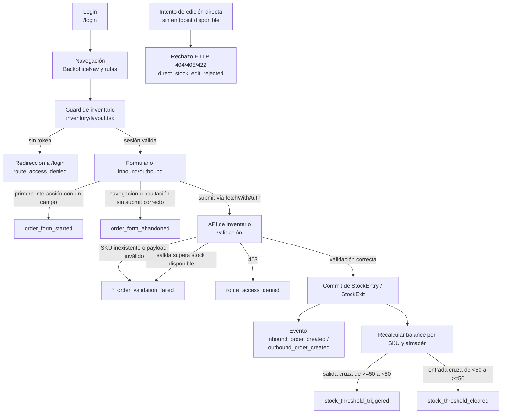

# Plan de telemetría de TrackFlow

## Índice

1. Contexto y alcance
2. Flujo de inventario
3. Catálogo de eventos
   3.1. Métricas obligatorias
   3.2. Oportunidades identificadas
   3.3. Oportunidades futuras de catálogo
   3.4. Resumen cuantitativo
4. Event Envelope
5. Convenciones de nombres, enums y versionado
6. Esquemas de eventos
7. Estrategia de entrega: stream y batch
8. Throttle y debounce
9. Privacidad y tratamiento de PII
10. Riesgos, eventos descartados y exclusiones
11. Mapeo previsto al almacenamiento
12. Guía de instrumentación por evento

## 1. Contexto y alcance

Este plan responde al RFI de TrackFlow: definir una telemetría de producto consistente para observar el inventario de sus almacenes de Los Ángeles y Zaragoza, y permitir decisiones operativas y ejecutivas basadas en datos agregables y comparables.

Los consumidores principales son:

- **Ana, Operaciones de Almacén:** planifica capacidad y personal, detecta cuellos de botella y prioriza auditorías.
- **Thomas, Dirección Ejecutiva:** compara volumen y SLA entre Estados Unidos y España.
- **Miguel, Comercial y Relación con Clientes:** identifica riesgos de rotura de stock y coordina avisos a clientes.
- **Andrés y Tecnología:** investigan errores y rendimiento y mantienen la instrumentación.

Los eventos de inventario se podrán agregar por **almacén**, **cliente**, **país**, **SKU** y **categoría de producto**. `country` se deriva del almacén (`los_angeles` → `US`, `zaragoza` → `ES`); `client_id` y `product_id` seguirán los mapeos provisionales documentados en §2 y sus discrepancias se conservarán visibles.

El alcance de este proyecto es el diseño de contratos y puntos de captura para el backoffice y la API de inventario. No implementa instrumentación, almacenamiento ni dashboards. Los eventos no incluirán datos de consumidores finales, transportistas o destinatarios; esos ámbitos quedan fuera de este plan.

## 2. Flujo de inventario

### 2.1 Recorrido y puntos de instrumentación

Los puntos de instrumentación se asignan a componentes existentes cuando existen; los eventos de producto son propuestas, no instrumentación ya desplegada:

| Punto | Origen real o previsto | Condición de captura |
|---|---|---|
| Login correcto o fallido | `/login` y endpoint de autenticación | Resultado del intento; el evento no incluye email, nombre, contraseña ni hash. |
| Acceso a inventario sin sesión | `uis/backoffice/src/app/inventory/layout.tsx` | El guard no encuentra token y redirige a `/login`. |
| Inicio o abandono de una orden | Formularios `uis/backoffice/src/app/inventory/orders/inbound/page.tsx` y `outbound/page.tsx` | `order_form_started` en la primera interacción con un campo, no al renderizar. Abandono tras `started` si el formulario se desmonta por navegación o se oculta la pestaña sin submit correcto. |
| Validación y creación de órdenes | `uis/backoffice/src/lib/api.ts` (`fetchWithAuth`) y `services/api/routes/inventory.py` | Fallo de validación tras respuesta de error; creación tras el commit de `StockEntry` o `StockExit`. |
| Rechazo de edición directa | API de inventario; no hay endpoint de edición directa | Propuesta de captura en el manejo backend de solicitudes identificables que intenten fijar stock y reciban 404/405/422; requiere reconocer el intento sin registrar su payload. |
| Cambio de umbral | `services/api/routes/inventory.py`, después del commit de la orden | Comparar balance previo y resultante del SKU en ese almacén; emitir solo en el cruce del umbral, no en cada movimiento posterior. |
| Denegación de acceso | `uis/backoffice/src/lib/api.ts` y `uis/backoffice/src/app/inventory/layout.tsx` | Respuesta HTTP 403 o redirección del guard por falta de token, con los motivos acotados de §3.2. |

### 2.2 Decisiones de auditoría incorporadas

- **D2 — `userId`:** string opaco con el identificador interno que devuelve `_user_uuid`: UUID cuando existe o, en su defecto, ID de TinyDB convertido a texto. Nunca email ni nombre. En el contrato será `type: string`, `minLength: 1`, sin `format: uuid`; se anota como discrepancia y conviene unificar el identificador a UUID en el futuro.
- **D15 — `product_category`:** `Apparel` y `Accessories` se normalizan a `fashion`; `Electronics` a `electronics`; `Beauty` a `cosmetics`. `Home`, `Sports`, `Packaging` y `Toys` aparecen solo en SKUs sintéticos `LOAD-` pendientes de purga: no emitir eventos para esos SKUs. El enum permanece limitado a `fashion`, `electronics` y `cosmetics`; se registrará en §10 el riesgo de catálogo y la recomendación de normalizarlo a las tres categorías del BRIEFING.
- **D16 — umbral:** hasta que exista configuración por cliente, el mínimo es el valor global 50 (`LOW_STOCK_THRESHOLD` en `uis/backoffice/src/app/inventory/products/page.tsx`) con `threshold_source: global_default`. `stock_threshold_triggered` añade `min_threshold` (integer) y `threshold_source` (`global_default` | `client_config`). Se emite después del commit de una salida solo al cruzar de `>=` a `<`; `stock_threshold_cleared` se emite después del commit de una entrada al cruzar de `<` a `>=`. No se repite mientras el stock siga bajo. No existe mínimo por cliente; el umbral global deja el evento obligatorio implementable ahora.
- **D17 — búsqueda:** no existe búsqueda de inventario en el backoffice. `inventory_search_performed` pasa a §3.3 como oportunidad futura de catálogo, sin captura ni esquema en esta versión.
- **D18 — formularios:** `order_form_started` comienza con la primera interacción con un campo. `order_form_abandoned` requiere un `started` previo y se produce al desmontar el formulario por navegación o al ocultarse la pestaña sin submit correcto. Sus propiedades serán `order_kind` (`inbound` | `outbound`), `last_field_touched` (nombre lógico del campo, nunca su valor), `fields_completed` (integer) y `time_in_form_ms` (integer).
- **D19 — acceso denegado:** se captura en `fetchWithAuth` ante HTTP 403 y en el guard de `uis/backoffice/src/app/inventory/layout.tsx` cuando falta token y se redirige a `/login`. Propiedades: `route` (plantilla sin query params, obligatoria), `reason` (`insufficient_permissions` | `inactive_user` | `no_session`, obligatoria) y `api_endpoint` (plantilla opcional, solo para 403). Nunca se copia el `detail` literal de la API ni información del usuario. La respuesta 403 cubre “Inactive user” (`auth.py`) y “Insufficient permissions” (`users.py`/`profiles.py`); entrega stream, nivel `warn`.
- **D20 — `requestId`:** hoy no existe `X-Request-ID` en cliente ni backend. En la futura captura, el servicio de telemetría genera un UUID por llamada en `fetchWithAuth`, lo envía en esa cabecera y asigna ese mismo `requestId` a los eventos nacidos de la llamada. Se recomienda que el middleware de `services/api/main.py` lea la cabecera y la registre en logs. Ese middleware registra hoy la ruta con query string; la telemetría usará siempre plantillas sin query params, riesgo que se desarrollará en §10.
